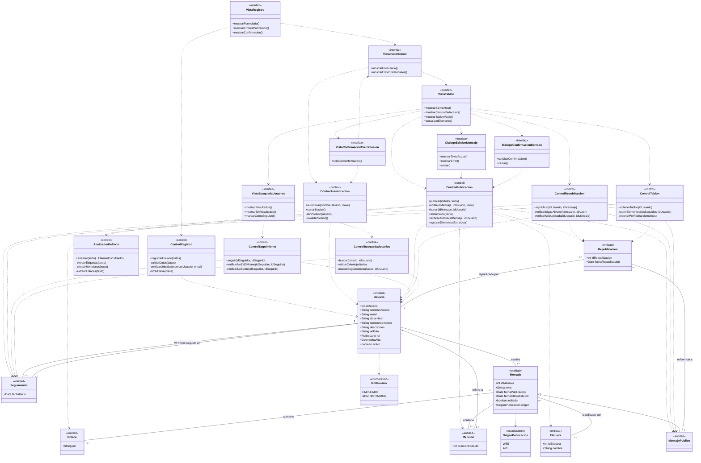
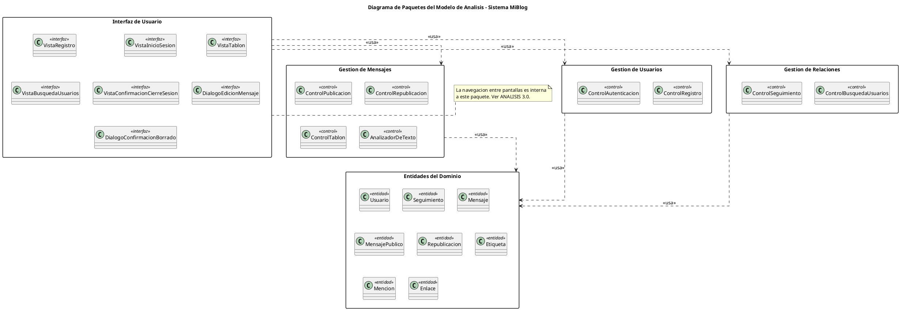

# ANÁLISIS — Sistema MiBlog
 
**Versión:** 2.2 · **Última modificación:** 15/09/2026 · **Etapa:** Análisis
 
**Materia:** Ingeniería de Software · **Alumno:** Abel · **Modalidad:** proyecto grupal, cursado en solitario
**Flujo del Proceso Unificado:** Análisis
**Trabajadores responsables:** Arquitecto · Ingeniero de Casos de Uso · Ingeniero de Componentes
**Documentos previos:** `DIA1_REQUISITOS_MiBlog.md` · `ESPECIFICACIONES_CASOS_DE_USO_MiBlog.md` · `REQUISITOS_NO_FUNCIONALES_MiBlog.md` · `PLAN_DEL_PROYECTO.md`
 
> **Alcance de realización.** Esta iteración realiza los casos de uso **CU0001, CU0002, CU0003, CU0004, CU0005, CU0006, CU0007, CU0009, CU0011 y CU0014**. Los restantes quedan especificados en el flujo de Requisitos y no forman parte del alcance de implementación de esta versión.
 
**Estado del documento:** `[DECIDIDO]` — las cinco decisiones de la sección 1 fueron aceptadas el 14/09/2026, con una corrección en la 1.4 que se resuelve en la **sección 8**.
 
---
 
## 0. La idea, antes de los diagramas
 
El flujo de Requisitos dejó escrito **qué tiene que hacer el sistema**, contado desde afuera: "el usuario aprieta Publicar y el sistema guarda el mensaje".
 
El flujo de Análisis contesta **qué objetos hacen falta adentro para que eso ocurra**, sin todavía comprometer ninguna tecnología. Todavía no hay Flask, ni SQLite, ni tablas, ni HTTP. Hay tres tipos de objeto y nada más:
 
| Estereotipo | En una frase | Ejemplo en MiBlog |
|---|---|---|
| **«interfaz»** (*boundary*) | Todo lo que toca el borde del sistema: una pantalla, un formulario, un diálogo. | `VistaTablon` |
| **«control»** | El que coordina los pasos de un caso de uso. No guarda datos, manda. | `ControlPublicacion` |
| **«entidad»** | La información que sobrevive cuando cerrás el navegador. | `Mensaje`, `Usuario` |
 
La regla de oro del análisis es la **separación de lo que cambia por motivos distintos**: si mañana cambia la pantalla, se toca solo la clase de interfaz; si cambia la regla de negocio, solo la de control; si cambia el dato que se guarda, solo la de entidad. Esa es toda la justificación de los tres estereotipos, y es exactamente la respuesta corta si te lo preguntan en la defensa.
 
Este documento produce cuatro artefactos del flujo de Análisis, más uno que en rigor pertenece al flujo de Diseño:
 
1. El catálogo de clases de análisis, con el caso de uso del que sale cada una.
2. Un diagrama de clases de análisis.
3. Un diagrama de paquetes con sus dependencias.
4. Diez diagramas de colaboración, uno por caso de uso realizado, con los mensajes numerados.
5. **La evaluación de qué patrones de diseño tienen anclaje real en los diez casos de uso** (sección 8). Los patrones se materializan en Diseño, pero **el anclaje es un hecho del análisis**: son las colaboraciones las que muestran dónde hay una familia de algoritmos, una jerarquía que se trata de forma uniforme o un esqueleto repetido. Por eso se decide acá y no en la Etapa 3.
---
 
## 1. Cinco cosas que hay que decidir antes de dar esto por cerrado
 
Pediste que te avisara si algo no se podía realizar con las clases propuestas. Esto es lo que apareció. **Las cinco decisiones fueron aceptadas el 14/09/2026**, con una corrección en la 1.4. Quedan acá escritas con su fundamento, porque son las que hay que poder defender.
 
### 1.1 El modelo de dominio no tiene `Sesion`, y CU0002 y CU0003 la necesitan
 
**El problema.** CU0002 paso 5 dice "el sistema abre la sesión". CU0003 paso 2 dice "el sistema invalida la sesión activa", y el `rnf 3.1` aclara que el identificador de sesión tiene que dejar de ser válido **del lado del servidor**, que no alcanza con borrarlo del navegador. Eso quiere decir que hay un estado que vive en algún lado. En el modelo de dominio de `DIA1_REQUISITOS_MiBlog.md` §4 no existe ninguna clase que lo represente.
 
**Las dos salidas posibles.**
 
| Opción | Qué implica | Costo |
|---|---|---|
| **A — La sesión es un mecanismo de diseño, no un concepto del dominio.** No se crea clase de entidad. En análisis, abrir y cerrar sesión son responsabilidades de `ControlAutenticacion`. En diseño se resuelve con el mecanismo de sesión de Flask. | El modelo de dominio queda como está. | Cero. Hay que poder explicarlo. |
| **B — La sesión es un concepto del dominio.** Se agrega la clase `Sesion` al modelo de dominio y al modelo de análisis. | `DIA1_REQUISITOS_MiBlog.md` §4 sube a **versión 2.0** (cambio estructural del modelo). | Rehacer el diagrama Mermaid del dominio. |
 
**Mi recomendación: opción A.** Tres razones, y las tres son defendibles en voz alta:
 
1. La sesión no es información del negocio. Si mañana MiBlog se convierte en una app de escritorio sin sesiones HTTP, `Usuario`, `Mensaje` y `Seguimiento` siguen existiendo igual; la sesión no.
2. **RNF41 ya la clasificó como restricción técnica**: "la gestión de sesiones y el cifrado de claves se resuelven con los mecanismos de Flask, sin dependencias adicionales". Un requisito no funcional de tipo restricción técnica es, por definición, materia de Diseño, no de Análisis.
3. La convención §7 de `ESPECIFICACIONES_CASOS_DE_USO_MiBlog.md` ya dejó a RNF41 fuera de los `rnf` locales precisamente por eso. Agregar ahora una entidad `Sesion` contradiría esa decisión ya tomada.
> **Lo que no se puede hacer es ignorarlo.** Si en la defensa preguntan "¿dónde está la sesión en tu modelo?", la respuesta tiene que ser esta explicación, no un silencio. Está anotada en la sección 6.4.
 
### 1.2 CU0009 paso 6 pide dos cosas que están fuera de alcance
 
**El problema.** El curso normal de CU0009 dice, en el paso 6:
 
> El sistema muestra además el listado de seguidores y seguidos (CU0013) y los temas del momento (CU0015).
 
**CU0013 y CU0015 no se realizan en esta iteración.** Los dos están en los once que quedan solo especificados. Si el paso 6 queda como está, el documento de requisitos promete una pantalla que el código no va a tener, y eso es exactamente el error que la cátedra le marcó al proyecto de referencia.
 
**Consecuencia para el análisis:** no propongo clases de control ni de interfaz para esos dos paneles. `VistaTablon` muestra el listado de elementos y nada más.
 
**Qué hay que hacer.** Editar CU0009 y agregar al paso 6 una marca de fuera de alcance. Texto sugerido:
 
> | 6 | El sistema muestra además el listado de seguidores y seguidos (CU0013) y los temas del momento (CU0015). **Fuera del alcance de realización de esta versión: ambos casos de uso quedan especificados y no se implementan. El tablón de esta iteración presenta únicamente el listado de elementos del paso 5.** |
 
Eso lleva `ESPECIFICACIONES_CASOS_DE_USO_MiBlog.md` a **versión 1.1**.
 
### 1.3 CU0014 paso 4 y CU0007 ca 7.1 apuntan al muro, que tampoco se realiza
 
**El problema.** Son dos referencias sueltas a **CU0010 Consultar Muro de un Usuario**, que está fuera de alcance:
 
- **CU0014 paso 4:** "El Usuario puede acceder al muro de cualquier resultado (CU0010) o seguirlo directamente (CU0011)." En esta iteración solo existe la segunda mitad.
- **CU0011 paso 1:** "El Usuario selecciona la opción Seguir desde el muro de otro usuario **o desde un resultado de búsqueda**." En esta iteración, solo desde el resultado de búsqueda. Esto es coherente con `PLAN_DEL_PROYECTO.md` §2.0.3 y no necesita cambio, pero conviene que quede dicho.
- **CU0007 ca 7.1:** describe un intento de republicar "alcanzado desde un muro o desde una búsqueda". Sin muro, y como la búsqueda de usuarios no lista mensajes, **ese curso alternativo no es alcanzable desde la interfaz en esta iteración**. Sigue siendo correcto especificarlo (protege al servidor de una petición armada a mano), pero el plan de pruebas de la Etapa 5 va a tener que decir cómo se ejercita, o declararlo no probable por interfaz.
**Qué hay que hacer.** Marcar el paso 4 de CU0014 igual que el 1.2, y dejar una observación en CU0007. También va a **versión 1.1** del mismo documento.
 
> **Corrección aplicada el 15/09/2026, en el flujo de Diseño (hallazgo H5 de `DISEÑO_MiBlog.md`).** Lo que este apartado dice del `ca 7.1` **no es correcto**, y se deja escrito para que se vea qué cambió. El `ca 7.1` **sí es alcanzable desde la interfaz**, sin muro y sin búsqueda de mensajes. Si el Usuario sigue a Beatriz y no sigue a Carlos, y Beatriz (que sí sigue a Carlos) republica un mensaje de Carlos, esa republicación entra en el tablón del Usuario por el paso 3 de CU0009, con su botón de republicar. Si el Usuario lo usa, lo que se republica es el mensaje de Carlos: `ControlRepublicacion` detecta que no lo sigue y es el `ca 7.1`. Se decidió que el botón aparezca en todo elemento cuyo autor original no sea el Usuario, y que la verificación la haga el servidor. La observación `{Ob 7.3}` de `ESPECIFICACIONES_CASOS_DE_USO_MiBlog.md` quedó corregida en su versión 1.2, y el plan de pruebas ejercita este curso por interfaz. Lo que sigue valiendo de este apartado es lo de CU0014 paso 4 y CU0011 paso 1.
 
### 1.4 `Mensaje` abstracta con una sola subclase concreta
 
**El problema.** El modelo de dominio tiene `Mensaje` «abstract» con dos hijas: `MensajePublico` y `MensajePrivado`. Como **CU0008 no se realiza**, en esta iteración `MensajePrivado` nunca se instancia. Queda una jerarquía con una sola hoja, que es una forma clásica de modelo forzado.
 
**Las dos salidas.**
 
| Opción | Qué implica |
|---|---|
| **A — Conservar la jerarquía**: `Mensaje` «abstract» + `MensajePublico`, y dejar `MensajePrivado` fuera por alcance. | El modelo de análisis sigue fiel al de dominio. Factory Method y Strategy siguen teniendo dónde apoyarse en Diseño. |
| **B — Colapsar** a una sola clase concreta `Mensaje`. | Más simple y más honesto respecto del código real, pero **elimina el anclaje de Factory Method y Strategy**, y la advertencia de `ESTADO_MI_PROYECTO.md` §5.1 pasa de "hay que decidir" a "hay que buscar otros dos patrones". |
 
**Decisión tomada: opción A.** Es la que usan todos los diagramas de este documento. La restricción era que las clases de entidad se correspondan con el modelo de dominio; conservar la jerarquía es la única que cumple eso al pie de la letra. Omitir `MensajePrivado` por alcance es una omisión justificada; colapsar la jerarquía sería un cambio de modelo.
 
> **Corrección aplicada el 14/09/2026.** La versión 1.0 de este documento dejaba la consecuencia sobre los patrones para la Etapa 3. **No se posterga: se resuelve ahora, en la sección 8.** El motivo es que el problema es más grande de lo que decía `ESTADO_MI_PROYECTO.md` §5.1. No son dos patrones sin anclaje: son los cuatro. Singleton se apoyaba en el acceso a `Configuracion` (CU0015, CU0017 y CU0019, fuera de alcance), Observer en notificaciones que la característica C27 decidió no implementar, y Factory Method y Strategy en `MensajePrivado`, que nunca se instancia. Llevar los cuatro a la Etapa 3 tal como están produciría un diagrama de clases de diseño lleno de patrones que el código no ejercita, que es exactamente la incoherencia entre artefactos que la cátedra le marcó al proyecto de referencia.
 
### 1.5 `Tablon`, `Muro` y `Tendencia` no son clases de entidad
 
**El problema.** Están en el modelo de dominio marcadas `<<derivada>>`. ¿Entran al modelo de análisis como entidades?
 
**No, y es una decisión, no un olvido.** Una clase de entidad del Proceso Unificado representa **información que el sistema guarda y que sobrevive al caso de uso**. El tablón no se guarda: se **calcula** cada vez, juntando mensajes y republicaciones y ordenándolos. No tiene ni un atributo propio.
 
En el modelo de análisis, el tablón es **el resultado que devuelve `ControlTablon`**, no un objeto persistente. Por eso `ControlTablon` existe: encapsula un cálculo, que es una de las dos razones por las que el PU admite una clase de control.
 
- `Muro` y `Tendencia` quedan directamente fuera: pertenecen a CU0010, CU0015 y CU0016, no realizados.
- En el modelo de dominio las tres **se quedan**, porque el enunciado las nombra y `DIA1_REQUISITOS_MiBlog.md` §4.3 ya justificó por qué.
**Qué hay que hacer:** nada en los documentos. Solo tenerlo listo para la defensa. Está en la sección 6.4.
 
### Resumen de las decisiones tomadas
 
| # | Decisión | Resuelto | Documento que se tocó |
|---|---|---|---|
| 1.1 | ¿`Sesion` es entidad? | **No.** Es un mecanismo de diseño. | Ninguno. `DIA1_REQUISITOS_MiBlog.md` queda en 1.0 |
| 1.2 | CU0009 paso 6 fuera de alcance | Marcado | `ESPECIFICACIONES_CASOS_DE_USO_MiBlog.md` → 1.1 |
| 1.3 | CU0014 paso 4 y CU0007 `ca 7.1` | Marcados. **La parte del `ca 7.1` se corrigió en Diseño: sí es alcanzable** | `ESPECIFICACIONES_CASOS_DE_USO_MiBlog.md` → 1.1, y → 1.2 por la corrección |
| 1.4 | ¿Jerarquía de `Mensaje`? | **Se conserva**, y la consecuencia sobre los patrones se resuelve en la **sección 8**, no en Diseño | `ESTADO_MI_PROYECTO.md` §5.1 → reemplazada |
| 1.5 | ¿`Tablon` es entidad? | **No.** Es un cálculo. | Ninguno |
 
---
 
## 2. Artefacto 1 — Clases de análisis
 
### 2.1 Cuántas hay y de dónde salen
 
| Estereotipo | Cantidad | Criterio con el que se derivaron |
|---|---|---|
| «interfaz» | **7** | Una por cada vista del prototipo. Ni una más. |
| «control» | **8** | Una por caso de uso o por grupo de casos de uso con un mismo flujo, más una que encapsula un cálculo exigido por un `rnf`. |
| «entidad» | **8** | Las del modelo de dominio que aparecen en alguno de los 10 casos de uso. |
| **Total** | **23** | |
 
### 2.2 Clases de interfaz («interfaz») — las 7 vistas del prototipo
 
Se corresponden una a una con las siete vistas de la Etapa 1: cinco pantallas y dos diálogos.
 
| Clase | Vista del prototipo | Sale de | Por qué existe |
|---|---|---|---|
| `VistaRegistro` | Pantalla de registro | **CU0001** | Es el único punto del sistema donde un Visitante entrega datos que todavía no tiene cuenta. Recibe los siete campos del `rnf 1.1` y devuelve los errores campo por campo del `ca 1.1`. |
| `VistaInicioSesion` | Pantalla de inicio de sesión | **CU0002** | Formulario de dos campos del `rnf 2.1`, con la clave enmascarada. Es además la pantalla a la que se vuelve al cerrar sesión (CU0003 paso 3). |
| `VistaTablon` | Pantalla de tablón | **CU0009**, y además **CU0004**, **CU0005**, **CU0006**, **CU0007**, **CU0003** | Es la pantalla principal. Muestra el listado (CU0009), contiene el campo de redacción con el contador del `rnf 4.1` (CU0004) y lleva en cada elemento los controles que disparan editar, borrar y republicar. El menú de cerrar sesión también sale de acá. |
| `VistaBusquedaUsuarios` | Pantalla de búsqueda | **CU0014**, y además **CU0011** | Recibe el criterio, muestra los resultados sin el correo (`rnf 14.2`) y lleva el botón "Seguir" en cada fila. Es el único camino a CU0011 en esta iteración. |
| `VistaConfirmacionCierreSesion` | Pantalla de confirmación de cierre | **CU0003** | Es la única confirmación que no es un diálogo sobre el tablón. |
| `DialogoEdicionMensaje` | Diálogo de edición | **CU0005** | Es una vista aparte y no un modo de `VistaTablon` porque tiene su propio ciclo: abre con el texto actual, valida, y puede cancelarse sin tocar nada (`ca 5.4`). Mezclarla con el tablón obligaría a esa clase a llevar dos estados a la vez. |
| `DialogoConfirmacionBorrado` | Diálogo de confirmación de borrado | **CU0006** | Existe porque el `rnf 6.2` exige confirmación explícita de una operación irreversible, con un texto que describe la consecuencia en cascada sobre las republicaciones. |
 
> **Por qué CU0004, CU0007 y CU0009 comparten `VistaTablon` y no tienen vista propia.** Porque el prototipo tiene siete vistas y la restricción era respetarlas. Los tres ocurren en la misma pantalla: publicar es el formulario de arriba, republicar es un botón en cada elemento del listado, y visualizar es el listado mismo. Inventar `VistaPublicacion` y `VistaRepublicacion` daría clases que no corresponden a ninguna pantalla real.
 
### 2.3 Clases de control («control»)
 
| Clase | Sale de | Por qué existe |
|---|---|---|
| `ControlRegistro` | **CU0001** | Coordina la validación, la verificación de unicidad de nombre de usuario y correo, el cifrado de la clave y el alta. Concentra la transacción del `rnf 1.3`. |
| `ControlAutenticacion` | **CU0002** y **CU0003** | Una sola clase para los dos casos de uso porque son las dos caras del mismo mecanismo: abrir y cerrar una sesión. Separarlos daría una clase de dos líneas. |
| `ControlPublicacion` | **CU0004**, **CU0005** y **CU0006** | Los tres operan sobre el mensaje propio y comparten dos reglas: el límite de 140 caracteres y la extracción de etiquetas, menciones y links. Además CU0005 y CU0006 comparten la verificación de autoría en servidor (`rnf 5.1` y `rnf 6.1`). |
| `ControlRepublicacion` | **CU0007** | Separada de `ControlPublicacion` porque **no crea un mensaje**: crea una referencia. Sus reglas son otras (el autor tiene que ser seguido, no puede ser uno mismo, no puede repetirse) y no comparte ninguna con las anteriores. |
| `ControlTablon` | **CU0009** | Encapsula el cálculo del tablón: buscar los seguidos, reunir mensajes propios y ajenos más las republicaciones de unos y otro, y ordenar por la fecha que corresponda a cada elemento (regla RA07). Es la razón por la que `Tablon` no necesita ser entidad. |
| `ControlSeguimiento` | **CU0011** | Coordina las tres verificaciones del curso normal: que el seguido exista y esté activo, que no sea uno mismo (`ca 11.2`) y que el seguimiento no exista ya (`ca 11.3`, `rnf 11.1`). |
| `ControlBusquedaUsuarios` | **CU0014** | Resuelve la búsqueda parcial e insensible a mayúsculas del `rnf 14.1` y marca en cada resultado si el Usuario ya lo sigue. |
| `AnalizadorDeTexto` | **CU0004** y **CU0005** | **Es la única clase de control que no representa el flujo de un caso de uso, y existe por un requisito explícito.** El `rnf 4.3` obliga a que la extracción de etiquetas, menciones y links se resuelva con un único componente reutilizado por la web y por la API. Si esa lógica viviera dentro de `ControlPublicacion`, CU0020 tendría que duplicarla. El PU admite clases de control que encapsulan un cálculo, además de las que encapsulan un flujo. |
 
> **Por qué no una clase de control por caso de uso.** El PU lo sugiere como punto de partida, no como regla. Diez controles para diez casos de uso daría cuatro clases de una sola operación (`ControlCierreSesion`, por ejemplo). El criterio que usé es el del PU: **un control por flujo de control distinto**. Cuando dos casos de uso comparten reglas y datos, comparten control. Si te lo preguntan, esa es la respuesta, y la tabla de arriba es la justificación caso por caso.
 
### 2.4 Clases de entidad («entidad») — todas del modelo de dominio
 
Ninguna es nueva. Las ocho están en `DIA1_REQUISITOS_MiBlog.md` §4.
 
| Clase | Atributos que se usan en esta iteración | Aparece en |
|---|---|---|
| `Usuario` | `idUsuario`, `nombreUsuario`, `email`, `claveHash`, `nombreCompleto`, `descripcion`, `urlFoto`, `rol`, `fechaAlta`, `activo` | CU0001, CU0002, CU0003, CU0004, CU0011, CU0014 |
| `Seguimiento` | `fechaInicio` | CU0007, CU0009, CU0011, CU0014 |
| `Mensaje` «abstract» | `idMensaje`, `texto`, `fechaPublicacion`, `fechaUltimaEdicion`, `editado`, `origen` | CU0004, CU0005, CU0006, CU0007, CU0009 |
| `MensajePublico` | — (hereda todo) | las mismas |
| `Republicacion` | `idRepublicacion`, `fechaRepublicacion` | CU0006, CU0007, CU0009 |
| `Etiqueta` | `idEtiqueta`, `nombre` | CU0004, CU0005, CU0006 |
| `Mencion` | `posicionEnTexto` | CU0004, CU0005, CU0006 |
| `Enlace` | `url` | CU0004, CU0005, CU0006 |
 
Se usan además las dos enumeraciones del dominio: `RolUsuario` (EMPLEADO / ADMINISTRADOR) y `OrigenPublicacion` (WEB / API). En esta iteración todos los mensajes se crean con origen `WEB`, porque CU0020 no se realiza; el atributo se guarda igual, porque el `rnf 4.5` lo exige para todo mensaje cualquiera sea su origen.
 
**Quedan fuera del modelo de análisis, por pertenecer a casos de uso no realizados:**
`MensajePrivado` (CU0008) · `Aplicacion` (CU0018, CU0020, CU0021) · `Configuracion` (CU0017, CU0015) · `EnvioSemanal` (CU0019) · `Tendencia` (CU0015) · `Muro` (CU0010, CU0021) · `Tablon` (es derivada, ver 1.5).
 
### 2.5 Tabla de trazabilidad: caso de uso → clases de análisis
 
Esta es la tabla que hay que poder mostrar si en la defensa preguntan de dónde salió cada clase.
 
| CU | «interfaz» | «control» | «entidad» |
|---|---|---|---|
| **CU0001** Registrar Usuario | `VistaRegistro` | `ControlRegistro` | `Usuario` |
| **CU0002** Iniciar Sesión | `VistaInicioSesion` | `ControlAutenticacion` | `Usuario` |
| **CU0003** Cerrar Sesión | `VistaConfirmacionCierreSesion`, `VistaTablon`, `VistaInicioSesion` | `ControlAutenticacion` | — |
| **CU0004** Publicar Mensaje | `VistaTablon` | `ControlPublicacion`, `AnalizadorDeTexto` | `MensajePublico`, `Usuario`, `Etiqueta`, `Mencion`, `Enlace` |
| **CU0005** Editar Mensaje Propio | `VistaTablon`, `DialogoEdicionMensaje` | `ControlPublicacion`, `AnalizadorDeTexto` | `MensajePublico`, `Etiqueta`, `Mencion`, `Enlace` |
| **CU0006** Borrar Mensaje Propio | `VistaTablon`, `DialogoConfirmacionBorrado` | `ControlPublicacion` | `MensajePublico`, `Republicacion`, `Etiqueta`, `Mencion`, `Enlace` |
| **CU0007** Republicar Mensaje | `VistaTablon` | `ControlRepublicacion` | `Republicacion`, `MensajePublico`, `Seguimiento` |
| **CU0009** Visualizar Tablón | `VistaTablon` | `ControlTablon` | `Seguimiento`, `MensajePublico`, `Republicacion`, `Usuario` |
| **CU0011** Seguir Usuario | `VistaBusquedaUsuarios` | `ControlSeguimiento` | `Seguimiento`, `Usuario` |
| **CU0014** Buscar Usuarios | `VistaBusquedaUsuarios` | `ControlBusquedaUsuarios` | `Usuario`, `Seguimiento` |
 
**Ninguna clase queda huérfana** (todas aparecen en al menos un CU) y **ningún CU queda sin las tres capas**, salvo CU0003, que legítimamente no toca ninguna entidad: solo destruye un estado de sesión, que por la decisión 1.1 no es entidad.
 
---
 
## 3. Artefacto 2 — Diagrama de clases de análisis
 
**La idea antes del dibujo:** las flechas van siempre en el mismo sentido. La interfaz conoce al control, el control conoce a las entidades, y **nadie mira para atrás**. Una entidad nunca conoce a un control, y **ninguna clase de control conoce una clase de interfaz**. Si en el diagrama aparece una flecha en contra, hay un error de modelado.
 
Entre las entidades, en cambio, sí hay asociaciones en los dos sentidos: son las mismas del modelo de dominio.
 
### 3.0 Dos convenciones que hacen falta para que esa regla se sostenga
 
En los diagramas de colaboración de la sección 5 hay flechas que salen de un control y terminan en una vista. Sin una convención explícita, eso contradice la regla de arriba. Son dos casos distintos y se resuelven distinto.
 
**Convención 1 — el retorno al que llamó no es una dependencia.**
Cuando una vista invoca a un control, el control le devuelve un resultado. En el diagrama de colaboración ese retorno **sí se dibuja y sí se numera**, porque forma parte de la secuencia del caso de uso, y va marcado `[retorno]`. Pero **no es una dependencia estructural**: el control no conoce el tipo de quien lo llamó, solo devuelve un valor. Por eso no aparece como flecha en el diagrama de clases. La misma convención vale un nivel más arriba: un diálogo que devuelve el control a `VistaTablon`, que fue quien lo abrió.
 
> La prueba de que es una convención honesta y no una excusa: en el diagrama de clases, **ninguna clase de control declara una operación que reciba o devuelva una clase de interfaz**. Si mañana el tablón se pide desde una app móvil, `ControlTablon` no se toca.
 
**Convención 2 — la navegación entre pantallas la hace la vista, nunca el control.**
Cuando el destino es una vista **distinta** de la que inició el caso de uso, eso no es un retorno: es navegación, y hay que modelarla. **La decisión es que la navegación la ejerce la clase de interfaz.** El control devuelve su resultado a quien lo llamó, y la vista decide a dónde ir con ese resultado.
 
Dos razones, y las dos se defienden en voz alta:
 
1. **Si navegara el control, el control conocería pantallas.** `ControlAutenticacion` tendría que conocer `VistaTablon`, y entonces no se podría reutilizar desde la API ni desde una interfaz distinta. La regla del sentido de las flechas quedaría rota de verdad, no por convención.
2. **En la arquitectura elegida, navegar es literalmente lo que hace la capa de presentación.** Con Flask y plantillas Jinja2, ir de una pantalla a otra es un *redirect* emitido al responder una petición: pertenece a la vista, no a la lógica de negocio.
Esto agrega **cuatro dependencias de navegación** entre clases de interfaz, que en la versión 1.0 de este documento faltaban:
 
| Navegación | Caso de uso | Paso |
|---|---|---|
| `VistaInicioSesion` → `VistaTablon` | CU0002 | paso 5: al abrir la sesión se redirige al tablón |
| `VistaConfirmacionCierreSesion` → `VistaInicioSesion` | CU0003 | paso 3: al cerrar se vuelve a la pantalla inicial |
| `VistaTablon` → `VistaBusquedaUsuarios` | CU0009 | `ca 9.1`: el tablón vacío ofrece buscar a quién seguir |
| `VistaRegistro` → `VistaInicioSesion` | CU0001 | paso 8: la confirmación ofrece iniciar sesión |
 
**El tercer caso que marcaste, CU0006, no era navegación.** `ControlPublicacion` abría `DialogoConfirmacionBorrado`, y eso era directamente un error: el diálogo lo abre `VistaTablon`, que es quien lo contiene y quien ya tenía esa dependencia en el diagrama de clases. La colaboración 5.6 quedó corregida y renumerada; no hizo falta ninguna dependencia nueva.
 
> **Consecuencia que hay que leer sí o sí: esto rompió el diagrama de paquetes de la versión 1.0.** Modelar las navegaciones destapó un ciclo. La sección 4 lo explica y lo resuelve.
 
### 3.1 Mermaid
 

 
### 3.2 Notas de lectura del diagrama
 
1. **`ControlPublicacion` conoce a `Republicacion`** aunque no la crea. Es por el borrado en cascada de CU0006 paso 5: para eliminar un mensaje hay que eliminar antes sus republicaciones. Quien las **crea** es `ControlRepublicacion`; quien las **destruye por arrastre** es `ControlPublicacion`. Los dos aparecen en la flecha por motivos distintos y conviene poder explicarlo.
2. **`VistaTablon` depende de los dos diálogos**, porque es la que los abre. Los diálogos, a su vez, hablan con `ControlPublicacion` directamente, no a través del tablón.
3. **`Tablon` no aparece.** Es lo que devuelve `ControlTablon.obtenerTablon()`, un conjunto ordenado de mensajes y republicaciones, no un objeto guardado. Ver sección 1.5.
4. **No hay ninguna flecha de entidad hacia control ni hacia interfaz, ni de control hacia interfaz.** Esa asimetría es el chequeo rápido de que el modelo está bien armado. Los retornos de un control a la vista que lo llamó no cuentan como flecha: ver convención 1 de §3.0.
5. **`ControlTablon` depende de `Usuario`** además de `Seguimiento`, `MensajePublico` y `Republicacion`. Es el mensaje 7 de la colaboración 5.8: cada elemento del tablón se muestra con su autor, y en las republicaciones además con quién republicó. Esta dependencia faltaba en la versión 1.0.
6. **Las cuatro flechas entre vistas son navegación**, no composición ni llamada: la vista de origen lleva al usuario a la de destino. Ver convención 2 de §3.0. Son las que sostienen la separación de la capa de presentación de la sección 4.
7. **No aparece `Sesion`.** Ver sección 1.1.
8. `ElementosExtraidos`, que devuelve `AnalizadorDeTexto`, no es una clase del modelo: es el nombre del valor de retorno (las tres listas de etiquetas, menciones y enlaces). En Diseño se convierte en una estructura concreta; ver sección 8.3.
### 3.3 Cómo renderizarlo
 
Pegarlo en `https://mermaid.live`, en la vista previa de Markdown de VS Code con la extensión de Mermaid, o en GitHub (lo renderiza solo).
Si el renderer se queja de los `%%` de comentario, borrar esas líneas: son solo separadores visuales.
 
---
 
## 4. Artefacto 3 — Diagrama de paquetes
 
### 4.0 Qué cambió respecto de la versión 1.0, y por qué
 
La versión 1.0 tenía **cuatro paquetes** y declaraba dos dependencias entre los funcionales: `Gestión de Usuarios` → `Gestión de Mensajes` y `Gestión de Mensajes` → `Gestión de Relaciones`. Al modelar las navegaciones de §3.0 aparecieron **dos problemas, y los dos eran reales**:
 
**Problema 1 — un ciclo.** Con la navegación explícita, `VistaInicioSesion` (Gestión de Usuarios) lleva a `VistaTablon` (Gestión de Mensajes), y `VistaTablon` abre `VistaConfirmacionCierreSesion` (Gestión de Usuarios). O sea: Usuarios → Mensajes → Usuarios. **Ciclo.** Y no se arregla cambiando quién navega: si navegara el control, `ControlAutenticacion` apuntaría a `VistaTablon` y el ciclo seguiría igual, porque el enlace de cerrar sesión vive en el menú del tablón y eso no se puede mover.
 
**Problema 2 — dos dependencias sin fundamento a nivel de clases.** Las justificaciones de la versión 1.0 estaban mal:
 
- `Gestión de Mensajes` → `Gestión de Relaciones` se justificaba porque `ControlTablon` consulta a quién sigue el usuario. Pero lo que consulta es la entidad **`Seguimiento`, que vive en `Entidades del Dominio`**, no en `Gestión de Relaciones`. Lo mismo con `ControlRepublicacion`. La dependencia no existía.
- `Gestión de Usuarios` → `Gestión de Mensajes` se justificaba con la redirección al tablón de CU0002, que es exactamente la navegación que en el diagrama de clases no estaba dibujada. Lo marcaste, y era correcto.
**La solución: separar la capa de presentación en su propio paquete.** Las siete clases de interfaz pasan a `Interfaz de Usuario`. Con eso, toda la navegación entre pantallas queda **adentro de un solo paquete** y deja de generar dependencias cruzadas. El ciclo desaparece, y los tres paquetes funcionales quedan independientes entre sí.
 
Es además lo que corresponde a la separación en capas que exige el **RNF25** (presentación, lógica y persistencia), así que no es un parche: es alinear el modelo de análisis con un requisito no funcional que ya estaba escrito.
 
**El costo, dicho sin adornos: las dos dependencias entre paquetes funcionales de la versión 1.0 desaparecen.** No se reemplazan por otras. Los tres paquetes de gestión solo dependen de las entidades.
 
### 4.1 La idea antes del dibujo
 
Cinco paquetes. **Tres salen de los paquetes de casos de uso** que ya definiste en `DIA1_REQUISITOS_MiBlog.md` §3.2: Gestión de Usuarios, Gestión de Mensajes y Gestión de Relaciones, que son los tres que tienen casos de uso realizados en esta iteración.
 
**Dos no salen de los casos de uso**, y cada uno tiene su motivo:
 
- **`Entidades del Dominio`**, porque `Usuario`, `Seguimiento` y `Mensaje` los usan los tres paquetes a la vez. Si cada uno se quedara con sus entidades, habría que decidir de quién es `Usuario`, y la respuesta sería "de los tres". Eso es la señal de que tiene que vivir aparte.
- **`Interfaz de Usuario`**, por lo explicado en §4.0: la navegación entre pantallas no respeta los límites funcionales, y dejarla cruzar paquetes genera ciclos.
**La regla que hay que poder defender:** las dependencias entre paquetes tienen que ser **acíclicas**. Si A depende de B y B depende de A, no se puede compilar uno sin el otro, no se puede probar uno sin el otro y no se puede entregar uno sin el otro. En este diagrama no hay ciclos, y §4.4 lo demuestra.
 
### 4.2 PlantUML
 

 
### 4.3 Justificación de cada dependencia
 
| Dependencia | Qué clases la fundamentan | Casos de uso |
|---|---|---|
| `Interfaz de Usuario` → `Gestión de Usuarios` | `VistaRegistro` → `ControlRegistro`; `VistaInicioSesion` y `VistaConfirmacionCierreSesion` → `ControlAutenticacion` | CU0001, CU0002, CU0003 |
| `Interfaz de Usuario` → `Gestión de Mensajes` | `VistaTablon` → `ControlTablon`, `ControlPublicacion` y `ControlRepublicacion`; los dos diálogos → `ControlPublicacion` | CU0004, CU0005, CU0006, CU0007, CU0009 |
| `Interfaz de Usuario` → `Gestión de Relaciones` | `VistaBusquedaUsuarios` → `ControlBusquedaUsuarios` y `ControlSeguimiento` | CU0011, CU0014 |
| `Gestión de Usuarios` → `Entidades del Dominio` | `ControlRegistro` crea `Usuario`; `ControlAutenticacion` lo busca y verifica su clave | CU0001 paso 7, CU0002 paso 4 |
| `Gestión de Mensajes` → `Entidades del Dominio` | `ControlPublicacion` y `ControlRepublicacion` sobre `MensajePublico`, `Republicacion`, `Etiqueta`, `Mencion` y `Enlace`; `ControlTablon` y `ControlRepublicacion` además consultan `Seguimiento` y `Usuario` | CU0004 a CU0007, CU0009 |
| `Gestión de Relaciones` → `Entidades del Dominio` | `ControlSeguimiento` crea `Seguimiento`; `ControlBusquedaUsuarios` busca `Usuario` | CU0011 paso 5, CU0014 paso 2 |
 
### 4.4 Demostración de que no hay ciclos
 
Cada paquete tiene un nivel, y las flechas van siempre de un nivel al siguiente. Un grafo estratificado así no puede tener ciclos.
 
| Nivel | Paquete | Depende de |
|---|---|---|
| 1 (arriba) | `Interfaz de Usuario` | los tres del nivel 2 |
| 2 | `Gestión de Usuarios`, `Gestión de Mensajes`, `Gestión de Relaciones` | solo del nivel 3 |
| 3 (abajo) | `Entidades del Dominio` | de nadie |
 
**Los tres paquetes del nivel 2 no se conocen entre sí.** Ese es el resultado de haber sacado la presentación afuera, y es lo que rompió el ciclo.
 
### 4.5 Dependencias que NO existen, y por qué importa
 
| Dependencia ausente | Por qué |
|---|---|
| `Entidades del Dominio` → cualquier otro | Una entidad nunca conoce a quien la usa. Si esta flecha apareciera, el modelo estaría mal. |
| Cualquier paquete de gestión → `Interfaz de Usuario` | **Ningún control conoce una vista.** Es la convención 1 de §3.0 vista a nivel de paquete. Si apareciera, `ControlTablon` no se podría reutilizar desde la API. |
| `Gestión de Usuarios` → `Gestión de Mensajes` | **Existía en la versión 1.0 y se eliminó.** Su único fundamento era la redirección al tablón de CU0002, y esa redirección ahora la ejerce `VistaInicioSesion`, que está en `Interfaz de Usuario`. |
| `Gestión de Mensajes` → `Gestión de Relaciones` | **Existía en la versión 1.0 y se eliminó.** `ControlTablon` y `ControlRepublicacion` consultan `Seguimiento`, que es una **entidad** y vive en `Entidades del Dominio`. Lo que sí existe es la navegación `VistaTablon` → `VistaBusquedaUsuarios` del `ca 9.1`, interna a `Interfaz de Usuario`. |
| `Gestión de Relaciones` → `Gestión de Usuarios` | No hay ninguna. Buscar y seguir no requieren nada del registro ni de la autenticación más allá de saber quién está en sesión, y eso llega como parámetro. |
| Un paquete `Persistencia` | **No existe en el modelo de análisis, y es a propósito.** Cómo se guardan las entidades es decisión de Diseño: es donde aparecen SQLite, el módulo de acceso a datos y el SQL parametrizado del RNF40. En Análisis, `ControlRegistro` simplemente "crea un Usuario". |
 
### 4.6 Correspondencia con las capas del RNF25
 
Esto es lo que conviene tener a mano si en la defensa preguntan por la arquitectura antes de la Etapa 3.
 
| Paquete de análisis | Capa del RNF25 | Qué va a ser en Diseño |
|---|---|---|
| `Interfaz de Usuario` | Presentación | Plantillas Jinja2 y las funciones de ruta de Flask |
| `Gestión de Usuarios`, `Gestión de Mensajes`, `Gestión de Relaciones` | Lógica | Módulos de servicio en Python |
| `Entidades del Dominio` | Lógica, apoyada en Persistencia | Clases de dominio más el módulo de acceso a datos con SQL parametrizado (RNF40) |
 
**Ojo con una cosa:** la capa de persistencia del RNF25 **no aparece acá**, y no es un olvido. `Entidades del Dominio` es el *qué* se guarda; el *cómo* se guarda es la capa de persistencia, y se decide en la Etapa 3.
 
### 4.7 Lo que queda pendiente de los paquetes originales
 
De los siete paquetes de casos de uso, **cuatro no aparecen acá** porque ninguno de sus casos de uso se realiza en esta iteración: `Tendencias` (CU0015, CU0016), `Administración` (CU0017, CU0018), `Notificaciones` (CU0019) e `Integración` (CU0020, CU0021). Siguen existiendo en el modelo de casos de uso; simplemente no tienen contenido en el modelo de análisis de esta versión.
 
---
 
## 5. Artefacto 4 — Diagramas de colaboración
 
### 5.0 Cómo leerlos, y por qué están numerados
 
Un diagrama de colaboración muestra **qué objetos participan en un caso de uso y qué mensajes se mandan entre ellos**. A diferencia de un diagrama de secuencia, no tiene eje de tiempo: el orden lo da **la numeración de los mensajes**. Sin números, el dibujo muestra quién habla con quién pero no en qué orden, y deja de ser una colaboración.
 
**Convenciones usadas acá:**
 
- Numeración **plana y correlativa** (1, 2, 3…), que es la que usa el Proceso Unificado en los diagramas de colaboración del modelo de análisis.
- Cada objeto se escribe `:Clase`, con dos puntos delante, porque son **instancias**, no clases. En UML estricto van subrayadas; PlantUML no subraya, y eso es una limitación del renderer, no un error del diagrama.
- Los mensajes que un objeto se manda a sí mismo aparecen como una flecha que sale y vuelve al mismo objeto.
- Los mensajes marcados **`[retorno]`** son la respuesta de un objeto a quien lo invocó. Se numeran porque forman parte de la secuencia, pero **no son dependencias** y por eso no figuran en el diagrama de clases. Ver convención 1 de §3.0.
- Los mensajes entre dos clases de interfaz son **navegación**, y esos sí figuran en el diagrama de clases. Ver convención 2 de §3.0.
- Debajo de cada diagrama va la **tabla de correspondencia mensaje ↔ paso del curso normal**. Esa tabla es lo que demuestra que la colaboración realiza el caso de uso especificado y no otra cosa.
**Para renderizar:** `https://www.plantuml.com/plantuml`, la extensión PlantUML de VS Code, o draw.io. Si tu versión del renderer se queja de `actor` dentro de un diagrama de objetos, reemplazá esa línea por `object "Usuario" as USR`.
 
---
 
### 5.1 CU0001 — Registrar Usuario
 
```plantuml
@startuml
title CU0001 - Registrar Usuario (colaboracion)
skinparam linetype ortho
 
actor "Visitante" as VIS
object ":VistaRegistro" as V
object ":ControlRegistro" as C
object ":Usuario" as U
 
VIS --> V : 1: seleccionarRegistrarse()
V --> V : 2: mostrarFormulario()
VIS --> V : 3: ingresarDatos(datos)
V --> C : 4: registrarUsuario(datos)
C --> C : 5: validarDatos(datos)
C --> U : 6: existeNombreUsuario(nombreUsuario)
C --> U : 7: existeEmail(email)
C --> C : 8: cifrarClave(clave)
C --> U : 9: crear(datos, claveHash, EMPLEADO, activo, fechaAlta)
C --> V : 10: [retorno] registroCompletado(usuario)
@enduml
```
 
| Msj | Paso del CU | Nota |
|---|---|---|
| 1–3 | 1, 2, 3 | El `rnf 1.1` define los siete campos del formulario. |
| 4 | 3 | La vista entrega los datos y deja de intervenir. |
| 5 | 4 | Campos obligatorios y formato. Si falla → `ca 1.1`. |
| 6, 7 | 5 | Unicidad. Si falla → `ca 1.2`. |
| 8 | 6 | Hash con salt (`rnf 1.2`). |
| 9 | 7 | Rol EMPLEADO, estado activo, fecha de alta. Mensajes 8 y 9 van en una transacción única (`rnf 1.3`). |
| 10 | 8 | Retorno a la vista que llamó. La confirmación ofrece iniciar sesión: ese enlace es la navegación `VistaRegistro` → `VistaInicioSesion`, y quien lo sigue es el Visitante, así que no es un mensaje de este caso de uso. |
 
> El almacenamiento de la foto (paso 6) no aparece como mensaje aparte: en análisis es parte de la creación del `Usuario`, que lleva `urlFoto`. Dónde se guarda el archivo es decisión de Diseño.
 
---
 
### 5.2 CU0002 — Iniciar Sesión
 
```plantuml
@startuml
title CU0002 - Iniciar Sesion (colaboracion)
skinparam linetype ortho
 
actor "Visitante" as VIS
object ":VistaInicioSesion" as V
object ":ControlAutenticacion" as C
object ":Usuario" as U
object ":VistaTablon" as VT
 
VIS --> V : 1: seleccionarIniciarSesion()
V --> V : 2: mostrarFormulario()
VIS --> V : 3: ingresarCredenciales(nombreUsuario, clave)
V --> C : 4: autenticar(nombreUsuario, clave)
C --> U : 5: buscarActivoPorNombreUsuario(nombreUsuario)
C --> U : 6: verificarClave(clave)
C --> C : 7: abrirSesion(usuario)
C --> V : 8: [retorno] sesionAbierta(idUsuario)
V --> VT : 9: navegarATablon(idUsuario)
@enduml
```
 
| Msj | Paso del CU | Nota |
|---|---|---|
| 1–3 | 1, 2, 3 | Clave enmascarada (`rnf 2.1`). Campo vacío → `ca 2.2`. |
| 4 | 3 | |
| 5, 6 | 4 | La comparación es contra el hash (`rnf 2.2`). Si cualquiera falla → `ca 2.1`, con mensaje genérico (`rnf 2.3`). |
| 7 | 5 | Por la decisión 1.1, abrir sesión es una responsabilidad de `ControlAutenticacion`, no una entidad. |
| 8 | 5 | **Retorno.** El control devuelve el resultado a la vista que lo llamó y no conoce ninguna pantalla. |
| 9 | 5 | **Navegación.** La ejerce `VistaInicioSesion`. Es la flecha `VistaInicioSesion ..> VistaTablon` del diagrama de clases, que en la versión 1.0 de este documento faltaba. Acá arranca CU0009. |
 
---
 
### 5.3 CU0003 — Cerrar Sesión
 
```plantuml
@startuml
title CU0003 - Cerrar Sesion (colaboracion)
skinparam linetype ortho
 
actor "Usuario" as USR
object ":VistaTablon" as VT
object ":VistaConfirmacionCierreSesion" as VC
object ":ControlAutenticacion" as C
object ":VistaInicioSesion" as VI
 
USR --> VT : 1: seleccionarCerrarSesion()
VT --> VC : 2: solicitarConfirmacion()
USR --> VC : 3: confirmar()
VC --> C : 4: cerrarSesion()
C --> C : 5: invalidarSesion()
C --> VC : 6: [retorno] sesionCerrada()
VC --> VI : 7: navegarAPantallaInicial()
@enduml
```
 
| Msj | Paso del CU | Nota |
|---|---|---|
| 1, 2, 3 | 1 | La confirmación es la séptima vista del prototipo. |
| 4, 5 | 2 | El `rnf 3.1` exige invalidar del lado del servidor, no solo borrar la cookie. Si la sesión ya había expirado → `ca 3.1`, y los mensajes 6 y 7 se ejecutan igual sin informar error. |
| 6 | 2 | **Retorno** a la vista que llamó. |
| 7 | 3 | **Navegación** `VistaConfirmacionCierreSesion` → `VistaInicioSesion`. El Usuario vuelve a ser Visitante. |
 
> **Este es el único caso de uso realizado que no toca ninguna entidad.** No es un olvido: solo destruye estado de sesión. Si te lo preguntan, es la prueba práctica de que la decisión 1.1 está tomada de forma consistente.
 
---
 
### 5.4 CU0004 — Publicar Mensaje
 
```plantuml
@startuml
title CU0004 - Publicar Mensaje (colaboracion)
skinparam linetype ortho
 
actor "Usuario" as USR
object ":VistaTablon" as V
object ":ControlPublicacion" as C
object ":AnalizadorDeTexto" as A
object ":MensajePublico" as M
object ":Etiqueta" as E
object ":Usuario" as U
object ":Mencion" as MC
object ":Enlace" as EN
 
USR --> V : 1: escribirTexto(texto)
USR --> V : 2: seleccionarPublicar()
V --> C : 3: publicar(idAutor, texto)
C --> C : 4: validarTexto(texto)
C --> A : 5: analizar(texto)
C --> M : 6: crear(idAutor, texto, fechaPublicacion, WEB)
C --> E : 7: obtenerOCrear(nombreEtiqueta)
C --> M : 8: asociarEtiqueta(etiqueta)
C --> U : 9: existeNombreUsuario(nombreMencionado)
C --> MC : 10: crear(mensaje, usuarioMencionado, posicion)
C --> EN : 11: crear(mensaje, url)
C --> V : 12: [retorno] mensajePublicado(mensaje)
@enduml
```
 
| Msj | Paso del CU | Nota |
|---|---|---|
| 1 | 2 | El contador de caracteres del `rnf 4.1` es la única lógica que corre en el navegador. |
| 2, 3 | 3 | |
| 4 | 4 | No vacío y ≤ 140. Se valida **en el servidor** (`rnf 4.2`), porque el mismo límite rige para la API. Falla → `ca 4.1` o `ca 4.2`. Sesión expirada → `ca 4.3`. |
| 5 | 5 | Único componente de extracción (`rnf 4.3`), reutilizable por CU0020. |
| 6 | 8 | Autor y fecha obligatorios, cualquiera sea el origen (`rnf 4.5`). |
| 7, 8 | 6 | Se repite por cada etiqueta encontrada. Las que ya existen se reutilizan. |
| 9, 10 | 7 | Se repite por cada mención. Si el nombre no existe, se descarta y no se crea `Mencion`. |
| 11 | 8 | Se repite por cada enlace. |
| — | — | Los mensajes 6 a 11 forman **una única transacción** (`rnf 4.4`). |
| 12 | 9 | |
 
---
 
### 5.5 CU0005 — Editar Mensaje Propio
 
```plantuml
@startuml
title CU0005 - Editar Mensaje Propio (colaboracion)
skinparam linetype ortho
 
actor "Usuario" as USR
object ":VistaTablon" as V
object ":DialogoEdicionMensaje" as D
object ":ControlPublicacion" as C
object ":AnalizadorDeTexto" as A
object ":MensajePublico" as M
object ":Etiqueta" as E
object ":Mencion" as MC
object ":Enlace" as EN
 
USR --> V : 1: seleccionarEditar(idMensaje)
V --> D : 2: abrirEdicion(idMensaje)
D --> C : 3: obtenerParaEdicion(idMensaje, idUsuario)
C --> M : 4: verificarAutoria(idUsuario)
C --> D : 5: [retorno] textoActual(texto)
USR --> D : 6: modificarTextoYConfirmar(nuevoTexto)
D --> C : 7: editar(idMensaje, idUsuario, nuevoTexto)
C --> C : 8: validarTexto(nuevoTexto)
C --> A : 9: analizar(nuevoTexto)
C --> MC : 10: eliminarDeMensaje(idMensaje)
C --> EN : 11: eliminarDeMensaje(idMensaje)
C --> M : 12: desasociarEtiquetas()
C --> E : 13: obtenerOCrear(nombreEtiqueta)
C --> M : 14: asociarEtiqueta(etiqueta)
C --> MC : 15: crear(mensaje, usuarioMencionado, posicion)
C --> EN : 16: crear(mensaje, url)
C --> M : 17: actualizarTexto(nuevoTexto, fechaUltimaEdicion, editado)
C --> D : 18: [retorno] mensajeActualizado(mensaje)
D --> V : 19: [retorno] cerrarYActualizarElemento(mensaje)
@enduml
```
 
| Msj | Paso del CU | Nota |
|---|---|---|
| 1, 2 | 1 | Si el mensaje ya no existe → `ca 5.1`. |
| 3, 4 | 2 | Autoría verificada en el servidor (`rnf 5.1`): ocultar el botón no es control suficiente. Si no es el autor → `ca 5.2`. |
| 5 | 3 | Con el contador de caracteres. |
| 6, 7 | 4 | Cancelar → `ca 5.4`: el diálogo se cierra y no se manda ningún mensaje al control. |
| 8 | 5 | Falla → `ca 5.3`, el texto original queda intacto. |
| 9–16 | 6 | Se borran los elementos viejos y se registran los nuevos. Las etiquetas que quedan sin uso permanecen registradas ({Ob 6.2}). |
| 17 | 7 | `editado = true` y fecha de edición. La marca es visible en muro y tablón (`rnf 5.2`). |
| 18, 19 | 8 | **Dos retornos encadenados**: el control devuelve al diálogo, que fue quien lo llamó, y el diálogo devuelve a `VistaTablon`, que fue quien lo abrió. Ninguno de los dos es una dependencia nueva. |
 
> **Acá se ve por qué la decisión C23 importa.** No hay ningún mensaje dirigido a `:Republicacion` en toda la colaboración. Como la republicación **referencia** al original en lugar de copiar su texto, todas las republicaciones muestran el texto nuevo sin que el sistema toque ninguna. Si la republicación copiara el texto, harían falta mensajes extra propagando el cambio a cada copia, y con ellos el riesgo de que alguna quedara desactualizada. Es la mejor respuesta que tenés a la pregunta "¿qué gana tu modelo con esa decisión?".
 
---
 
### 5.6 CU0006 — Borrar Mensaje Propio
 
```plantuml
@startuml
title CU0006 - Borrar Mensaje Propio (colaboracion)
skinparam linetype ortho
 
actor "Usuario" as USR
object ":VistaTablon" as V
object ":DialogoConfirmacionBorrado" as D
object ":ControlPublicacion" as C
object ":MensajePublico" as M
object ":Republicacion" as R
object ":Mencion" as MC
object ":Enlace" as EN
 
USR --> V : 1: seleccionarBorrar(idMensaje)
V --> C : 2: verificarAutoria(idMensaje, idUsuario)
C --> M : 3: esAutor(idUsuario)
C --> V : 4: [retorno] autoriaConfirmada()
V --> D : 5: solicitarConfirmacion(idMensaje)
USR --> D : 6: confirmar()
D --> C : 7: borrar(idMensaje, idUsuario)
C --> R : 8: eliminarPorMensaje(idMensaje)
C --> MC : 9: eliminarDeMensaje(idMensaje)
C --> EN : 10: eliminarDeMensaje(idMensaje)
C --> M : 11: desasociarEtiquetas()
C --> M : 12: eliminar()
C --> D : 13: [retorno] mensajeBorrado()
D --> V : 14: [retorno] cerrarYActualizarVista()
@enduml
```
 
| Msj | Paso del CU | Nota |
|---|---|---|
| 1 | 1 | Si el mensaje ya fue borrado → `ca 6.1`, la vista se actualiza sin error. |
| 2, 3 | 2 | Autoría en el servidor (`rnf 6.1`). No es el autor → `ca 6.2`. |
| 4 | 2 | **Retorno** al tablón. |
| **5** | **3** | **Corregido en la versión 2.0.** Quien abre el diálogo es `VistaTablon`, no el control: el diálogo es parte de la presentación y el tablón es quien lo contiene. En la versión 1.0 este mensaje salía de `ControlPublicacion`, lo que contradecía la regla de §3. Como `VistaTablon ..> DialogoConfirmacionBorrado` ya estaba en el diagrama de clases, la corrección no agregó ninguna dependencia. El texto de la confirmación avisa que el mensaje va a desaparecer también de los tablones donde fue republicado (`rnf 6.2`). |
| 6, 7 | 4 | Rechazar → `ca 6.3`: no se manda el mensaje 7 y el mensaje queda intacto. |
| **8** | **5** | **El borrado en cascada.** Primero las republicaciones, después el mensaje: al revés, quedaría una republicación apuntando a nada. |
| 9, 10, 11, 12 | 6 | Menciones, enlaces, desasociación de etiquetas y por último el mensaje. |
| — | — | Los mensajes 8 a 12 forman **una única transacción** (`rnf 6.3`, regla RA06). |
| 13, 14 | 7 | **Dos retornos encadenados**, igual que en CU0005: el control devuelve al diálogo y el diálogo devuelve al tablón. |
 
> **Por qué la autoría se verifica dos veces (mensajes 2–3, y otra vez dentro del 7).** Porque entre la confirmación y el borrado hay una interacción del usuario, y el `rnf 6.1` exige verificación en servidor **en cada solicitud**. El mensaje 7 vuelve a recibir `idUsuario` justamente por eso. Es el mismo criterio que en CU0005.
 
---
 
### 5.7 CU0007 — Republicar Mensaje
 
```plantuml
@startuml
title CU0007 - Republicar Mensaje (colaboracion)
skinparam linetype ortho
 
actor "Usuario" as USR
object ":VistaTablon" as V
object ":ControlRepublicacion" as C
object ":MensajePublico" as M
object ":Seguimiento" as S
object ":Republicacion" as R
 
USR --> V : 1: seleccionarRepublicar(idMensaje)
V --> C : 2: republicar(idUsuario, idMensaje)
C --> M : 3: obtenerAutor(idMensaje)
C --> C : 4: verificarNoEsPropio(idUsuario, idAutor)
C --> S : 5: existeSeguimiento(idUsuario, idAutor)
C --> R : 6: existeRepublicacion(idUsuario, idMensaje)
C --> R : 7: crear(idUsuario, idMensaje, fechaRepublicacion)
C --> V : 8: [retorno] republicacionCreada(republicacion)
@enduml
```
 
| Msj | Paso del CU | Nota |
|---|---|---|
| 1, 2 | 1 | El botón está en cada elemento del tablón. |
| 3 | 2 | Se recupera el autor del mensaje original. |
| 4 | 2 | Mensaje propio → `ca 7.2`. |
| 5 | 2 | Consulta la entidad `Seguimiento`, que vive en `Entidades del Dominio`: **no** hay dependencia hacia `Gestión de Relaciones`. Si no lo sigue → `ca 7.1`, alcanzable desde el tablón (ver la corrección de §1.3). |
| 6 | 3 | Ya republicado → `ca 7.3`. |
| 7 | 4 | **No se copia texto.** Solo usuario, fecha y referencia al original. |
| 8 | 5 | Se muestra quién es el autor original y quién republicó (`rnf 7.1`). |
 
> El `rnf 7.2` (una republicación no incrementa el conteo de etiquetas) **no genera ningún mensaje en esta colaboración, y eso es lo correcto**: se cumple justamente porque el mensaje 7 no crea ninguna `Etiqueta`. Un requisito que se cumple por ausencia de código es más fuerte que uno que se cumple por una regla que alguien tiene que acordarse de escribir.
 
---
 
### 5.8 CU0009 — Visualizar Tablón
 
```plantuml
@startuml
title CU0009 - Visualizar Tablon (colaboracion)
skinparam linetype ortho
 
actor "Usuario" as USR
object ":VistaTablon" as V
object ":ControlTablon" as C
object ":Seguimiento" as S
object ":MensajePublico" as M
object ":Republicacion" as R
object ":Usuario" as U
 
USR --> V : 1: solicitarTablon()
V --> C : 2: obtenerTablon(idUsuario)
C --> S : 3: buscarSeguidosDe(idUsuario)
C --> M : 4: buscarPublicosDeAutores(idsSeguidos + idUsuario)
C --> R : 5: buscarRealizadasPor(idsSeguidos + idUsuario)
C --> M : 6: obtenerMensajeReferenciado()
C --> U : 7: obtenerDatosDeAutores(idsAutores)
C --> C : 8: ordenarPorFecha(elementos)
C --> V : 9: [retorno] elementos(elementos)
@enduml
```
 
| Msj | Paso del CU | Nota |
|---|---|---|
| 1, 2 | 1 | Se llega acá al iniciar sesión (CU0002 msj 8) o desde el menú. |
| 3 | 2 | Consulta la entidad `Seguimiento`, que vive en `Entidades del Dominio`: igual que en CU0007, **no** hay dependencia hacia `Gestión de Relaciones`. |
| 4 | 3 | Mensajes públicos de los seguidos **y los propios**. Al ser `MensajePublico`, los privados quedan excluidos por construcción (`rnf 9.1`). |
| 5 | 3 | **Las republicaciones, propias y ajenas.** Este mensaje es el que agregó CU0007 y no existía en la versión original del tablón. |
| 6 | 3 | Por cada republicación se recupera el texto **vigente** del original. Es la contracara de C23. |
| 7 | 5 | Autor, y en las republicaciones también quién republicó. |
| 8 | 4 | **Orden mixto:** fecha de publicación para un mensaje, fecha de republicación para una republicación (`rnf 9.2`, regla RA07). |
| 9 | 5 | Tablón vacío → `ca 9.1`, que ofrece ir a CU0014. |
| — | 6 | **Fuera de alcance.** Ver hallazgo 1.2: los paneles de CU0013 y CU0015 no se realizan y no aparecen en esta colaboración. |
 
> **Este es el caso de uso más caro del sistema** y el que define el rendimiento percibido (`rnf 9.3`: menos de 3 segundos con el juego de datos de prueba). Los mensajes 4, 5 y 6 son consultas sobre colecciones. Que en análisis se vean como tres mensajes separados no significa que en Diseño vayan a ser tres consultas: es exactamente el tipo de decisión que se toma en la Etapa 3. Anotalo, porque es un buen ejemplo de "análisis dice qué, diseño dice cómo".
 
---
 
### 5.9 CU0011 — Seguir Usuario
 
```plantuml
@startuml
title CU0011 - Seguir Usuario (colaboracion)
skinparam linetype ortho
 
actor "Usuario" as USR
object ":VistaBusquedaUsuarios" as V
object ":ControlSeguimiento" as C
object ":Usuario" as U
object ":Seguimiento" as S
 
USR --> V : 1: seleccionarSeguir(idSeguido)
V --> C : 2: seguir(idSeguidor, idSeguido)
C --> U : 3: buscarActivoPorId(idSeguido)
C --> C : 4: verificarNoEsElMismo(idSeguidor, idSeguido)
C --> S : 5: existeSeguimiento(idSeguidor, idSeguido)
C --> S : 6: crear(idSeguidor, idSeguido, fechaInicio)
C --> V : 7: [retorno] seguimientoCreado(idSeguido)
@enduml
```
 
| Msj | Paso del CU | Nota |
|---|---|---|
| 1 | 1 | **En esta iteración el único origen es la pantalla de búsqueda.** Ver hallazgo 1.3: el muro (CU0010) no se realiza. |
| 2 | 1 | |
| 3 | 2 | No existe o no está activo → `ca 11.1`. |
| 4 | 3 | Seguirse a sí mismo → `ca 11.2`. |
| 5 | 4 | Ya existe → `ca 11.3`: no se crea un segundo seguimiento y la vista muestra la marca "Siguiendo". "Dejar de seguir" es CU0012, fuera de alcance (`{Ob 11.4}`). La unicidad se impone también en el modelo de datos, no solo acá (`rnf 11.1`). |
| 6 | 5 | Efecto inmediato, sin aprobación del seguido (`rnf 11.2`, característica C18). |
| 7 | 6 | No se envía notificación ({Ob 11.2}). |
 
---
 
### 5.10 CU0014 — Buscar Usuarios
 
```plantuml
@startuml
title CU0014 - Buscar Usuarios (colaboracion)
skinparam linetype ortho
 
actor "Usuario" as USR
object ":VistaBusquedaUsuarios" as V
object ":ControlBusquedaUsuarios" as C
object ":Usuario" as U
object ":Seguimiento" as S
 
USR --> V : 1: ingresarCriterioYConfirmar(criterio)
V --> C : 2: buscar(criterio, idUsuario)
C --> C : 3: validarCriterio(criterio)
C --> U : 4: buscarActivosPorCriterio(criterio)
C --> S : 5: obtenerSeguidosDe(idUsuario)
C --> C : 6: marcarSeguidos(resultados, idsSeguidos)
C --> V : 7: [retorno] resultados(resultados)
@enduml
```
 
| Msj | Paso del CU | Nota |
|---|---|---|
| 1, 2 | 1 | |
| 3 | 1 | Criterio vacío → `ca 14.1`. |
| 4 | 2 | Coincidencia parcial, insensible a mayúsculas y acentos (`rnf 14.1`), solo cuentas activas ({Ob 14.2}). Sin resultados → `ca 14.2`. |
| 5, 6 | 3 | Marca cuáles ya sigue, para que cada resultado muestre el botón "Seguir" o la marca "Siguiendo". "Dejar de seguir" es CU0012, fuera de alcance. |
| 7 | 3 | **Los resultados no incluyen el correo** (`rnf 14.2`). |
| — | 4 | La mitad de "acceder al muro (CU0010)" **queda fuera de alcance**; ver hallazgo 1.3. La otra mitad, seguir directamente, es CU0011 y arranca en la colaboración 5.9. |
 
---
 
### 5.11 Verificación: los diez casos de uso se realizan
 
| CU | ¿Se realiza con las clases propuestas? | Observación |
|---|---|---|
| CU0001 | Sí, completo | — |
| CU0002 | Sí, completo | Depende de la decisión 1.1 sobre la sesión. |
| CU0003 | Sí, completo | Ídem. |
| CU0004 | Sí, completo | — |
| CU0005 | Sí, completo | — |
| CU0006 | Sí, completo | — |
| CU0007 | Sí, completo | Los tres cursos alternativos son alcanzables desde la interfaz, incluido el `ca 7.1` (corrección de §1.3). El `ca 7.4`, agregado en Diseño, se realiza con los mismos mensajes: el mensaje 3 no encuentra el mensaje. |
| CU0009 | Sí, **salvo el paso 6** | El paso 6 pide CU0013 y CU0015, fuera de alcance. Ver hallazgo 1.2. |
| CU0011 | Sí, completo | Único origen: la búsqueda. |
| CU0014 | Sí, **salvo media frase del paso 4** | La parte que apunta a CU0010. Ver hallazgo 1.3. |
 
**No hubo que inventar ninguna clase de entidad que no esté en el modelo de dominio.** El modelo de dominio quedó completo para los diez casos de uso realizados, con la única duda de `Sesion` explicada en 1.1, resuelta como mecanismo de diseño.
 
**Chequeo de coherencia entre las colaboraciones y el diagrama de clases (versión 2.0).** Cada mensaje de las diez colaboraciones cae en una de estas cuatro categorías, y todas están cubiertas:
 
| Categoría | ¿Figura en el diagrama de clases? | Ejemplos |
|---|---|---|
| Actor → vista | No: el actor no es una clase | CU0004 msj 1 y 2 |
| Vista → control, vista → vista, vista → diálogo, control → control, control → entidad | **Sí**, como dependencia | CU0009 msj 2, CU0002 msj 9, CU0005 msj 2, CU0004 msj 5, CU0009 msj 3 |
| Mensaje a sí mismo | No hace falta: no cruza clases | CU0004 msj 4 |
| `[retorno]` | **No**, por la convención 1 de §3.0 | CU0009 msj 9, CU0006 msj 13 y 14 |
 
**No queda ningún mensaje de control a vista que no sea un retorno.** Las tres excepciones de la versión 1.0 —CU0002 msj 8, CU0003 msj 6 y CU0006 msj 4— quedaron resueltas: las dos primeras como navegación ejercida por la vista, la tercera como corrección de un error de asignación de responsabilidad.
 
---
 
## 6. Teoría para la defensa
 
### 6.1 Para qué sirve el flujo de Análisis
 
En una frase: **refinar y estructurar los requisitos usando el lenguaje de los desarrolladores, todavía sin comprometer ninguna tecnología.**
 
Tres cosas concretas que hace y que Requisitos no puede hacer:
 
1. **Resuelve las ambigüedades del lenguaje del cliente.** "El sistema muestra el tablón" no dice quién lo arma ni con qué. Análisis contesta: `ControlTablon`, juntando `MensajePublico` y `Republicacion`.
2. **Encuentra lo que se repite.** El `rnf 4.3` pedía un único componente de extracción de texto. Recién en Análisis, al ver que CU0004, CU0005 y CU0020 lo necesitan, aparece `AnalizadorDeTexto` como clase propia.
3. **Da la primera estructura interna del sistema**, en paquetes con dependencias acíclicas, que es la entrada del Diseño.
### 6.2 Trabajadores y actividades del flujo de Análisis
 
| Trabajador | De qué es responsable | Actividades | Qué produjo en MiBlog |
|---|---|---|---|
| **Arquitecto** | De la **integridad del modelo de análisis** como un todo: que sea correcto, consistente y legible. Y de la vista arquitectónica de ese modelo. | *Análisis de la arquitectura* | Los cinco paquetes de análisis de la sección 4 y sus dependencias. Identificó también las entidades evidentes (`Usuario`, `Mensaje`, `Seguimiento`) y los requisitos especiales comunes: transacciones (`rnf 1.3`, `4.4`, `6.3`) y seguridad (`rnf 1.2`, `5.1`, `6.1`). **No detalla ninguna clase**: solo esboza la estructura. |
| **Ingeniero de Casos de Uso** | De la **integridad de una realización de caso de uso-análisis**: que realice el caso de uso completo, incluidos los cursos alternativos. | *Analizar un caso de uso* | Los diez diagramas de colaboración de la sección 5, y la identificación de qué clases participan en cada uno y cómo se reparten el comportamiento. **No es responsable de las clases en sí**, solo de que el caso de uso se realice. |
| **Ingeniero de Componentes** | De la **integridad de una o varias clases de análisis** y de los paquetes que las contienen: sus atributos, sus responsabilidades y sus relaciones. | *Analizar una clase* · *Analizar un paquete* | El catálogo de clases de la sección 2 y el diagrama de la sección 3. Es quien resolvió, por ejemplo, que `ControlPublicacion` se quede con CU0004, CU0005 y CU0006 en vez de tener tres clases. |
 
**La pregunta clásica:** *¿por qué son tres trabajadores distintos y no uno?* Porque cada uno responde por una unidad distinta y **las tres se cruzan**. Una clase participa en varios casos de uso; un caso de uso usa varias clases. Si una sola persona fuera responsable de todo, no habría forma de detectar que dos casos de uso le están pidiendo cosas incompatibles a la misma clase. El Ingeniero de Casos de Uso empuja desde el caso de uso, el Ingeniero de Componentes defiende la coherencia de la clase, y el Arquitecto arbitra. En este proyecto los tres roles los cumplo yo, pero **los roles existen igual** y los artefactos están separados según esa división.
 
### 6.3 Por qué existen exactamente tres estereotipos
 
Porque son las **tres razones distintas por las que un sistema cambia**:
 
| Estereotipo | Cambia cuando cambia… | Ejemplo en MiBlog |
|---|---|---|
| «interfaz» | …**el entorno**: el actor, el dispositivo, el protocolo. | Si mañana el tablón se ve desde una app móvil, se agrega una clase de interfaz y **nada más se toca**. |
| «control» | …**la regla de negocio**. | Si el límite pasa de 140 a 280 caracteres, cambia `ControlPublicacion`. La pantalla y la entidad no se enteran. |
| «entidad» | …**la información que se guarda**. | Si mañana hay que guardar el idioma del usuario, cambia `Usuario`. |
 
Separarlas es lo que hace que un cambio quede **contenido en una sola clase** en vez de propagarse por todo el sistema. Ese es todo el argumento, y es el mismo que sostiene la separación en capas del RNF25 en el flujo de Diseño.
 
### 6.4 La diferencia entre el modelo de análisis y el de diseño
 
**En una frase: el análisis dice *qué* objetos hacen falta; el diseño dice *cómo* se construyen.**
 
| | Modelo de **análisis** | Modelo de **diseño** |
|---|---|---|
| Naturaleza | Conceptual y abstracto | Físico y concreto |
| Tecnología | **Genérico**: el mismo análisis sirve para Flask, para Java o para una app de escritorio | **Específico**: existe para un lenguaje, un framework y una base de datos |
| Estereotipos | **Solo tres**: interfaz, control, entidad | Los que haga falta, según el lenguaje y los patrones |
| Formalidad | Menos formal, es un esbozo | Más formal, es el plano |
| Costo | Barato de hacer y de tirar | Caro: del orden de cinco veces más |
| Capas | Pocas | Muchas: presentación, lógica, persistencia |
| Ciclo de vida | Puede no mantenerse hasta el final | **Debe** mantenerse: es lo que se codifica |
| Qué es | **Define** una estructura, entrada esencial del diseño | **Da forma** al sistema, conservando en lo posible la estructura del análisis |
 
**El ejemplo concreto que conviene tener preparado.** Tomá `ControlTablon` y seguila por los dos modelos:
 
| En Análisis | En Diseño |
|---|---|
| Una clase `ControlTablon` «control» con una operación `obtenerTablon(idUsuario)`. | Se parte en varias piezas: una función de ruta de Flask que recibe la petición HTTP, una clase de servicio con la lógica, y un módulo de acceso a datos con SQL parametrizado (RNF40). |
| Tres mensajes distintos a `Seguimiento`, `MensajePublico` y `Republicacion`. | Puede ser **una sola consulta SQL** con un `UNION`, si eso hace falta para cumplir el `rnf 9.3` de los 3 segundos. |
| La entidad `Usuario` es una clase con diez atributos. | Se convierte en una clase `Usuario`, un objeto de acceso a datos y una tabla `usuarios` con sus índices y su restricción de unicidad. |
| No existe ninguna `Sesion`. | Aparece el mecanismo de sesión de Flask (RNF41). |
 
**Por qué esa diferencia justifica hacer los dos.** Si hubiera arrancado directamente por el diseño, las decisiones de negocio (qué entra al tablón, qué pasa al borrar) habrían quedado mezcladas con decisiones de SQLite, y cambiar de base de datos obligaría a releer las reglas del negocio. El análisis es lo que hace que esas reglas queden escritas una sola vez y en un lugar donde la tecnología no las ensucia.
 
### 6.5 Preguntas probables y respuestas cortas
 
**¿Dónde está la sesión en tu modelo?**
No es una clase de entidad, y es deliberado. Una entidad representa información del negocio que sobrevive al caso de uso. La sesión es un mecanismo técnico: RNF41 la clasificó como restricción técnica y se resuelve en el flujo de Diseño con el mecanismo de sesión de Flask. En Análisis, abrir y cerrar sesión son responsabilidades de `ControlAutenticacion`.
 
**¿Por qué el tablón no es una clase?**
Porque no se guarda: se calcula. No tiene ningún atributo propio. Está en el modelo de dominio marcado `<<derivada>>` porque el enunciado lo nombra, pero en el modelo de análisis es lo que devuelve `ControlTablon`, no un objeto persistente. Lo mismo vale para el muro y las tendencias.
 
**¿Por qué no tenés una clase de control por cada caso de uso?**
Porque el PU lo sugiere como punto de partida, no como regla. El criterio es un control por flujo de control distinto. CU0002 y CU0003 son las dos caras del mismo mecanismo, y CU0004, CU0005 y CU0006 comparten la validación de 140 caracteres, la extracción de texto y la verificación de autoría. Separarlos daría clases de una sola operación.
 
**¿Y por qué `ControlRepublicacion` está separada de `ControlPublicacion`, entonces?**
Porque no comparte ninguna regla con ella. Republicar no crea un mensaje ni valida texto: crea una referencia, y sus tres verificaciones (que siga al autor, que no sea propio, que no esté repetida) no aparecen en ningún otro caso de uso.
 
**¿Por qué `AnalizadorDeTexto` es control si no es un caso de uso?**
Porque el PU admite dos tipos de clase de control: las que encapsulan el flujo de un caso de uso y las que encapsulan un cálculo o una derivación compleja. Esta es del segundo tipo, y existe por un requisito explícito, el `rnf 4.3`, que exige un único componente reutilizado por la web y por la API.
 
**¿Cómo sabés que los paquetes están bien?**
Por dos chequeos. Uno, que no haya ciclos: `Interfaz de Usuario` → los tres paquetes de gestión → `Entidades del Dominio`, siempre hacia abajo, y **los tres de gestión no se conocen entre sí** (§4.4). Dos, que ninguna entidad conozca a un control ni a una vista.
 
**¿Por qué no hay un paquete de persistencia?**
Porque cómo se guardan las entidades es una decisión de Diseño. En Análisis, `ControlRegistro` simplemente crea un `Usuario`. Meter SQLite acá sería adelantar diseño y perder la propiedad más útil del modelo de análisis, que es ser genérico respecto de la tecnología.
 
**¿Por qué los mensajes de las colaboraciones están numerados?**
Porque un diagrama de colaboración no tiene eje de tiempo. El orden lo da la numeración. Sin números muestra quién habla con quién, pero no en qué secuencia, y entonces no describe el caso de uso: describe una topología.
 
---
 
## 7. Gestión de configuración — qué hay que actualizar ahora
 
### 7.1 La idea
 
Gestión de configuración, en la parte que te pide la cátedra, es simple: **cada documento tiene que decir qué versión es, de cuándo es, y qué cambió respecto de la anterior.** Sirve para dos cosas concretas en la defensa:
 
1. Demostrar que el proyecto avanzó por etapas y no apareció de golpe.
2. Poder contestar "¿este documento refleja la última decisión?" mirando una fecha, en vez de releerlo entero.
### 7.2 El formato
 
**Al principio de cada documento, debajo del título:**
 
```
**Versión:** X.Y · **Última modificación:** DD/MM/AAAA · **Etapa:** <flujo del PU>
```
 
**Al final de cada documento:**
 
```
## Control del documento
 
| Versión | Fecha | Etapa / Chat | Cambios |
|---|---|---|---|
| 1.0 | DD/MM/AAAA | <flujo del PU> | Versión inicial |
```
 
**Las reglas:**
 
- Una fila **por cambio con contenido**. Una corrección de tipeo no genera fila ni sube la versión.
- Se conservan **como máximo las últimas cuatro filas**. Las más viejas se borran.
- **X.1, X.2…** para cambios menores: agregar una aclaración, marcar un paso, corregir un dato.
- **X.0** para cambios de alcance o decisiones estructurales: agregar o sacar un caso de uso, cambiar el modelo de dominio, cambiar el stack.
- En **Etapa / Chat** va el flujo del Proceso Unificado en el que se hizo el cambio: Requisitos, Análisis, Diseño, Implementación, Prueba, o **Gestión del proyecto** para los documentos que no son de un flujo (índice, plan, estado, informe de contexto).
### 7.3 Estado de versiones de todos los documentos, hoy
 
| Documento | Etapa | Versión | Estado al 14/09/2026 |
|---|---|---|---|
| `00_INDICE.md` | Gestión del proyecto | **1.1** | ✅ Aplicado: agregado `ANALISIS_MiBlog.md` al mapa y la convención de control de versiones. |
| `PLAN_DEL_PROYECTO.md` | Gestión del proyecto | **1.1** | ✅ Aplicado: Etapa 2 marcada como cerrada. |
| `INFORME_CONTEXTO_PROYECTO.md` | Gestión del proyecto | 1.0 | Sin cambios. |
| `ESTADO_MI_PROYECTO.md` | Gestión del proyecto | **1.2** | ✅ Aplicado: entregables de Análisis en ✅, §5.1 de patrones reemplazada con su criterio de verificación, bitácora y §9.1 actualizadas. |
| `REQUISITOS_CANDIDATOS_MiBlog.md` | Requisitos | 1.0 | Sin cambios. |
| `REQUISITOS_FUNCIONALES_MiBlog.md` | Requisitos | 1.0 | Sin cambios. |
| `REQUISITOS_NO_FUNCIONALES_MiBlog.md` | Requisitos | 1.0 | Sin cambios. |
| `DIA1_REQUISITOS_MiBlog.md` | Requisitos | 1.0 | Sin cambios: al aceptarse la decisión 1.1, el modelo de dominio no se toca. |
| `ESPECIFICACIONES_CASOS_DE_USO_MiBlog.md` | Requisitos | **1.1** | ✅ Aplicado: marcados fuera de alcance CU0009 paso 6 y CU0014 paso 4, y agregada la observación {Ob 7.3} en CU0007. |
| `ANALISIS_MiBlog.md` | Análisis | **2.1** | Este documento. Sube a 2.0 y no a 1.1 porque cambiaron dos cosas estructurales: la composición del diagrama de paquetes (de cuatro paquetes a cinco, con dos dependencias eliminadas) y el conjunto de patrones de diseño. La corrección de la dependencia faltante y la de CU0006, solas, habrían sido 1.1. |
 
> **Por qué `ESTADO_MI_PROYECTO.md` va a 1.1 y no a 2.0, si le cambió la sección de patrones.** Porque su §5.1 estaba en `[PROPUESTA]` y nunca en `[DECIDIDO]`: nada se había construido sobre ella. Reemplazar una propuesta no confirmada no es revertir una decisión estructural. Si los patrones ya hubieran estado decididos y hubiera existido un diagrama de diseño apoyado en ellos, ahí sí correspondería 2.0.
 
### 7.4 Cuándo te voy a avisar de aquí en adelante
 
Estos son los disparadores. Cada vez que pase uno, la documentación queda desactualizada y hay que tocarla en el mismo chat, no después:
 
| Si pasa esto… | …hay que actualizar |
|---|---|
| Se cierra un flujo del PU | `ESTADO_MI_PROYECTO.md` (entregables + bitácora + §9.1) y `PLAN_DEL_PROYECTO.md` (estado de la etapa) |
| Se agrega o se saca un caso de uso del alcance | **Todo**: especificaciones, plan, estado, análisis, diseño, pruebas. Subida a **X.0** en cada uno. Esta es la que hay que evitar. |
| Cambia el modelo de dominio | `DIA1_REQUISITOS_MiBlog.md` a **X.0**, y el modelo de análisis detrás |
| Cambia una decisión técnica del stack | Requisitos no funcionales §8, arquitectura, despliegue, subsistemas, plan de pruebas y código. Subida a **X.0** |
| Un documento nombra un CU o un artefacto fuera de alcance sin decirlo | Ese documento, a X.1 |
| Llega una corrección de la cátedra | El documento corregido **y** `ESTADO_MI_PROYECTO.md` §8 |
| Se crea un documento nuevo | `00_INDICE.md` §3 |
 
**Estado de los avisos al 14/09/2026:** los cuatro documentos que quedaban desactualizados —`ESPECIFICACIONES_CASOS_DE_USO_MiBlog.md`, `ESTADO_MI_PROYECTO.md`, `PLAN_DEL_PROYECTO.md` y `00_INDICE.md`— **ya fueron actualizados**. No queda ningún documento desfasado.
 
**Próximo aviso previsto: al cerrar la Etapa 3 (Diseño).** Van a quedar desactualizados `ESTADO_MI_PROYECTO.md` (entregables de Diseño y bitácora) y `PLAN_DEL_PROYECTO.md` (estado de la etapa). Y hay uno más que conviene tener presente desde ahora: **si en la Etapa 4 algún patrón de la sección 8 no llega al código**, hay que volver sobre el diagrama de clases de diseño y sobre `ESTADO_MI_PROYECTO.md` §5.1 en la misma jornada, no al final.
 
### 7.5 Encabezados aplicados
 
Estos son los encabezados que quedaron en cada documento. Los cuatro que cambiaron hoy ya están aplicados en los archivos entregados junto a este.
 
```
00_INDICE.md
**Versión:** 1.1 · **Última modificación:** 14/09/2026 · **Etapa:** Gestión del proyecto
 
PLAN_DEL_PROYECTO.md
**Versión:** 1.1 · **Última modificación:** 14/09/2026 · **Etapa:** Gestión del proyecto
 
ESTADO_MI_PROYECTO.md
**Versión:** 1.1 · **Última modificación:** 14/09/2026 · **Etapa:** Gestión del proyecto
 
INFORME_CONTEXTO_PROYECTO.md
**Versión:** 1.0 · **Última modificación:** 12/09/2026 · **Etapa:** Gestión del proyecto
 
REQUISITOS_CANDIDATOS_MiBlog.md
**Versión:** 1.0 · **Última modificación:** 13/09/2026 · **Etapa:** Requisitos
 
REQUISITOS_FUNCIONALES_MiBlog.md
**Versión:** 1.0 · **Última modificación:** 13/09/2026 · **Etapa:** Requisitos
 
REQUISITOS_NO_FUNCIONALES_MiBlog.md
**Versión:** 1.0 · **Última modificación:** 13/09/2026 · **Etapa:** Requisitos
 
DIA1_REQUISITOS_MiBlog.md
**Versión:** 1.0 · **Última modificación:** 13/09/2026 · **Etapa:** Requisitos
 
ESPECIFICACIONES_CASOS_DE_USO_MiBlog.md
**Versión:** 1.1 · **Última modificación:** 14/09/2026 · **Etapa:** Requisitos
```
 
Y los bloques de cierre de los cuatro que cambian hoy:
 
```
ESPECIFICACIONES_CASOS_DE_USO_MiBlog.md
 
## Control del documento
 
| Versión | Fecha | Etapa / Chat | Cambios |
|---|---|---|---|
| 1.0 | 13/09/2026 | Requisitos | Versión inicial: 21 casos de uso especificados con la plantilla de la cátedra. |
| 1.1 | 14/09/2026 | Análisis | Marcados como fuera del alcance de realización el paso 6 de CU0009 (CU0013 y CU0015) y el paso 4 de CU0014 (CU0010). Agregada observación en CU0007 sobre la alcanzabilidad del ca 7.1 sin CU0010. |
```
 
```
ESTADO_MI_PROYECTO.md
 
## Control del documento
 
| Versión | Fecha | Etapa / Chat | Cambios |
|---|---|---|---|
| 1.0 | 13/09/2026 | Gestión del proyecto | Versión inicial. Flujo de Requisitos cerrado, alcance cerrado en 10 casos de uso, stack decidido. |
| 1.1 | 14/09/2026 | Análisis | Flujo de Análisis cerrado: los cuatro entregables producidos. Aceptadas las cinco decisiones de modelado de ANALISIS_MiBlog.md §1. Reemplazada la §5.1: los cuatro patrones propuestos quedaron sin anclaje y se decidieron otros cuatro. Agregado el control de versiones a los documentos del proyecto. |
```
 
```
PLAN_DEL_PROYECTO.md
 
## Control del documento
 
| Versión | Fecha | Etapa / Chat | Cambios |
|---|---|---|---|
| 1.0 | 13/09/2026 | Gestión del proyecto | Versión inicial. Reemplaza a PLAN_6_DIAS.md y PROMPTS_POR_ETAPA.md. |
| 1.1 | 14/09/2026 | Análisis | Etapa 2 (Análisis) marcada como cerrada. Agregado el esquema de control de versiones de los documentos. |
```
 
```
00_INDICE.md
 
## Control del documento
 
| Versión | Fecha | Etapa / Chat | Cambios |
|---|---|---|---|
| 1.0 | 12/09/2026 | Gestión del proyecto | Versión inicial. |
| 1.1 | 14/09/2026 | Análisis | Agregado ANALISIS_MiBlog.md al mapa de documentos y la convención de control de versiones. |
```
 
---
 
## 8. Patrones de diseño con anclaje real en los diez casos de uso
 
### 8.1 Por qué esto se decide acá y no en la Etapa 3
 
Los patrones se dibujan y se codifican en el flujo de **Diseño**. Pero **el anclaje de un patrón es un hecho del análisis**: si hay o no una familia de algoritmos, una jerarquía que se trata de forma uniforme o un esqueleto repetido es algo que muestran las colaboraciones de la sección 5, no el diagrama de clases de diseño.
 
Los cuatro patrones previstos en `ESTADO_MI_PROYECTO.md` §5.1 estaban en estado `[PROPUESTA]` y **los cuatro se apoyaban en casos de uso que no se realizan**. Llevarlos así a la Etapa 3 daría un diagrama de clases de diseño con patrones que el código nunca ejercita, que es la incoherencia entre artefactos que la cátedra le marcó al proyecto de referencia. Por eso se resuelve ahora.
 
**El criterio.** Un patrón tiene anclaje real si cumple las dos condiciones:
 
- **(a)** Resuelve un problema que aparece en al menos uno de los diez casos de uso realizados.
- **(b)** El código de la Etapa 4 lo va a ejercitar de verdad.
Si falla cualquiera de las dos, se descarta y se escribe el motivo. Un patrón descartado con su motivo escrito es una decisión de ingeniería; un patrón dibujado que nadie usa es un adorno.
 
### 8.2 Qué pasa con los cuatro previstos
 
| Patrón | Anclaje previsto | Estado | Motivo |
|---|---|---|---|
| **Singleton** | Acceso a la configuración del sitio (`n` días de los temas del momento) | **Descartado** | `Configuracion` no está en el modelo de análisis: CU0015, CU0017 y CU0019 no se realizan. No hay ninguna configuración a la que acceder. |
| **Observer** | Notificación a los seguidores | **Descartado** | La característica **C27** decidió que no hay notificaciones in-app. Ninguno de los diez casos de uso tiene un sujeto que observar ni un observador que registrar. Dejarlo documentaría funcionalidad inexistente. |
| **Factory Method** | Creación de los tipos de mensaje (público / privado) | **Anclaje descartado, patrón reubicado** | `MensajePrivado` nunca se instancia: CU0008 está fuera de alcance. Con un solo tipo concreto no hay nada que decidir en una fábrica. Nuevo anclaje en **8.3**. |
| **Strategy** | Visibilidad del mensaje | **Anclaje descartado, patrón reubicado** | Misma razón: con un solo tipo de mensaje no hay dos estrategias de visibilidad entre las cuales elegir. Nuevo anclaje en **8.3**. |
 
**En una frase: de los cuatro nombres sobreviven dos, pero de los cuatro anclajes originales no sobrevive ninguno.**
 
> **Sobre el rescate de Singleton.** Se puede hacer Singleton al módulo de acceso a datos o a `AnalizadorDeTexto`, y los dos serían decorativos. En Flask, la instancia única por proceso ya la resuelve el framework, y `AnalizadorDeTexto` no tiene estado, así que tener una o mil instancias da exactamente lo mismo. Un Singleton que no resuelve un problema real es peor que no tener Singleton: en la defensa, "¿qué problema te resolvió?" no tendría respuesta.
 
### 8.3 Strategy y Factory Method en `AnalizadorDeTexto` — CU0004 y CU0005
 
**El problema real.** El `rnf 4.3` exige un único componente que extraiga del mismo texto **tres cosas distintas**: etiquetas `#`, menciones `@` y enlaces. Y exige que ese componente lo reutilice también la API (CU0020). Hoy son tres extracciones; la característica C28 (búsqueda de texto libre) o una eventual extracción de emojis o de códigos internos harían cuatro o cinco. Sin patrón, cada nueva extracción obliga a abrir `AnalizadorDeTexto` y agregarle un `if`.
 
**Strategy.** Una familia `Extractor` con tres implementaciones: `ExtractorEtiquetas`, `ExtractorMenciones`, `ExtractorEnlaces`. `AnalizadorDeTexto` recorre la familia y **no conoce ninguna implementación concreta**. Agregar un cuarto extractor no toca ni `AnalizadorDeTexto` ni `ControlPublicacion`.
 
> **La objeción, y la respuesta.** En la lectura estricta de GoF, Strategy elige **una** algoritmo de la familia. Acá se aplican los tres juntos. La intención del patrón —definir una familia de algoritmos, encapsular cada uno y hacerlos intercambiables— se cumple igual, y la propiedad que interesa, que es poder agregar un algoritmo sin tocar el contexto, también. Si te aprietan con esto en la defensa, la respuesta es que el contexto **itera** sobre la familia en lugar de seleccionar un miembro, y que eso no cambia ni la estructura ni el beneficio. La alternativa sería no darle nombre y llamarlo composición polimórfica, que es correcto pero menos informativo.
 
**Factory Method.** Cada extractor crea un tipo de objeto distinto: `Etiqueta`, `Mencion` o `Enlace`. La operación `crearElemento()` se declara en `Extractor` y **cada subclase decide qué clase instancia**. Esa es literalmente la definición del patrón, y no hay que forzar nada para que encaje.
 
> **Un detalle que conviene tener contestado.** `ExtractorEtiquetas` no siempre crea: reutiliza la `Etiqueta` si ya existe (CU0004 mensaje 7, `obtenerOCrear`). Lejos de debilitar el patrón, lo confirma. La razón de ser de un método de fábrica es justamente que quien llama **no tenga que saber** si recibió un objeto nuevo o uno que ya estaba.
 
**Consecuencia sobre el modelo de análisis: ninguna.** El supertipo `ElementoExtraido` sobre `Etiqueta`, `Mencion` y `Enlace` **no entra en §2.4**, porque no está en el modelo de dominio y no representa información del negocio: es una abstracción de construcción. Nace como **clase de diseño** en la Etapa 3. Lo mismo vale para `Extractor`. El modelo de análisis de este documento no cambia.
 
**Lo ejercitan:** CU0004 (mensajes 5, 7, 10, 11) y CU0005 (mensajes 9, 13, 15, 16).
 
#### Estructura mínima que el código de la Etapa 4 tiene que tener
 
Un patrón no es una intención, es una estructura. Esto es lo mínimo que tiene que existir en el código para que Strategy y Factory Method sean reales y no una etiqueta puesta encima de tres funciones.
 
```python
# extractores.py  --- la familia
from abc import ABC, abstractmethod
import re
 
class Extractor(ABC):
    """Interfaz comun de la familia. Strategy."""
 
    @abstractmethod
    def patron(self) -> str: ...
 
    @abstractmethod
    def crear_elemento(self, coincidencia, mensaje):
        """Factory Method: cada subclase decide QUE clase instancia."""
        ...
 
    def extraer(self, texto, mensaje):
        # invariante de la familia, escrito una sola vez
        return [self.crear_elemento(c, mensaje)
                for c in re.finditer(self.patron(), texto)]
 
class ExtractorEtiquetas(Extractor):   # crea Etiqueta (obtener_o_crear)
class ExtractorMenciones(Extractor):   # crea Mencion
class ExtractorEnlaces(Extractor):     # crea Enlace
 
# analizador.py  --- el contexto
class AnalizadorDeTexto:
    def __init__(self, extractores):        # se los INYECTAN, no los conoce
        self._extractores = extractores
 
    def analizar(self, texto, mensaje):
        return [e for x in self._extractores for e in x.extraer(texto, mensaje)]
```
 
**Las cuatro condiciones que se verifican en la pasada de coherencia:**
 
1. Existe una **interfaz común declarada** (`Extractor`, clase abstracta), no un diccionario de funciones ni tres funciones sueltas.
2. `AnalizadorDeTexto` **no nombra ninguna clase concreta**: las recibe por constructor o por registro. Si en `analizador.py` aparece `import ExtractorEtiquetas`, el patrón ya no está.
3. **La prueba definitiva:** agregar un cuarto extractor tiene que ser crear una clase nueva y registrarla, con **cero líneas modificadas** en `AnalizadorDeTexto` y en `ControlPublicacion`. Si hay que tocar alguno de los dos, no es Strategy.
4. La creación del elemento la decide **cada subclase** en `crear_elemento()`. Si esa decisión está en la clase base con un `if` por tipo, o si el analizador construye `Etiqueta`, `Mencion` y `Enlace` directamente, no es Factory Method.
**Señales de que se degradó** (cualquiera de estas lo invalida):
 
| Señal | Qué es en realidad |
|---|---|
| Tres métodos `_extraer_etiquetas()`, `_extraer_menciones()`, `_extraer_enlaces()` **dentro** de `AnalizadorDeTexto`, llamados uno tras otro | Descomposición funcional, no Strategy. Es exactamente lo que el `rnf 4.3` quería evitar. |
| Las tres expresiones regulares en el mismo archivo que el analizador | Idem: no hay familia, hay un módulo con tres constantes |
| `if tipo == "etiqueta"` en cualquier punto del recorrido | El `if` por tipo es el síntoma clásico de que la polimorfia se perdió |
| `AnalizadorDeTexto` importa alguna clase concreta de extractor | Acoplamiento al detalle: rompe la condición 2 |
| Una única `crear_elemento()` en la base que decide con un `if` | Es una fábrica con `switch`, no Factory Method |
 
### 8.4 El tablón mixto — CU0007 y CU0009
 
**El problema real.** Los mensajes 4, 5 y 8 de la colaboración 5.8 producen una lista donde conviven `MensajePublico` y `Republicacion`. `ControlTablon` tiene que ordenarlos por fecha, y **la fecha se llama distinto en cada uno** (`fechaPublicacion` contra `fechaRepublicacion`, `rnf 9.2` y regla RA07). Después la vista tiene que mostrarlos, y el texto de una republicación es el del mensaje al que referencia (mensaje 6, característica C23).
 
Sin un supertipo común, `ControlTablon` tiene que preguntar de qué tipo es cada elemento antes de cada operación. Ese `if` por tipo, repetido en cada punto del código que toca el tablón, es exactamente lo que los patrones existen para eliminar.
 
**Composite queda descartado.** Composite resuelve **jerarquías parte-todo**: un objeto compuesto que contiene otros del mismo tipo y se trata igual que una hoja, en un árbol. El tablón es una **lista plana**, y una `Republicacion` **no contiene** un `MensajePublico`: lo **referencia**. No hay recursión ni anidamiento, y no se republica una republicación. Aplicarlo acá sería un patrón mal usado, que es de las cosas que un tribunal detecta rápido y que cuesta más caro que no haber puesto ninguno.
 
**Decorator es el nombre correcto**, si querés un patrón GoF con nombre. `Republicacion` cumple las cuatro condiciones: tiene la misma interfaz que el elemento que envuelve, guarda una referencia a él, **delega** el texto y el autor original, y agrega responsabilidad propia (quién republicó y cuándo). Es literalmente lo que hace el mensaje 6 de la colaboración 5.8.
 
> **La objeción, y la respuesta.** Un Decorator de libro es transitorio y anidable; `Republicacion` es persistente y no se anida. Lo que sí cumple —misma interfaz, referencia al envuelto, delegación, responsabilidad agregada— es el núcleo del patrón. Y la propiedad que interesa es la que sostiene la característica C23: **como el texto se delega en vez de copiarse, editar el original se refleja solo en todas las republicaciones**. La prueba está en la colaboración 5.5, donde no hay ni un mensaje dirigido a `Republicacion`.
 
**Si preferís no forzar el nombre**, la posición mínima y totalmente defendible es: un supertipo abstracto `ElementoDeTablon` con `obtenerFechaDeOrden()`, `obtenerTextoVigente()` y `obtenerAutorOriginal()`, resuelto por polimorfismo. No es un patrón GoF y no hace falta que lo sea.
 
**Mi recomendación: declarar Decorator, con la salvedad escrita.** La cátedra pide patrones en el diagrama de clases de diseño, y este es real: el código lo va a usar y hay un caso de prueba directo que lo verifica. La salvedad escrita te protege de la objeción, y tenerla anticipada juega a favor, no en contra.
 
Igual que en 8.3, `ElementoDeTablon` es **clase de diseño**, no entidad de análisis: no está en el modelo de dominio.
 
**Lo ejercitan:** CU0009 (mensajes 4, 5, 6 y 8) y CU0007 (mensaje 7).
 
#### Estructura mínima que el código de la Etapa 4 tiene que tener
 
1. Una abstracción `ElementoDeTablon` con `obtener_fecha_de_orden()`, `obtener_texto_vigente()` y `obtener_autor_original()`.
2. `MensajePublico` la implementa con sus propios datos.
3. `Republicacion` guarda una **referencia** al elemento que envuelve y **delega** en él `obtener_texto_vigente()` y `obtener_autor_original()`, y agrega lo suyo: quién republicó y cuándo.
4. `ControlTablon` ordena con una sola llamada polimórfica: `sorted(elementos, key=lambda e: e.obtener_fecha_de_orden(), reverse=True)`.
**Señales de que se degradó:**
 
| Señal | Por qué lo invalida |
|---|---|
| `Republicacion` tiene un campo `texto` propio con una copia | Rompe la delegación y con ella la característica **C23**: al editar el original, la republicación mostraría el texto viejo |
| `if isinstance(elemento, Republicacion)` en `ControlTablon` | Es el `if` por tipo que el supertipo existe para eliminar |
| `` en la plantilla Jinja2 | **El más fácil de pasar por alto.** La plantilla también es código: si el `if` por tipo se mudó ahí, el patrón se degradó igual |
 
### 8.5 Un cuarto patrón que sale del propio análisis: Template Method — CU0004 y CU0005
 
Este no estaba en la lista. Sale de mirar las colaboraciones 5.4 y 5.5 una al lado de la otra.
 
**El problema real.** Publicar y editar tienen el **mismo esqueleto**:
 
1. Validar el texto (no vacío, ≤ 140 caracteres).
2. Analizarlo con `AnalizadorDeTexto`.
3. Registrar etiquetas, menciones y enlaces.
4. Persistir.
Y difieren en dos puntos nada más: editar verifica autoría antes y borra los elementos viejos, y publicar **crea** el mensaje mientras que editar lo **actualiza**.
 
Eso es exactamente el problema de Template Method: un algoritmo con **estructura fija y pasos variables**. `ControlPublicacion` define el esqueleto una vez, y publicar y editar completan los pasos que cambian.
 
**El beneficio es concreto y verificable:** la regla de los 140 caracteres y la extracción de texto quedan escritas **una sola vez**. Hoy, si mañana el límite pasa a 280, hay dos lugares donde tocarlo y uno se puede olvidar. Con el esqueleto compartido hay uno solo.
 
**Lo ejercitan:** CU0004 (mensajes 4 a 11) y CU0005 (mensajes 8 a 17).
 
#### Estructura mínima que el código de la Etapa 4 tiene que tener
 
```python
# operaciones_mensaje.py
from abc import ABC, abstractmethod
 
class OperacionSobreMensaje(ABC):
 
    LIMITE = 140          # el limite vive aca y en ningun otro lado
 
    def ejecutar(self, usuario, texto, **datos):
        """TEMPLATE METHOD. Define el orden de los pasos.
        No se sobrescribe en ninguna subclase."""
        self._autorizar(usuario, **datos)          # gancho
        texto = self._validar_texto(texto)         # invariante
        elementos = self._analizador.analizar(texto, ...)
        mensaje = self._persistir_mensaje(texto, usuario, **datos)   # variable
        self._reemplazar_elementos(mensaje, elementos)               # invariante
        return mensaje
 
    def _autorizar(self, usuario, **datos):
        pass                                        # por defecto no hace nada
 
    def _validar_texto(self, texto): ...            # no vacio y <= LIMITE
 
    @abstractmethod
    def _persistir_mensaje(self, texto, usuario, **datos): ...
 
class Publicacion(OperacionSobreMensaje):
    def _persistir_mensaje(...):   # CREA el MensajePublico
 
class Edicion(OperacionSobreMensaje):
    def _autorizar(...):           # verifica autoria (rnf 5.1)
    def _persistir_mensaje(...):   # ACTUALIZA, marca editado y fecha
```
 
`ControlPublicacion.publicar()` y `.editar()` quedan en una línea cada uno: instancian `Publicacion` o `Edicion` y llaman a `ejecutar()`.
 
**Las cuatro condiciones que se verifican en la pasada de coherencia:**
 
1. El **orden de los pasos está escrito una sola vez**, en un método de la clase base, y ese método **no se sobrescribe** en ninguna subclase. Este es el corazón del patrón.
2. El límite de 140 caracteres y la llamada al analizador aparecen **una sola vez en toda la capa de lógica**. Un `grep -rn "140" ` sobre esa capa tiene que devolver **un solo resultado**.
3. Existen **dos subclases concretas**. Con una sola, el patrón no se ejercita y no se puede sostener.
4. La clase base **no sabe cuál de las dos la está ejecutando**: no hay ningún `if es_edicion` ni parámetro de modo.
**Señales de que se degradó:**
 
| Señal | Qué es en realidad | Por qué no alcanza |
|---|---|---|
| `publicar()` y `editar()` cada uno con su propia secuencia de llamadas, compartiendo un helper privado `_procesar_texto()` | **Extracción de método** | El **orden de los pasos queda escrito dos veces**. Si mañana hay que insertar un paso entre validar y analizar, hay dos lugares donde tocarlo y uno se puede olvidar. Template Method existe justamente para que el orden tenga un solo dueño. |
| Un único método `guardar(texto, modo)` con `if modo == "editar"` | **Parámetro de modo** | La variabilidad está en un `if` en tiempo de ejecución, no en una jerarquía. Agregar una tercera operación (por ejemplo, publicar vía API, CU0020) obliga a abrir y modificar el método. |
| `grep "140"` devuelve más de un resultado en la capa de lógica | Duplicación de la regla de negocio | Es la evidencia directa de que el esqueleto no está compartido |
| Una subclase sobrescribe `ejecutar()` | Herencia mal usada | Si la subclase puede cambiar el orden, la base dejó de garantizar el invariante y el patrón perdió su único beneficio |
 
> **El discriminador, en una frase.** Template Method y extracción de método comparten *código*; solo Template Method comparte el **orden**. Si al mirar `publicar()` y `editar()` ves la secuencia de pasos escrita dos veces, por más que cada paso llame a un helper compartido, el patrón no está.
 
### 8.6 Resultado
 
| Patrón | Anclaje | CU que lo ejercitan | Condición (a) | Condición (b) |
|---|---|---|---|---|
| **Strategy** | Familia de extractores en `AnalizadorDeTexto` | CU0004, CU0005 | ✅ `rnf 4.3` | ✅ |
| **Factory Method** | Creación del elemento extraído por cada extractor | CU0004, CU0005 | ✅ `rnf 4.3` | ✅ |
| **Decorator** | `Republicacion` sobre `MensajePublico` | CU0007, CU0009 | ✅ C23, RA07 | ✅ |
| **Template Method** | Esqueleto compartido de publicar y editar en `ControlPublicacion` | CU0004, CU0005 | ✅ | ✅ |
| ~~Singleton~~ | ~~Configuración del sitio~~ | — | ❌ sin CU | — |
| ~~Observer~~ | ~~Notificación a seguidores~~ | — | ❌ C27 | — |
| ~~Composite~~ | ~~Elementos del tablón~~ | — | ❌ no hay árbol | — |
 
**Cuatro patrones, los cuatro ejercitados por casos de uso que sí se implementan.** Es la misma cantidad que preveía el plan, con la diferencia de que a estos el código los va a usar.
 
### 8.7 Qué cambia esto aguas abajo
 
| Dónde | Qué hay que hacer |
|---|---|
| `ESTADO_MI_PROYECTO.md` §5.1 | Se reemplaza entera. Los cuatro patrones nuevos pasan de `[PROPUESTA]` a `[DECIDIDO]`, y los tres descartados quedan registrados con su motivo. Aplicado en la versión 1.1 de ese documento. |
| **Etapa 3 — Diseño** | El diagrama de clases de diseño integral lleva los cuatro **en un solo diagrama**, no uno por patrón. Es la exigencia expresa de la cátedra, y el error que le marcaron dos veces al proyecto de referencia. |
| **Etapa 3 — clases de diseño nuevas** | `Extractor` (abstracta) más sus tres concretas, `ElementoExtraido` (abstracta) y `ElementoDeTablon` (abstracta). **Ninguna es entidad**, ninguna está en el modelo de dominio y ninguna aparece en el modelo de análisis. |
| **Etapa 5 — Prueba** | Cada patrón necesita al menos un caso de prueba que lo ejercite. El más directo es el de Decorator: editar un mensaje que alguien republicó y verificar que la republicación muestra el texto nuevo. |
 
> **El riesgo, dicho ahora.** Template Method y Strategy son los dos que más fácil se caen si el código de la Etapa 4 sale apurado. Si al final `ControlPublicacion` queda con dos métodos copiados y pegados, hay que **sacar Template Method de la documentación**, no dejarlo dibujado. La coherencia entre el diagrama y el código vale más que la cantidad de patrones.
 
### 8.8 Criterio de verificación para la pasada de coherencia final
 
Esta tabla es la que se aplica en el Cierre, con el código ya escrito. **Se responde mirando el código, no el diagrama.** Un patrón que no pasa su verificación se saca del diagrama de clases de diseño y de `ESTADO_MI_PROYECTO.md` §5.1; no se deja documentado con la esperanza de que no lo miren.
 
| Patrón | La pregunta que decide | Pasa si… | No pasa si… |
|---|---|---|---|
| **Strategy** | ¿Puedo agregar un cuarto extractor sin tocar `AnalizadorDeTexto` ni `ControlPublicacion`? | Existe `Extractor` abstracta, tres concretas, y el analizador las recibe inyectadas | Las tres extracciones son métodos o funciones dentro del analizador, o el analizador importa alguna clase concreta |
| **Factory Method** | ¿Quién decide qué clase se instancia? | Lo decide cada subclase de `Extractor` en `crear_elemento()` | Lo decide un `if` en la clase base, o el analizador construye `Etiqueta`, `Mencion` y `Enlace` directamente |
| **Decorator** | ¿De dónde saca el texto una republicación? | Lo **delega** en el mensaje que referencia | Tiene una copia propia del texto, o hay un `if` por tipo en `ControlTablon` o en la plantilla Jinja2 |
| **Template Method** | ¿Cuántas veces está escrito el **orden** de los pasos de publicar y editar? | Una sola, en `ejecutar()` de la clase base, y ninguna subclase lo sobrescribe | Está escrito dos veces, aunque cada paso llame a un helper compartido. Eso es extracción de método |
 
**Tres comprobaciones mecánicas** que se pueden correr sobre el repositorio y que no dependen de criterio:
 
| Comando | Resultado esperado | Qué detecta |
|---|---|---|
| `grep -rn "140" <capa de lógica>` | **una sola** aparición | Template Method degradado a código duplicado |
| `grep -rn "isinstance\|es_republicacion" <lógica y plantillas>` | **cero** apariciones | Decorator degradado a `if` por tipo |
| `grep -rn "Extractor[A-Z]" analizador.py` | **cero** apariciones | Strategy degradado: el contexto conoce las implementaciones |
 
**Regla de decisión, para no discutirlo en el momento.** Si un patrón no pasa, hay dos salidas y las dos son legítimas: **arreglar el código** si queda tiempo, o **sacar el patrón de la documentación** si no. Lo que no es legítimo es entregar un diagrama que muestra un patrón que el código no tiene. En la defensa, un patrón menos se explica en una frase; una incoherencia entre el diagrama y el código, no.
 
---
 
## Control del documento
 
| Versión | Fecha | Etapa / Chat | Cambios |
|---|---|---|---|
| 1.0 | 14/09/2026 | Análisis | Versión inicial. Catálogo de 23 clases de análisis (7 interfaz, 8 control, 8 entidad), diagrama de clases de análisis, diagrama de paquetes con dependencias, diez diagramas de colaboración con mensajes numerados, y anclaje teórico del flujo de Análisis. |
| 2.0 | 14/09/2026 | Análisis | Aceptadas las cinco decisiones de §1. Agregada §8: evaluación de patrones de diseño con anclaje real (Strategy, Factory Method, Decorator y Template Method aprobados; Singleton, Observer y Composite descartados con su motivo). Agregadas las convenciones de retorno y navegación en §3.0; corregidas las colaboraciones de CU0002, CU0003, CU0005 y CU0006. Agregada la dependencia faltante `ControlTablon ..> Usuario` y las cuatro de navegación entre vistas. Diagrama de paquetes rehecho: cinco paquetes con la capa de presentación separada; eliminadas las dependencias `Gestión de Usuarios → Gestión de Mensajes` y `Gestión de Mensajes → Gestión de Relaciones`, que no tenían fundamento a nivel de clases y generaban un ciclo. |
| 2.1 | 14/09/2026 | Análisis | Agregada a §8.3, §8.4 y §8.5 la estructura mínima de clases que el código debe tener para que cada patrón sea real, con sus señales de degradación. Agregada §8.8: criterio de verificación para la pasada de coherencia final, con tres comprobaciones mecánicas sobre el repositorio. Corregida la ubicación de §8, que había quedado dentro del bloque de ejemplo de §7.2, y del bloque de control del documento, que ahora cierra el archivo. |
| 2.2 | 15/09/2026 | Diseño | Correcciones de los hallazgos del flujo de Diseño. H8: eliminadas las cuatro frases que sobrevivían de la versión 1.0 (§5.7 y §5.8 hablaban de la dependencia hacia `Gestión de Relaciones`, §6.2 de cuatro paquetes y §6.5 daba la cadena de paquetes vieja). H5: agregada en §1.3 la corrección del `ca 7.1`, que sí es alcanzable, y actualizadas la tabla de decisiones y la fila de CU0007 en §5.11. H4: en §5.9 y §5.10, la marca "Siguiendo" reemplaza a la oferta de "Dejar de seguir". |
