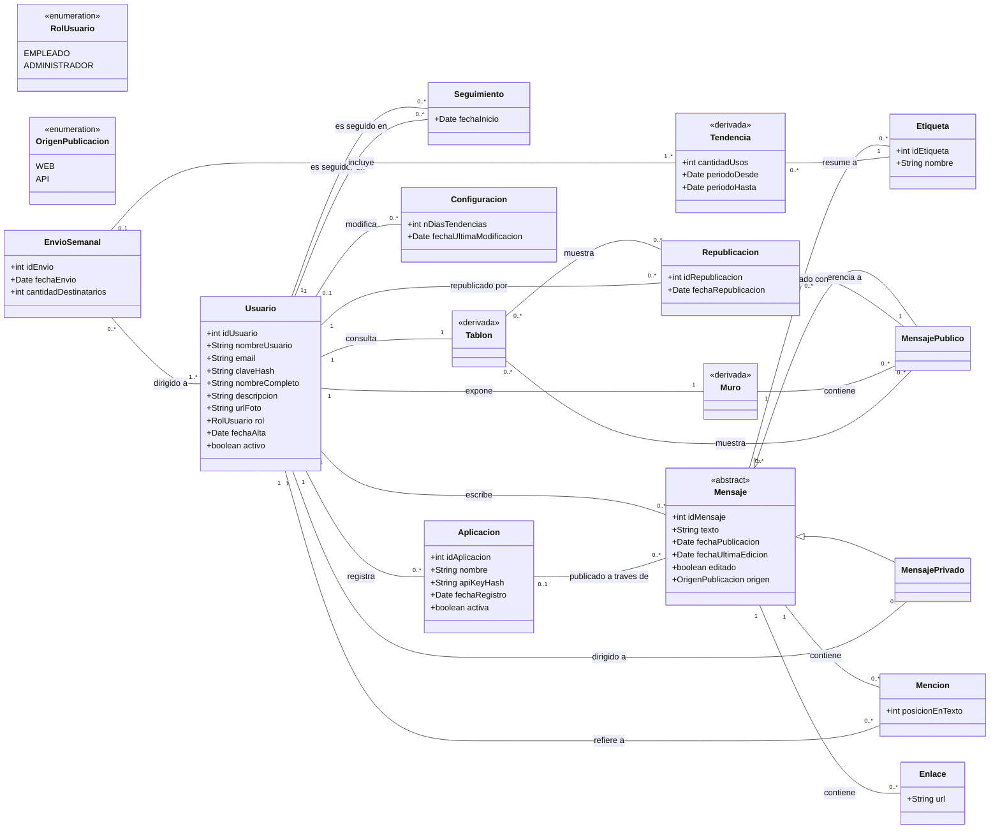
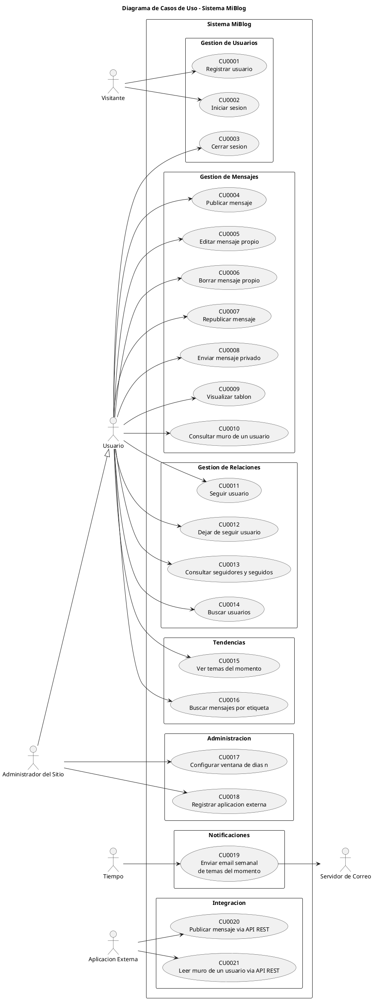

# DÍA 1 — Flujo de Requisitos (parte A) — Sistema **MiBlog**

**Versión:** 1.2 · **Última modificación:** 28/10/2026 · **Etapa:** Requisitos

**Materia:** Ingeniería de Software · **Alumno:** Abel · **Modalidad:** proyecto planteado para grupos de ocho personas, cursado y entregado en solitario
**Redactado el:** 12/09/2026 · **Entrega y defensa:** 24/11/2026
**Alcance de este documento:** decisiones bloqueantes cerradas + Actores + Listado de Casos de Uso priorizado + Modelo de Dominio + Diagrama único de Casos de Uso.

## 0. Códigos usados en todos los documentos

El orden de construcción de los artefactos es: enunciado → requisitos candidatos → requisitos funcionales y no funcionales → casos de uso. Cada código pertenece a una etapa y solo referencia etapas anteriores.

| Código | Significa | Documento donde vive |
|---|---|---|
| **R00–R17** | Requisito escrito literalmente en el enunciado. | `enunciado_microblogging.pdf` |
| **C01–C38** | Característica evaluada (requisito candidato), aprobada o no. | `REQUISITOS_CANDIDATOS_MiBlog.md` |
| **RF01–RF21** | Requisito funcional. | `REQUISITOS_FUNCIONALES_MiBlog.md` |
| **RA01–RA11** | Regla funcional automática. | `REQUISITOS_FUNCIONALES_MiBlog.md` |
| **RNF01–RNF42** | Requisito no funcional. | `REQUISITOS_NO_FUNCIONALES_MiBlog.md` |
| **CU0001–CU0021** | Caso de uso. | este documento |

---

> **Estado del documento:** `[DECIDIDO]` — cerrado el 13/09/2026, al cerrarse el flujo de Requisitos. Los actores, el catálogo de 21 casos de uso, el modelo de dominio, el diagrama único de casos de uso y el alcance de la iteración no volvieron a cambiar: el análisis, el diseño, el código y las 262 pruebas se construyeron sobre ellos.

---

## 1. Decisiones cerradas

### 1.1 Datos del proyecto

| Tema | Estado | Valor |
|---|---|---|
| Modalidad | `[DECIDIDO]` | Proyecto planteado para **grupos de ocho personas**, cursado y entregado **en solitario**. Sin reparto de CU, sin herramienta de backlog. |
| Alcance de la entrega | `[DECIDIDO]` | **Decisión propia del alumno**, no acordada con la cátedra: documentación completa del flujo de Requisitos y realización completa de 10 de los 21 casos de uso. El fundamento y el pendiente de conversarlo con la cátedra están en la sección 7. |
| Plazo | `[DECIDIDO]` | Entrega y defensa oral el **24/11/2026**. |
| Nombre del sistema | `[DECIDIDO]` | **MiBlog** |
| Artefactos SCRUM | `[DECIDIDO]` | **No se producen** (la materia ya está regularizada; el final es proyecto + defensa). |

### 1.2 Supuestos propios (decisiones sobre lo que el enunciado no dice)

Cada uno de estos está registrado como característica en `REQUISITOS_CANDIDATOS_MiBlog.md`, con su código C. No se usa una numeración propia para no multiplicar códigos.

| Cód. | Supuesto | Estado | Decisión | Fundamento |
|---|---|---|---|---|
| C17 | Login / cierre de sesión | `[DECIDIDO]` | Entran como CU0002 y CU0003 | No está en el enunciado, pero la cátedra se lo exigió al grupo de referencia. Sin sesión, "mensajes propios" (R13) y "sus seguidores" (R08) no tienen sujeto. |
| C18 | Seguir / dejar de seguir | `[DECIDIDO]` | CU propios. Seguimiento **unidireccional y sin aprobación** del seguido. | El enunciado nunca menciona solicitudes ni aceptación. Modelo Twitter, no modelo Facebook. Aprobación agregaría un CU y un estado no pedidos. |
| C21, C22 | Búsqueda de usuarios y de mensajes por etiqueta | `[DECIDIDO]` | Ambas entran (CU0014 y CU0016) | R07 dice "para futuras búsquedas y estadísticas"; R15 exige links al listado de mensajes de cada etiqueta. Sin búsqueda, R15 no tiene destino. |
| C19 | Visibilidad de los mensajes no privados | `[DECIDIDO]` | **Públicos dentro de la empresa.** El seguimiento determina qué *llega al tablón*, no qué se *puede leer*. | R02 describe el mecanismo de entrega. Si fuera restricción de acceso: (a) R16 expone el muro a aplicaciones externas que no siguen a nadie, y (b) los temas del momento (R09) contarían etiquetas de mensajes inaccesibles. El único canal restringido del enunciado es el mensaje privado (R12). |
| C23 | Edición de un mensaje ya republicado | `[DECIDIDO]` | La republicación **referencia** al mensaje original. Al editarlo, todas las republicaciones reflejan el texto nuevo y el mensaje queda marcado como *editado* con fecha. | Una sola fuente de verdad del texto. Si la republicación copiara el texto, el conteo de etiquetas de R09 contaría la misma etiqueta dos veces y rompería el email semanal (R14). |
| C24 | Alcance del Administrador | `[DECIDIDO]` | Configura `n` (R10) **y** gestiona el registro de aplicaciones externas (R17). **Sin** moderación de contenido ni baja de usuarios. | R17 exige que las aplicaciones "se registren"; el único actor administrativo del enunciado es el administrador. La moderación agregaría CU y un estado "usuario deshabilitado" que nadie pidió. |
| C27 | Notificaciones in-app | `[DECIDIDO]` | **No se implementan.** Único canal de notificación: el email semanal (R14). | El enunciado menciona menciones `@` (R06) pero nunca dice que notifiquen. Queda documentado como extensión futura. |
| C25 | Autenticación de aplicaciones externas | `[DECIDIDO]` | **API key** emitida al registrar la aplicación, enviada por cabecera HTTP. | OAuth *client credentials* es más ortodoxo pero exige un servidor de tokens que no se va a implementar en 4 días. Prometer en la arquitectura algo que el código no hace es exactamente el error que la cátedra le marcó al Grupo 3. |
| — | "Usuario Registrado" vs "Usuario Autenticado" | `[DECIDIDO]` | **Se unifican** en un solo actor: *Usuario*. | El grupo de referencia mantuvo la distinción y le generó precondiciones incoherentes. Quien todavía no inició sesión es el actor *Visitante*. |

---

## 2. ARTEFACTO 1 — Listado de Actores

`[DECIDIDO]` 13/09/2026

| Actor | Tipo | Descripción | Requisitos |
|---|---|---|---|
| **Visitante** | Primario, humano | Empleado de la empresa que aún no tiene cuenta o no inició sesión. Solo puede registrarse e iniciar sesión. | R03 |
| **Usuario** | Primario, humano | Empleado registrado con sesión activa. Publica, edita y borra sus mensajes, republica, envía mensajes privados, sigue y deja de seguir, consulta su tablón, los muros ajenos, sus seguidores y seguidos, los temas del momento y las búsquedas. | R01, R02, R04–R09, R11–R13 |
| **Administrador del Sitio** | Primario, humano. **Especialización de Usuario** | Empleado con privilegios adicionales: configura la ventana de `n` días de los temas del momento y registra o da de baja las aplicaciones externas habilitadas a consumir la API. Hereda todo lo que puede hacer un Usuario. | R10, R17 |
| **Tiempo** | Primario, no humano | Disparador temporal del proceso automático semanal. No es una persona ni un sistema externo: es el evento de calendario que inicia el CU0019. | R14 |
| **Aplicación Externa** | Primario, no humano | Sistema de terceros previamente registrado que consume la API REST con su API key para publicar mensajes y leer el muro de un usuario. | R16, R17 |
| **Servidor de Correo (SMTP)** | **Secundario**, no humano | Servicio externo al que el sistema entrega los emails del resumen semanal. No inicia ningún caso de uso. | R14, R15 |

### 2.1 Dos decisiones de modelado que conviene poder defender

1. **No existe un actor "Sistema".** El borrador previo proponía uno para el envío semanal. Un sistema **nunca es actor de sí mismo**: un actor es, por definición, algo externo a la frontera. Lo que está afuera y dispara ese caso de uso es el **paso del tiempo**. Modelarlo como actor *Tiempo* es la convención estándar de UML/PU para procesos batch y es una pregunta de defensa muy probable.
2. **Administrador hereda de Usuario** (generalización de actores). Evita repetir 15 líneas de asociación en el diagrama y refleja la realidad: el administrador también es un empleado que publica.

---

## 3. ARTEFACTO 2 — Listado de Casos de Uso con prioridad

`[DECIDIDO]` 13/09/2026

### 3.1 Criterio de priorización

La priorización es actividad del **Arquitecto** en el flujo de Requisitos. El criterio **no** es "qué le gusta más al usuario", es:

1. **Riesgo técnico** — ¿es lo que puede salir mal y no sé todavía cómo resolver?
2. **Importancia arquitectónica** — ¿obliga a incorporar una capa, un mecanismo o un componente que ningún otro CU usa? (persistencia de archivos, planificador, SMTP, API REST, sesión)
3. **Dependencia** — ¿hay otros CU que no funcionan si este no existe?

**Alta** = cumple 2 o 3 criterios. **Media** = cumple 1. **Baja** = no cumple ninguno; es CRUD sin riesgo.

### 3.2 Catálogo (21 casos de uso)

| Cód. | Caso de uso | Actor primario | Paquete | Req. | Prioridad | Descripción breve |
|---|---|---|---|---|---|---|
| CU0001 | Registrar usuario | Visitante | Gestión de Usuarios | R03 | **Alta** | El visitante crea su cuenta indicando nombre de usuario (≤15), email, clave, nombre completo, descripción y foto. El sistema valida unicidad del nombre de usuario y del email. |
| CU0002 | Iniciar sesión | Visitante | Gestión de Usuarios | C17 | **Alta** | El visitante se autentica con nombre de usuario y clave; el sistema abre una sesión y lo habilita como Usuario. |
| CU0003 | Cerrar sesión | Usuario | Gestión de Usuarios | C17 | Baja | El usuario finaliza su sesión y vuelve a ser Visitante. |
| CU0004 | Publicar mensaje | Usuario | Gestión de Mensajes | R01, R05, R06 | **Alta** | El usuario publica un texto de hasta 140 caracteres. El sistema registra autor y fecha, y extrae del texto las etiquetas `#`, las menciones `@` y los links. |
| CU0005 | Editar mensaje propio | Usuario | Gestión de Mensajes | R13, C23 | Media | El usuario modifica el texto de un mensaje suyo. El sistema re-extrae etiquetas, menciones y links, marca el mensaje como editado con fecha, y el cambio se refleja en todas sus republicaciones. |
| CU0006 | Borrar mensaje propio | Usuario | Gestión de Mensajes | R13 | Media | El usuario elimina un mensaje suyo. Se eliminan también sus republicaciones, por ser referencias al original. |
| CU0007 | Republicar mensaje | Usuario | Gestión de Mensajes | R11 | Media | Desde su tablón, el usuario reenvía a sus seguidores un mensaje creado por alguien a quien sigue. No se copia el texto: se crea una referencia. |
| CU0008 | Enviar mensaje privado | Usuario | Gestión de Mensajes | R12 | Media | El usuario publica un mensaje de hasta 140 caracteres dirigido a un único destinatario. No aparece en muros ni tablones ni cuenta para los temas del momento. |
| CU0009 | Visualizar tablón | Usuario | Gestión de Mensajes | R04, R05 | **Alta** | El usuario ve el listado cronológico de los mensajes de los usuarios a los que sigue, de los propios y de las republicaciones de ambos. |
| CU0010 | Consultar muro de un usuario | Usuario | Gestión de Mensajes | C20 | Media | El usuario abre el perfil de otro usuario y ve su foto, descripción y sus mensajes públicos en orden cronológico. |
| CU0011 | Seguir usuario | Usuario | Gestión de Relaciones | R02, C18 | **Alta** | El usuario comienza a seguir a otro; desde ese momento los mensajes del seguido aparecen en su tablón. |
| CU0012 | Dejar de seguir usuario | Usuario | Gestión de Relaciones | C18 | Baja | El usuario deja de seguir a otro y sus mensajes dejan de aparecer en el tablón. |
| CU0013 | Consultar seguidores y seguidos | Usuario | Gestión de Relaciones | R08 | Media | Desde la página principal el usuario consulta quiénes lo siguen y a quiénes sigue. |
| CU0014 | Buscar usuarios | Usuario | Gestión de Relaciones | C21 | Baja | El usuario busca por nombre de usuario o nombre completo y accede al muro del resultado. |
| CU0015 | Ver temas del momento | Usuario | Tendencias | R09, R10 | **Alta** | El usuario ve el ranking de las etiquetas más repetidas en los últimos `n` días, con `n` tomado de la configuración del sitio. |
| CU0016 | Buscar mensajes por etiqueta | Usuario | Tendencias | R07, R15 | Media | El usuario obtiene el listado de mensajes públicos que contienen una etiqueta determinada. Es el destino de los links del email semanal. |
| CU0017 | Configurar ventana de días `n` | Administrador | Administración | R10 | Media | El administrador modifica la cantidad de días que se consideran para calcular los temas del momento. |
| CU0018 | Registrar aplicación externa | Administrador | Administración | R17, C25 | Media | El administrador da de alta una aplicación autorizada a usar la API y el sistema emite su API key. También puede darla de baja. |
| CU0019 | Enviar email semanal de temas del momento | Tiempo | Notificaciones | R14, R15 | **Alta** | Una vez por semana el sistema calcula los temas del momento y envía a cada usuario un email con el listado y los links al listado de mensajes de cada etiqueta. Actor secundario: Servidor de Correo. |
| CU0020 | Publicar mensaje vía API REST | Aplicación Externa | Integración | R16, R17 | Media | Una aplicación registrada publica un mensaje en nombre de un usuario, autenticándose con su API key. |
| CU0021 | Leer muro de un usuario vía API REST | Aplicación Externa | Integración | R16, R17 | Media | Una aplicación registrada obtiene los mensajes públicos de un usuario, autenticándose con su API key. |

**Resumen:** 7 Alta · 11 Media · 3 Baja.

### 3.3 Cobertura de requisitos (traza inversa)

| Req. | Cubierto por |
|---|---|
| R00 (objetivo) | El sistema completo; no se traduce a un CU |
| R01 | CU0004 |
| R02 | CU0009, CU0011 |
| R03 | CU0001 |
| R04 | CU0009 |
| R05 | CU0004, CU0009 |
| R06 | CU0004, CU0005 |
| R07 | CU0016 |
| R08 | CU0013 |
| R09 | CU0015 |
| R10 | CU0017 |
| R11 | CU0007 |
| R12 | CU0008 |
| R13 | CU0005, CU0006 |
| R14 | CU0019 |
| R15 | CU0019, CU0016 |
| R16 | CU0020, CU0021 (y CU0010 como equivalente en la web) |
| R17 | CU0018, CU0020, CU0021 |

**No queda ningún requisito sin caso de uso, y ningún caso de uso sin requisito o sin supuesto propio documentado.** Esa tabla es lo que hay que poder mostrar si en la defensa preguntan de dónde salieron los CU.

### 3.4 Cambios respecto del borrador de `ESTADO_MI_PROYECTO.md` §4

| Cambio | Motivo |
|---|---|
| Se agregó **CU0003 Cerrar sesión** | Si hay login hay logout; es trivial pero su ausencia se nota. |
| Se agregó **CU0010 Consultar muro de un usuario** | El enunciado expone "el muro de un usuario" por API (R16). Si la web no tiene ese concepto, la API expone algo que no existe en el sistema. |
| **CU0017 Registrar aplicación** pasó a ser exclusivo del **Administrador** | El borrador decía "Administrador / Usuario", ambigüedad que hay que cerrar (característica C24). |
| Se **descartó** "Editar perfil" | No está en el enunciado. Con 4 días, no se agrega alcance inventado. |
| Se **descartó** un CU separado "Validar credencial de aplicación" | Sería descomposición funcional: no entrega valor observable a ningún actor. Queda como precondición de CU0020 y CU0021. |
| El actor **Sistema** se reemplazó por **Tiempo** | Ver §2.1. |

---

## 4. ARTEFACTO 3 — Modelo de Dominio

`[DECIDIDO]` 13/09/2026 · Diagrama de clases **sin métodos**, con atributos y con **multiplicidad en todas las asociaciones**.

### 4.1 Mermaid

### 4.2 Restricciones que no entran en el diagrama

Van como nota al pie del documento entregable:

- `Mensaje.texto` ≤ 140 caracteres (R01).
- `Usuario.nombreUsuario` ≤ 15 caracteres y único (R03).
- `Usuario.email` único.
- Un usuario no puede seguirse a sí mismo: en `Seguimiento`, seguidor ≠ seguido.
- No puede haber dos `Seguimiento` con el mismo par (seguidor, seguido).
- Solo se puede republicar un `MensajePublico` de un usuario al que se sigue (R11).
- Los `MensajePrivado` **no** cuentan para `Tendencia` ni aparecen en `Muro` ni en `Tablon`.
- `Configuracion` es única en el sistema (instancia singleton del dominio).

### 4.3 Decisiones de modelado y por qué

| Decisión | Alternativa descartada | Por qué |
|---|---|---|
| `Seguimiento` es **clase**, no una asociación reflexiva simple | Asociación `Usuario`–`Usuario` | Tiene atributo propio (`fechaInicio`) y es la clase equivalente a la "Amistad" que a UMBook le faltaba. Además es lo que consulta CU0013. |
| `Mensaje` **abstracta** con `MensajePublico` y `MensajePrivado` | Una sola clase `Mensaje` con atributo `visibilidad` y destinatario opcional | La jerarquía es lo que después le da anclaje real a **Factory Method** (tipos de mensaje) y a **Strategy** (visibilidad) en el flujo de Diseño. Con una sola clase y un `if`, esos patrones quedan decorativos. |
| `Republicacion` es **clase aparte**, no subclase de `Mensaje` | Subclase de `Mensaje` con texto vacío | Coherente con la característica C23: la republicación no tiene texto propio, apunta al original. Una subclase con el atributo principal siempre nulo es un olor a modelo forzado. |
| `Etiqueta` con N:M contra `Mensaje` | Guardar las etiquetas como texto dentro del mensaje | R07 pide clasificar "para futuras búsquedas y estadísticas". Sin entidad propia no hay ni búsqueda (CU0016) ni ranking (CU0015). |
| `Mencion` es clase, no N:M directo | Asociación N:M `Mensaje`–`Usuario` | Permite guardar la posición en el texto y deja abierta la extensión "notificar al mencionado" sin rehacer el modelo. Si querés recortar, esta es la primera que se puede simplificar. |
| `Muro`, `Tablon` y `Tendencia` marcadas `<<derivada>>` | Omitirlas | El enunciado nombra las tres ("muro", "tablón de anuncios", "temas del momento"). Omitirlas es exactamente el hueco que la cátedra le marcó a UMBook. Marcarlas como derivadas deja claro que no son tablas nuevas, sino vistas calculadas. |
| `Administrador` como atributo `rol`, no como subclase de `Usuario` | Subclase `Administrador` | La subclase no tendría ningún atributo propio. En el **diagrama de casos de uso** sí se modela como actor especializado, porque ahí lo que se hereda es comportamiento, no datos. Esa asimetría es deliberada y conviene poder explicarla. |

---

## 5. ARTEFACTO 4 — Diagrama de Casos de Uso (UNO SOLO para toda la aplicación)

`[DECIDIDO]` 13/09/2026 · **Un único diagrama**, con los 6 actores y los 21 CU. La cátedra marcó FALTA dos veces al grupo de referencia por hacer un mini-diagrama por caso de uso.

### 5.1 PlantUML

### 5.2 Cómo renderizarlo y qué revisar

- Pegarlo en `https://www.plantuml.com/plantuml`, en la extensión PlantUML de VS Code, o en draw.io (Arrange → Insert → PlantUML).
- Si la versión del renderer se queja por anidar `package` dentro de `rectangle`, borrar la línea `rectangle "Sistema MiBlog" {` y su llave de cierre. Se pierde el marco del sistema pero el diagrama sale.
- **No hay relaciones `<<include>>` ni `<<extend>>` en este diagrama, y es a propósito.** Los candidatos que se evaluaron (validar API key, extraer etiquetas) no entregan valor observable a un actor: son pasos internos. Meterlos como CU sería descomposición funcional, que es el error clásico de confundir caso de uso con función. Si en la defensa preguntan por qué no hay `include`, esa es la respuesta.
- La única relación estructural es la **generalización `Administrador --|> Usuario`**: el administrador puede hacer todo lo que hace un usuario, más CU0017 y CU0018.

---

## 6. Anclaje teórico para la defensa

Para cada artefacto: flujo del Proceso Unificado, trabajador que lo produce, actividad en la que se genera y qué decisión comunica.

| Artefacto | Flujo del PU | Trabajador (rol) | Actividad | Qué decisión comunica |
|---|---|---|---|---|
| **Listado de Actores y Casos de Uso** | Requisitos | **Analista de Sistemas** (responsable del modelo de casos de uso como un todo) | *Encontrar actores y casos de uso* | Dónde está la **frontera del sistema**: qué es externo (actor), qué es interno (caso de uso) y qué queda afuera del alcance. |
| **Priorización de los Casos de Uso** | Requisitos, con entrada al inicio de Análisis y Diseño | **Arquitecto** | *Priorizar los casos de uso* (selección de los arquitectónicamente significativos) | Qué casos de uso se realizan en las **primeras iteraciones** y por lo tanto qué forma va a tener la **arquitectura candidata**. Criterio: riesgo e importancia arquitectónica, no gusto del usuario. |
| **Modelo de Dominio** | Requisitos (actividad preliminar de modelado del negocio) | **Analista de Sistemas** | *Desarrollar un modelo del dominio* | El **vocabulario común** entre cliente y equipo: qué objetos del negocio existen, cómo se llaman y cómo se relacionan. Es la materia prima de las clases de entidad del Análisis. |
| **Diagrama de Casos de Uso** | Requisitos | **Analista de Sistemas** | *Encontrar actores y casos de uso* + *Estructurar el modelo de casos de uso* | La **vista completa del sistema en una sola imagen**: todos los actores, todos los CU y las relaciones entre ellos. Es el contrato funcional con el cliente. |

### 6.1 Preguntas probables y respuestas cortas

**¿Por qué un caso de uso y no una función?**
Un caso de uso es una secuencia completa de acciones que entrega **un resultado observable de valor a un actor**. Una función es un paso interno. "Publicar mensaje" es un CU; "validar longitud de 140 caracteres" es un paso dentro de él. El PU está *dirigido por casos de uso* justamente porque el CU atraviesa todos los flujos: se especifica en Requisitos, se realiza en Análisis y Diseño, se codifica en Implementación y se verifica en Prueba. Una función no tiene esa trazabilidad.

**¿Quién produce el modelo de dominio y para qué sirve después?**
Lo produce el Analista de Sistemas en el flujo de Requisitos. Sirve para fijar el vocabulario y, sobre todo, porque sus clases se convierten en las **clases de entidad** del modelo de análisis, y de ahí en las clases persistentes del diseño. En MiBlog, `Mensaje`, `Usuario`, `Etiqueta` y `Seguimiento` van a reaparecer en las tres etapas.

**¿Modelo del negocio o modelo del dominio?**
Modelo del **dominio** —que es lo que corresponde acá— cuando alcanza con identificar los objetos y conceptos que maneja el negocio. Modelo del **negocio** cuando además hace falta describir los procesos de la organización con casos de uso del negocio y trabajadores. MiBlog no reorganiza procesos de la empresa, agrega un canal de comunicación: con el modelo del dominio alcanza, y eso hay que poder justificarlo, no omitirlo.

**¿Cómo priorizaste los CU y con qué criterio?**
Riesgo técnico, importancia arquitectónica y dependencia (§3.1). Por eso CU0019 (email semanal) es Alta aunque sea una sola pantalla: introduce planificador, proceso batch, SMTP y un actor no humano. Y por eso CU0014 (buscar usuarios) es Baja aunque el usuario lo use todos los días: no agrega ningún mecanismo nuevo.

---

## 7. Alcance de la iteración — entrega mínima viable

`[DECIDIDO]` 13/09/2026

El proyecto está planteado para grupos de ocho personas y se cursó en solitario. Este apartado define **qué se reduce y qué no**, de modo que el recorte quede documentado como una decisión de alcance y no se lea como funcionalidad olvidada.

### 7.0 De quién es esta decisión

**El recorte de alcance es una decisión propia del alumno. No está acordado con la cátedra: el alcance nunca se conversó con el profesor.**

**Fundamento.** Según lo que comentaron compañeros de la materia, el mínimo esperado eran **cuatro casos de uso realizados**. En esta entrega se realizaron **diez**, porque con cuatro la aplicación no tiene sentido de uso: no se puede mostrar el circuito completo de un microblogging —registrarse, seguir a alguien, publicar y ver el resultado en el tablón— y lo entregado no se parecería al sistema que describe el enunciado.

**Pendiente.** Conversar el alcance con la cátedra antes del **24/11/2026** y registrar su respuesta, si la hay, en `ESTADO_MI_PROYECTO.md` §8. Si no la hay, el recorte se defiende como decisión propia con el fundamento de arriba: diez casos de uso realizados sobre un mínimo esperado de cuatro, y los once restantes especificados en el flujo de Requisitos.

### 7.1 Principio aplicado

En el Proceso Unificado, una iteración **no** tiene por qué realizar todos los casos de uso. Lo que sí debe hacer es declarar cuáles realiza. Por eso:

- El **flujo de Requisitos se entrega completo**. Ya está hecho y no cuesta nada adicional: recortarlo solo haría parecer que faltan requisitos del enunciado.
- Los flujos de **Análisis, Diseño, Implementación y Prueba se aplican únicamente sobre el subconjunto de la sección 7.2**.

### 7.2 Casos de uso realizados en esta iteración

Diez casos de uso. El criterio de selección es que, ejecutados en secuencia, demuestren el sistema funcionando de punta a punta: una persona se registra, entra, busca a alguien, lo sigue, publica, edita, borra, republica y ve el resultado en su tablón.

| CU | Nombre | Por qué entra |
|---|---|---|
| CU0001 | Registrar Usuario | Crea la entidad central. Sin esto no hay sistema. |
| CU0002 | Iniciar Sesión | Mecanismo de sesión, transversal a todo lo demás. No está en el enunciado, pero la cátedra se lo exigió al grupo de referencia (característica C17). |
| CU0003 | Cerrar Sesión | Trivial una vez resuelto CU0002. Su ausencia se nota más de lo que cuesta implementarlo. |
| CU0004 | Publicar Mensaje | Núcleo del dominio. Incluye el límite de 140 caracteres y la extracción de etiquetas, menciones y links. |
| CU0005 | Editar Mensaje Propio | Cubre la mitad de R13 y es donde se materializa la decisión C23: al editar, las republicaciones reflejan el texto nuevo. |
| CU0006 | Borrar Mensaje Propio | Completa R13. Obliga a resolver el borrado en cascada de las republicaciones. |
| CU0007 | Republicar Mensaje | Cubre R11 e introduce la clase Republicacion, que cambia la consulta del tablón. |
| CU0011 | Seguir Usuario | Sin seguimiento, el tablón no tiene contenido ajeno y el sistema no es un microblogging. |
| CU0014 | Buscar Usuarios | Es el punto de entrada de CU0011: sin búsqueda no hay forma de alcanzar a un usuario que todavía no se sigue. Cubre la característica C21. |
| CU0009 | Visualizar Tablón | Es el requisito R04 del enunciado y la pantalla principal del sistema. Cierra el circuito. |

Estos diez cubren los requisitos **R01, R03, R04, R05, R06, R11, R13 y parcialmente R02** del enunciado, más la característica **C21**.

#### Consecuencias técnicas para el flujo de Diseño

La incorporación de CU0005, CU0006 y CU0007 no es aditiva: modifica dos cosas que ya estaban resueltas y que hay que rehacer en Análisis y Diseño.

1. **La consulta del tablón (CU0009) deja de ser solo mensajes.** Debe reunir los mensajes públicos de los seguidos, los propios, **y también las republicaciones de unos y otro**, ordenando cada elemento por la fecha que corresponda: la de publicación para un mensaje, la de republicación para una republicación. Es la regla RA07, que hasta ahora no tenía cómo ejercitarse porque no existía CU0007.
2. **El borrado (CU0006) es en cascada.** Al eliminar un mensaje se eliminan todas sus republicaciones, en una única transacción. No puede quedar una republicación apuntando a un mensaje inexistente. Es la regla RA06 y el `rnf 6.3`.

### 7.3 Casos de uso especificados pero no realizados

Los once restantes —CU0008, CU0010, CU0012, CU0013, CU0015, CU0016, CU0017, CU0018, CU0019, CU0020 y CU0021— quedan **completamente especificados** en `ESPECIFICACIONES_CASOS_DE_USO_MiBlog.md` y **no se implementan** en esta versión.

Esto debe figurar explícitamente en el documento de arquitectura y en el plan de pruebas. En la lista de requisitos candidatos, las características correspondientes permanecen en estado **aprobado** y no pasan a **incluido**, que es exactamente lo que esos estados significan.

### 7.4 Qué se reduce en cada flujo

| Flujo | Alcance completo | Alcance de esta entrega |
|---|---|---|
| **Requisitos** | 21 CU especificados, modelo de dominio, diagrama de casos de uso, requisitos candidatos, funcionales y no funcionales | **Sin cambios: se entrega completo.** |
| **Análisis** | Clases de análisis y realización de los 21 CU | Clases de análisis del modelo completo; realización de los 10 CU de la sección 7.2 |
| **Diseño** | Arquitectura, subsistemas, despliegue, clases de diseño y diagramas de interacción de los 21 CU | Arquitectura, subsistemas y despliegue completos; diagramas de interacción de los 10 CU |
| **Implementación** | 21 CU codificados | 10 CU codificados |
| **Prueba** | Plan de pruebas y casos de prueba de los 21 CU | Plan de pruebas completo; casos y procedimientos de prueba de los 10 CU |
| **Prototipos de interfaz** | Las 21 pantallas | Las pantallas de los 10 CU |

### 7.5 Lo que no se recorta

Tres cosas se mantienen completas aunque el alcance de implementación se reduzca, porque son las que sostienen la coherencia del proyecto:

1. **El modelo de dominio**, con las 15 clases. Un modelo recortado a las clases implementadas dejaría afuera conceptos que el enunciado nombra.
2. **El diagrama de casos de uso**, con los 21 CU y los 6 actores. Es un solo diagrama para toda la aplicación, según la exigencia expresa de la cátedra.
3. **Los tres documentos de requisitos** (candidatos, funcionales y no funcionales), sin quitar ninguna entrada.

---

## 8. Registro — líneas aplicadas a `ESTADO_MI_PROYECTO.md`

> **Registro histórico, ya aplicado. No es una tarea pendiente.**

El 13/09/2026, al cerrarse este documento, se trasladaron a `ESTADO_MI_PROYECTO.md` los datos del proyecto de la §1.1, la tabla de supuestos propios de la §1.2 y el estado de los entregables de Requisitos. El documento vivo del proyecto los tiene incorporados desde entonces y los mantuvo al día en sus versiones posteriores; **la fuente de ese contenido es `ESTADO_MI_PROYECTO.md`, no esta sección.**

Las instrucciones originales se retiraron en la versión 1.2 de este documento: eran indicaciones de trabajo entre chats, cumplidas seis semanas antes, y sus marcas `[PROPUESTA]` contradecían el estado real del proyecto.

---

## 9. Riesgos abiertos

1. **El alcance no está conversado con la cátedra.** El recorte de la sección 7 es una decisión propia del alumno, tomada sobre lo que comentaron compañeros de la materia. No hay ninguna aprobación de un docente, ni verbal ni escrita. Conviene plantearlo antes del 24/11/2026 y registrar la respuesta. Si llega la defensa sin esa conversación, el recorte se sostiene por su fundamento —diez casos de uso realizados sobre un mínimo esperado de cuatro— y no por una autorización, que no existe.
2. **El recorte de alcance debe estar declarado en cada documento, no solo acá.** Vale para el documento de arquitectura y para el plan de pruebas. Un documento que describe funcionalidad que el código no tiene es la falla que la cátedra marcó en el proyecto de referencia.

> El riesgo que figuraba acá como tercero —las secciones marcadas `[PROPUESTA]` cuando todo el proyecto ya se había construido sobre ellas— quedó resuelto en la versión 1.2 y por eso se retiró, en lugar de dejarlo abierto sin motivo.

---

## Control del documento

| Versión | Fecha | Etapa / Chat | Cambios |
|---|---|---|---|
| 1.0 | 13/09/2026 | Requisitos | Versión inicial: actores, catálogo de 21 casos de uso priorizado, modelo de dominio, diagrama único de casos de uso y alcance de la iteración. |
| 1.1 | 28/10/2026 | Requisitos | **Encabezado de versión y bloque de control**, que faltaban (P-6). **Corregida la afirmación falsa de que la cátedra aceptó el alcance reducido** (§1.1, §7, §8 y §9): el recorte es una decisión propia del alumno, con su fundamento —mínimo esperado de cuatro casos de uso según compañeros, diez realizados— y el pendiente de conversarlo con la cátedra antes del 24/11/2026. Corregidos además el plazo de entrega (24/11/2026), el rango de los requisitos no funcionales (RNF01–RNF42) y el riesgo 2 de la §9, que daba por abierta la decisión tecnológica, cerrada desde el 13/09/2026. |
| 1.2 | 28/10/2026 | Requisitos | **Marcas de estado puestas al día.** La nota de encabezado y las secciones §2, §3, §4, §5 y §7 pasaron de `[PROPUESTA]` a `[DECIDIDO]` con su fecha de cierre: el proyecto entero se construyó sobre ellas. La §8 pasó a ser un registro histórico ya aplicado, sin las instrucciones de trabajo del 13/09 ni sus marcas `[PROPUESTA]`. En la §7.2 se precisó que el login lo exigió la cátedra **al grupo de referencia**, no a este alumno. Se retiró el riesgo 3 de la §9, resuelto por estos mismos cambios. **Aclaración sobre la fila 1.1:** lo que se corrigió entonces fue el plazo de entrega del encabezado y de la §1.1; las dos menciones a «4 días» de la §1.2 (C25) y la §3.4 se conservan a propósito, porque describen el contexto real en el que se tomaron esas decisiones el 13/09/2026. |
