# DISEÑO — Sistema MiBlog
 
**Versión:** 1.4 · **Última modificación:** 28/10/2026 · **Etapa:** Diseño
 
**Materia:** Ingeniería de Software · **Alumno:** Abel · **Modalidad:** proyecto grupal, cursado en solitario
**Flujo del Proceso Unificado:** Diseño
**Trabajadores responsables:** Arquitecto · Ingeniero de Casos de Uso · Ingeniero de Componentes
**Documentos previos:** `ANALISIS_MiBlog.md` (2.2) · `ESPECIFICACIONES_CASOS_DE_USO_MiBlog.md` (1.3) · `REQUISITOS_NO_FUNCIONALES_MiBlog.md` (1.1) · `DIA1_REQUISITOS_MiBlog.md` · `PLAN_DEL_PROYECTO.md`
 
> **Alcance de realización.** Esta iteración realiza los casos de uso CU0001, CU0002, CU0003, CU0004, CU0005, CU0006, CU0007, CU0009, CU0011 y CU0014. Los restantes quedan especificados en el flujo de Requisitos y no forman parte del alcance de implementación de esta versión.
 
**Tecnología (RNF29 a RNF42), la misma en todo este documento y en el código:** Python 3 · Flask · plantillas Jinja2 · hojas de estilo propias · SQLite mediante `sqlite3` · Linux. Sin ORM, sin framework de frontend, sin servidor de aplicaciones de producción.
 
**Estado del documento:** `[DECIDIDO]` — confirmado el 15/09/2026. Las seis decisiones de la **sección 1** fueron aceptadas, y las correcciones que pedían los demás hallazgos ya están aplicadas en los documentos de Requisitos y Análisis. **Flujo de Diseño cerrado.**
 
---
 
## 0. La idea, antes de los diagramas
 
El Análisis contestó **qué objetos hacen falta**. El Diseño contesta **cómo se construyen con Python, Flask y SQLite**. Todo lo que está en este documento tiene que poder escribirse tal cual en el código de la Etapa 4.
 
Tres cosas cambian respecto del Análisis, y conviene tenerlas en la cabeza antes de leer los diagramas:
 
1. **Aparece la tecnología.** Una clase de interfaz pasa a ser una clase Python cuyos métodos atienden rutas de Flask, más una plantilla Jinja2. Una entidad pasa a ser una clase Python, más un repositorio con SQL, más una tabla.
2. **Aparecen los nombres definitivos.** Python escribe los métodos en minúscula con guion bajo: `registrarUsuario` del análisis es `registrar_usuario` acá, y así en todo el código.
3. **Aparecen piezas que el análisis no necesitaba**: la capa de acceso a datos, las transacciones, la sesión, los patrones con sus clases abstractas.
Este documento produce los seis artefactos pedidos:
 
1. Arquitectura en capas y tabla de mecanismos de diseño (sección 2).
2. Un solo diagrama de clases de diseño con los cuatro patrones adentro (sección 3).
3. Diagrama de despliegue (sección 4).
4. Diagrama de subsistemas en capas (sección 5).
5. Diez diagramas de secuencia con fragmentos `alt` (sección 6).
6. Diagramas de estado de `Mensaje` y `Usuario` (sección 7).
**Cómo ver los diagramas.** Están en PlantUML y los compilé todos antes de entregarlos. El diagrama de clases es muy ancho: en `plantuml.com` pedilo como **SVG**, porque la salida PNG del servidor recorta las imágenes de más de 4096 píxeles. Junto a este documento van también las imágenes ya generadas.
 
---
 
## 1. Lo que encontré al diseñar
 
Pediste que te avisara si el diseño no alcanzaba para realizar algún caso de uso. **La respuesta corta: los diez casos de uso se pueden realizar.** No hizo falta forzar ningún diagrama.
 
Lo que sí apareció son **doce hallazgos**. Algunos eran decisiones de diseño, otros eran cosas que las especificaciones prometían y ningún caso de uso realizado podía cumplir, y el resto eran correcciones a documentos anteriores.
 
**Estado al 15/09/2026: los doce están resueltos.** Las decisiones fueron confirmadas y las correcciones, aplicadas. La tabla del final de esta sección dice dónde quedó cada uno. El texto de cada hallazgo se conserva tal como se detectó, para que se vea de dónde salió cada cambio.
 
### Resumen
 
| # | Hallazgo | Tipo | Qué propongo | Toca |
|---|---|---|---|---|
| **H1** | La sesión de Flask no se puede invalidar en el servidor | Decisión de diseño | Tabla técnica `sesiones` | Este documento |
| **H2** | Las firmas de ANALISIS §8.3 y ANALISIS §8.5 del análisis no encajan entre sí | Decisión de diseño | `analizar(texto)` sin mensaje | Este documento |
| **H3** | `ca 7.3` ofrece "deshacer la republicación" y no existe ese caso de uso | Requisito inalcanzable | Quitar la oferta | Especificaciones |
| **H4** | `ca 11.3` y la colaboración 5.10 del análisis ofrecen "Dejar de seguir" (CU0012, fuera de alcance) | Requisito inalcanzable | Mostrar "Siguiendo" sin acción | Especificaciones |
| **H5** | `ca 7.1` **sí** es alcanzable desde la interfaz | Corrección | Corregir `{Ob 7.3}` y ANALISIS §1.3 | Especificaciones, Análisis |
| **H6** | CU0007 no dice qué pasa si el mensaje ya no existe | Curso faltante | Agregar `ca 7.4` | Especificaciones |
| **H7** | `Usuario.activo` nunca pasa a `False` en ningún caso de uso | Contradicción en el dominio | Conservar el atributo y declararlo | Decisión tuya |
| **H8** | `ANALISIS_MiBlog.md` 2.1 conserva cuatro frases de la versión 1.0 que contradicen la 2.0 | Corrección | Llevarlo a 2.2 | Análisis |
| **H9** | Sin JavaScript no hay diálogos flotantes | Decisión de diseño | Cada diálogo es una página propia | Este documento |
| **H10** | Leer `.env` sin dependencias extra | Decisión de diseño | Agregar `python-dotenv` | Este documento |
| **H11** | La presentación necesita conocer las clases de dominio | Refinamiento de Análisis | Declarar la dependencia | Este documento |
| **H12** | Tres detalles menores en los documentos de requisitos | Corrección | Ver abajo | Requisitos |
 
---
 
### H1 — La sesión de Flask, sola, no cumple el `rnf 3.1`
 
**El problema.** La decisión 1.1 del análisis dijo que la sesión se resuelve "con el mecanismo de sesión de Flask". Pero la sesión que Flask trae por defecto **no vive en el servidor**: es una cookie firmada que guarda el navegador. El servidor no tiene ninguna lista de sesiones abiertas.
 
Consecuencia: cuando el usuario cierra sesión, Flask borra la cookie del navegador, pero **si alguien copió esa cookie antes, la copia sigue funcionando** hasta que venza. Eso es exactamente lo que el `rnf 3.1` prohíbe: "no alcanza con borrarlo del navegador".
 
La extensión que resuelve esto (Flask-Session) es una dependencia adicional de manejo de sesiones, y el RNF41 prohíbe justamente esas.
 
**La solución.** Usar la sesión de Flask solo para transportar un **token al azar**, y guardar en SQLite una fila por cada sesión abierta:
 
- Al iniciar sesión, `ControlAutenticacion` genera el token con `secrets.token_urlsafe(32)`, guarda su **hash SHA-256** en la tabla `sesiones` con una fecha de vencimiento, y la vista pone el token en la cookie.
- En cada petición protegida, `GuardiaSesion` busca esa fila. Si no está o venció, no hay sesión.
- Al cerrar sesión, **se borra la fila**. La cookie copiada deja de servir, porque ya no hay nada en el servidor que la reconozca.
**Por qué no contradice la decisión 1.1.** La tabla `sesiones` **no tiene clase de dominio**: no hay ninguna `Sesion` en el diagrama de clases. Es una tabla técnica que solo conoce `RepositorioSesiones`, igual que un índice. La sesión sigue sin ser un concepto del negocio; lo que cambió es cómo se construye el mecanismo. Y no agrega ninguna dependencia: `secrets` y `hashlib` son de la biblioteca estándar.
 
**Por qué el hash y no el token.** Si alguien se lleva una copia del archivo `miblog.sqlite3`, encuentra hashes, y con un hash no se puede armar una cookie válida. Cuesta una línea.
 
**Cómo se limpian las sesiones vencidas.** En dos momentos, los dos sin procesos extra:
 
| Momento | Qué pasa | Método |
|---|---|---|
| **Al validar** | `GuardiaSesion` pide `obtener_usuario_en_sesion(token)`. Si `buscar_usuario_vigente()` no devuelve a nadie, la fila de ese token **se borra si está vencida**. | `RepositorioSesiones.eliminar_si_vencida(hash_token, ahora)` |
| **Al iniciar sesión** | Antes de crear la sesión nueva, se borran **todas** las vencidas, de cualquier usuario. | `RepositorioSesiones.eliminar_vencidas(ahora)` |
 
**Por qué hacen falta los dos.** La limpieza al validar solo alcanza a quien **vuelve** con su cookie. Una sesión abandonada (el usuario cerró el navegador y no volvió) nunca se valida otra vez, y su fila quedaría para siempre. La limpieza al iniciar sesión se lleva esas.
 
> **Para la defensa: "¿Cómo se limpian las sesiones vencidas?"**
> "Una sesión vencida **nunca se acepta**, se haya borrado o no: la consulta que valida compara la fecha de vencimiento con la hora actual. Borrarla es orden, no seguridad. La fila se borra en el momento en que alguien intenta usarla ya vencida, y además cada inicio de sesión borra las vencidas de todos, lo que cubre las sesiones abandonadas. No uso un planificador porque `cron` corresponde a CU0019, que no se realiza, y no borro en cada petición porque sería escribir en SQLite cada vez que alguien mira el tablón."
 
**Por qué la validación también mira `activo`.** `buscar_usuario_vigente()` hace el `JOIN` con `usuarios` y exige `activo = 1`. Si una cuenta quedara deshabilitada, sus sesiones abiertas dejarían de valer en la petición siguiente (ver H7).
 
`[DECIDIDO]` 15/09/2026. Confirmado, con la limpieza de sesiones vencidas agregada.
 
---
 
### H2 — La firma de `analizar()` de ANALISIS §8.3 no encaja con el orden de ANALISIS §8.5
 
**El problema.** Las dos estructuras mínimas que el análisis dejó escritas se contradicen entre sí:
 
- ANALISIS §8.3 escribe `analizar(texto, mensaje)` y `crear_elemento(coincidencia, mensaje)`: para extraer, **ya tiene que existir el mensaje**.
- ANALISIS §8.5 escribe el esqueleto de Template Method en este orden: validar → **analizar** → **persistir el mensaje** → reemplazar los elementos. O sea: se analiza **antes** de que el mensaje exista.
Las dos cosas no pueden ser ciertas a la vez. Y el orden de ANALISIS §8.5 es el correcto, porque es el de CU0004: el paso 5 (analizar) va antes del paso 8 (almacenar).
 
**La solución.** Sacar el parámetro `mensaje` de la extracción:
 
| | Análisis §8.3 | Diseño |
|---|---|---|
| Analizar | `analizar(texto, mensaje)` | `analizar(texto) -> list[ElementoExtraido]` |
| Extraer | `extraer(texto, mensaje)` | `extraer(texto) -> list[ElementoExtraido]` |
| Crear | `crear_elemento(coincidencia, mensaje)` | `crear_elemento(coincidencia) -> ElementoExtraido` |
 
Los elementos salen del analizador **sin guardar**, y se guardan después en `_reemplazar_elementos()`, cuando el mensaje ya tiene id. Para guardarlos sin preguntar de qué tipo es cada uno, cada elemento sabe guardarse: `elemento.guardar_en(registro, id_mensaje)`.
 
**Consecuencia sobre el "obtener o crear" de la etiqueta.** ANALISIS §8.3 decía que `ExtractorEtiquetas` reutiliza la etiqueta si ya existe. Con la extracción separada de la base, **eso pasa a `RepositorioElementos.registrar_etiqueta()`**, con `INSERT OR IGNORE`. El extractor crea un objeto `Etiqueta` con el nombre; la base decide si ya había una fila con ese nombre.
 
Esto tiene una ventaja que conviene decir en voz alta: **los extractores no tocan la base**. Se pueden probar con una cadena de texto y nada más, que es justo lo que el plan pide para las pruebas unitarias de la extracción.
 
**Lo que no cambia:** las cuatro condiciones de ANALISIS §8.3 y ANALISIS §8.8 se siguen cumpliendo. Existe `Extractor` abstracta, hay tres concretas, `AnalizadorDeTexto` las recibe por constructor sin nombrar ninguna, y cada subclase decide en `crear_elemento()` qué clase instancia.
 
`[DECIDIDO]` 15/09/2026. Confirmado: `analizar(texto)`, sin el parámetro `mensaje`.
 
---
 
### H3 — `ca 7.3` ofrece algo que no existe
 
**El problema.** CU0007 `ca 7.3`, paso 7.3.2: "El sistema informa la situación y **ofrece deshacer la republicación existente**."
 
No hay ningún caso de uso "Deshacer republicación". **No está entre los diez realizados, y tampoco entre los 21 especificados.** El diseño no puede ofrecer una operación que no está en el modelo de casos de uso.
 
**Qué hace el diseño:** informa "Ya republicaste este mensaje" y no ofrece nada más.
 
**Aplicado** en `ESPECIFICACIONES_CASOS_DE_USO_MiBlog.md` 1.2: el paso 7.3.2 solo informa, y la nueva `{Ob 7.4}` explica por qué no hay oferta de deshacer.
 
---
 
### H4 — "Dejar de seguir" es CU0012, que no se realiza
 
**El problema.** Dos lugares ofrecen una acción de CU0012 Dejar de Seguir Usuario, que está fuera de alcance:
 
- CU0011 `ca 11.3`, paso 11.3.2: "actualiza la vista mostrando la opción **Dejar de seguir**".
- La colaboración 5.10 del análisis, mensajes 5 y 6: "para que el botón muestre Seguir o Dejar de seguir".
**Qué hace el diseño:** en los resultados de búsqueda, a quien ya seguís se lo marca con la etiqueta **"Siguiendo"**, sin botón.
 
**Aplicado** en `ESPECIFICACIONES_CASOS_DE_USO_MiBlog.md` 1.2 (paso 11.3.2 marcado fuera de alcance, con `{Ob 11.4}`) y en `ANALISIS_MiBlog.md` 2.2 (colaboraciones 5.9 y 5.10).
 
---
 
### H5 — `ca 7.1` sí se puede alcanzar desde la interfaz
 
**El problema.** `{Ob 7.3}` y ANALISIS §1.3 dicen que `ca 7.1` (republicar un mensaje de alguien que no seguís) **no se puede alcanzar desde la interfaz** en esta versión. **Eso no es cierto**, y lo descubrí armando la secuencia de CU0009.
 
El caso concreto:
 
1. Vos seguís a Beatriz. No seguís a Carlos.
2. Beatriz, que sí sigue a Carlos, republica un mensaje de Carlos.
3. Por el paso 3 de CU0009, **esa republicación aparece en tu tablón**: es una republicación hecha por alguien que seguís.
4. La republicación tiene botón "Republicar". Si lo apretás, lo que se republica es el mensaje **de Carlos**, a quien no seguís.
5. `ControlRepublicacion` rechaza: es `ca 7.1`.
**Por qué importa.** Es una buena noticia para la Etapa 5: `ca 7.1` pasa a tener un caso de prueba por interfaz, en vez de "no verificable por interfaz".
 
**La decisión de diseño:** el botón "Republicar" aparece en **todo elemento cuyo autor original no sos vos**, y el servidor decide. La alternativa es que la plantilla oculte el botón cuando no seguís al autor, pero eso obliga a que `ControlTablon` devuelva además la lista de seguidos, y deja `ca 7.1` otra vez inalcanzable.
 
**Aplicado** en `ESPECIFICACIONES_CASOS_DE_USO_MiBlog.md` 1.2 (`{Ob 7.3}` reescrita, y ajustados el paso 7.1.1 y la precondición de CU0007, que exigía que el autor fuera seguido) y en `ANALISIS_MiBlog.md` 2.2 (corrección en §1.3 y fila de CU0007 en §5.11).
 
`[DECIDIDO]` 15/09/2026. Confirmado: el botón aparece en todo elemento cuyo autor original no sea el Usuario, y decide el servidor.
 
---
 
### H6 — CU0007 no tiene curso para un mensaje que ya no existe
 
**El problema.** CU0005 tiene `ca 5.1` y CU0006 tiene `ca 6.1` para el caso en que el mensaje se borró mientras la pantalla estaba abierta. **CU0007 no lo tiene**, y le puede pasar exactamente lo mismo: Carlos borra su mensaje y vos apretás "Republicar" sobre la página vieja.
 
**Qué hace el diseño:** `ControlRepublicacion` lanza `MensajeInexistenteError` y la vista muestra "El mensaje ya no está disponible", igual que en `ca 5.1`. En la versión 1.0 de este documento estaba como nota y no como fragmento `alt`, porque el curso no estaba especificado. Ahora que lo está, la secuencia 6.7 lo tiene como rama `alt`.
 
**Aplicado** en `ESPECIFICACIONES_CASOS_DE_USO_MiBlog.md` 1.2: `ca 7.4 — El mensaje ya no existe`, referenciado desde el paso 1, igual que `ca 5.1` y `ca 6.1`.
 
---
 
### H7 — `Usuario.activo` describe un estado al que nadie llega
 
**El problema.** El modelo de dominio tiene `Usuario.activo`, y tres especificaciones lo consultan: `ca 2.1` ("la cuenta no está activa"), `ca 11.1` y `{Ob 14.2}`. Pero **ninguno de los 21 casos de uso pone ese atributo en `False`**.
 
Y hay algo peor: la característica **C24** dice textualmente que el administrador **no** da de baja usuarios, y justifica la decisión diciendo que la moderación "agregaría un estado *usuario deshabilitado* que nadie pidió". El estado que C24 quería evitar ya está en el modelo como atributo.
 
**Por qué aparece recién ahora.** Porque el diagrama de estados de `Usuario` obliga a dibujar cómo se llega a cada estado, y al estado "inactivo" no llega ninguna flecha.
 
**Las dos salidas:**
 
| Opción | Qué implica | Costo |
|---|---|---|
| **A — Conservar `activo` y declararlo** | El diagrama de estados muestra `Inactivo` como inalcanzable en esta versión, con la nota. Las consultas siguen filtrando por `activo = 1`. | Cero. Hay que poder explicarlo. |
| **B — Sacar `activo`** | `DIA1_REQUISITOS_MiBlog.md` pasa a **2.0**, y se tocan `ca 2.1`, `ca 11.1`, `{Ob 14.2}`, el análisis y este documento. | Alto, y a un día de programar. |
 
**Mi recomendación: A.** El atributo no hace daño, el filtro por cuentas activas es barato, y deja el modelo listo para una baja futura. Lo que no se puede es que la pregunta te tome por sorpresa en la defensa. El diagrama 7.2 está hecho con la opción A.
 
`[DECIDIDO]` 15/09/2026. **Opción A.** `DIA1_REQUISITOS_MiBlog.md` queda en 1.0.
 
> **Para la defensa: "¿Para qué sirve `activo` si ningún caso de uso lo pone en `False`?"**
> "`activo` **no es una función de moderación**: la moderación y la baja de usuarios las descartó la característica C24. Es una **marca de habilitación reservada**: existe en el modelo para que una cuenta pueda quedar deshabilitada sin borrarla, lo que conservaría sus mensajes y sus seguimientos. Y las consultas filtran por ella **de forma defensiva**: iniciar sesión, validar una sesión abierta, seguir, mencionar y buscar solo trabajan con cuentas activas. Si mañana alguien agrega la baja, o se cambia el valor directamente en la base, ninguna pantalla muestra, deja entrar ni deja seguir a esa cuenta, y no hay que tocar ninguna consulta. El costo es una condición `activo = 1`."
 
**La pregunta que viene después: "¿Y cómo lo probás?"** Preparando el dato. El juego de datos de prueba incluye un usuario con `activo = 0`, cargado directamente en la base de prueba. Con él se verifican `ca 2.1` (no puede iniciar sesión), `ca 11.1` (no se lo puede seguir) y `{Ob 14.2}` (no aparece en la búsqueda). Que ningún caso de uso produzca el estado no impide probar que el sistema lo respeta.
 
---
 
### H8 — Cuatro frases de la versión 1.0 quedaron vivas en `ANALISIS_MiBlog.md` 2.1
 
La versión 2.0 del análisis **eliminó** la dependencia `Gestión de Mensajes → Gestión de Relaciones` y pasó de cuatro a cinco paquetes. Pero estas cuatro frases siguen diciendo lo anterior:
 
| Dónde | Qué dice | Qué debería decir |
|---|---|---|
| §5.7, tabla de CU0007, mensaje 5 | "Es la dependencia `Gestión de Mensajes` → `Gestión de Relaciones` del diagrama de paquetes." | "Consulta la entidad `Seguimiento`, que vive en `Entidades del Dominio`." |
| §5.8, tabla de CU0009, mensaje 3 | "Otra vez la dependencia hacia `Gestión de Relaciones`." | Ídem. |
| §6.2, fila del Arquitecto | "Los **cuatro** paquetes de análisis de la sección 4" | "Los cinco paquetes" |
| §6.5, "¿Cómo sabés que los paquetes están bien?" | "`Gestión de Usuarios` → `Gestión de Mensajes` → `Gestión de Relaciones` → `Entidades del Dominio`" | "`Interfaz de Usuario` → los tres de gestión → `Entidades del Dominio`; los tres de gestión no se conocen entre sí" |
 
**Por qué conviene corregirlas ya.** La de §6.5 está justo en la sección de preguntas para la defensa: si la leés el día anterior, te preparás con la respuesta equivocada.
 
**Aplicado** en `ANALISIS_MiBlog.md` 2.2: las cuatro frases corregidas, junto con la corrección de H5.
 
---
 
### H9 — Los diálogos son páginas propias
 
**El problema.** El prototipo tiene dos diálogos sobre el tablón (edición y confirmación de borrado). Un diálogo que se abre encima de una página sin recargarla necesita JavaScript, y el RNF31 dice que **la única lógica en el navegador es el contador de caracteres**.
 
**La solución.** Cada diálogo tiene su propia dirección y su propia plantilla:
 
- `GET /mensajes/<id>/editar` muestra `dialogo_edicion.html`.
- `GET /mensajes/<id>/borrar` muestra `dialogo_borrado.html`.
Las dos plantillas se dibujan con estilo de diálogo (un recuadro centrado sobre fondo oscurecido) usando solo la hoja de estilos. **"Cancelar" es un enlace a `/tablon`**: no llega ninguna petición a la lógica, que es justo lo que piden `ca 5.4` y `ca 6.3`.
 
**Consecuencia sobre la correspondencia con el análisis.** En la colaboración 5.6, quien verificaba la autoría antes de abrir el diálogo era `VistaTablon`. En diseño lo hace `DialogoConfirmacionBorrado.solicitar_confirmacion()`, porque abrir el diálogo **es** pedir su página. El mensaje es el mismo; cambia el objeto que lo manda.
 
`[DECIDIDO]` 15/09/2026. Confirmado: cada diálogo es una página propia.
 
---
 
### H10 — Cómo se lee el `.env`
 
**El problema.** Tu regla es que los secretos vayan en `.env` (RNF13). Flask lee `.env` automáticamente **solo si está instalado `python-dotenv`**. Sin eso, habría que cargar las variables a mano en la terminal antes de cada ejecución, y eso el día de la defensa es una forma de que no arranque.
 
**Decisión:** agregar `python-dotenv` a `requirements.txt`. No es una dependencia de autenticación, así que **no choca con el RNF41**, y no hay que aprender nada: se instala y Flask la usa solo.
 
**Alternativa sin dependencias:** leer las variables de entorno con `os.environ` y documentar en el README que antes de `flask run` hay que ejecutar `set -a && . ./.env && set +a`.
 
`[DECIDIDO]` 15/09/2026. **`python-dotenv`**, con una condición que se cumplió: la dependencia está declarada también en `REQUISITOS_NO_FUNCIONALES_MiBlog.md` §8.0 (versión 1.1), con su motivo y la aclaración de por qué no choca con el RNF41. Si el código sumara una dependencia que el documento de requisitos no nombra, habría una incoherencia entre documento y código, que es el error que la cátedra le marcó al proyecto de referencia.
 
---
 
### H11 — La presentación conoce el dominio
 
**El problema.** En el diagrama de paquetes del análisis, `Interfaz de Usuario` depende **solo** de los tres paquetes de gestión. Pero en diseño, la plantilla `tablon.html` llama a `obtener_texto_vigente()` sobre los objetos que devuelve `ControlTablon`, y las vistas capturan los errores de negocio por su nombre. Eso es una dependencia real de la presentación hacia `dominio`.
 
En el análisis no aparecía porque la convención 1 (§3.0) decía que un valor devuelto no es dependencia. En diseño **sí lo es**, porque ahora el código llama métodos sobre ese valor.
 
**La alternativa que descarto:** que cada control devuelva copias planas de los datos en lugar de objetos del dominio. Duplica casi todas las clases y **rompe el Decorator**: la plantilla dejaría de poder pedirle el texto vigente a la republicación.
 
**Qué se hace:** declarar la dependencia `presentacion → dominio` en el diagrama de clases y en el de subsistemas. La regla que importa sigue en pie: **la presentación nunca llega al acceso a datos** (RNF25), y hay una comprobación mecánica para eso en §2.7.
 
---
 
### H12 — Tres detalles menores en los documentos de requisitos
 
1. **CU0009:** el `rnf 9.3` (tiempo de respuesta) está referenciado desde el **paso 6**, que ahora está marcado fuera de alcance. Hay que moverlo al paso 5, que es el que se realiza.
2. **CU0001 `{Ob 1.1}`:** dice que la longitud mínima de 8 caracteres está "documentada en RNF08", pero RNF08 no menciona ninguna longitud. O se agrega al RNF08, o se corrige la observación.
3. **`REQUISITOS_NO_FUNCIONALES_MiBlog.md`:** no tiene el encabezado de versión ni el bloque "Control del documento", y dice "Estado: `[PROPUESTA]` — pendiente de confirmación", aunque el índice lo da como 1.0 y la decisión tecnológica ya está cerrada. Es el único documento propio que no cumple la regla de gestión de configuración.
**Aplicado:** el punto 1 y el 2 en `ESPECIFICACIONES_CASOS_DE_USO_MiBlog.md` 1.2 (el `rnf 9.3` pasa al paso 5; la longitud mínima de clave queda en el `rnf 1.1` y `{Ob 1.1}` apunta ahí). El punto 3 en `REQUISITOS_NO_FUNCIONALES_MiBlog.md` 1.1.
 
---
 
### Resumen: cómo quedó cada hallazgo
 
| # | Estado | Resultado | Dónde quedó |
|---|---|---|---|
| H1 | `[DECIDIDO]` | Tabla `sesiones` con token aleatorio y hash SHA-256, más la limpieza de sesiones vencidas | Este documento: §2.6, §3, §6.2, §6.4 |
| H2 | `[DECIDIDO]` | `analizar(texto)` sin `mensaje` | Este documento: §3, §6.4 |
| H3 | Aplicado | `ca 7.3` sin oferta de deshacer | `ESPECIFICACIONES_CASOS_DE_USO_MiBlog.md` 1.2 |
| H4 | Aplicado | "Dejar de seguir" marcado fuera de alcance | `ESPECIFICACIONES_CASOS_DE_USO_MiBlog.md` 1.2 · `ANALISIS_MiBlog.md` 2.2 |
| H5 | `[DECIDIDO]` y aplicado | Botón en todo elemento ajeno; `ca 7.1` alcanzable | `ESPECIFICACIONES_CASOS_DE_USO_MiBlog.md` 1.2 · `ANALISIS_MiBlog.md` 2.2 |
| H6 | Aplicado | `ca 7.4`, con su rama `alt` en la secuencia 6.7 | `ESPECIFICACIONES_CASOS_DE_USO_MiBlog.md` 1.2 · este documento §6.7 |
| H7 | `[DECIDIDO]` | Opción A: se conserva `activo`; `Inactivo` inalcanzable en esta versión | Este documento: §7.2 y §8.4 |
| H8 | Aplicado | Cuatro frases de la versión 1.0 corregidas | `ANALISIS_MiBlog.md` 2.2 |
| H9 | `[DECIDIDO]` | Cada diálogo es una página propia | Este documento: §2.5 |
| H10 | `[DECIDIDO]` | `python-dotenv`, declarada también en los requisitos | `REQUISITOS_NO_FUNCIONALES_MiBlog.md` 1.1 §8.0 |
| H11 | Aplicado | Dependencia `presentacion → dominio` declarada | Este documento: §3 y §5 |
| H12 | Aplicado | `rnf 9.3` al paso 5 · longitud de clave en `rnf 1.1` · encabezado y control en los RNF | `ESPECIFICACIONES_CASOS_DE_USO_MiBlog.md` 1.2 · `REQUISITOS_NO_FUNCIONALES_MiBlog.md` 1.1 |
 
`DIA1_REQUISITOS_MiBlog.md` no cambia: con la opción A de H7, el modelo de dominio queda como está.
 
---
 
## 2. Artefacto 1 — Arquitectura en capas y mecanismos de diseño
 
### 2.1 La idea
 
Una arquitectura en capas es una regla sobre **quién puede llamar a quién**. Cada capa solo le pide cosas a la de abajo, y nunca a la de arriba. Así, si cambia la base de datos, se toca solo la capa que habla con la base; si cambia una pantalla, se toca solo la presentación.
 
El RNF25 pide tres capas (presentación, lógica, persistencia) y la sección 8.2 de los requisitos no funcionales ya las abrió en cuatro, separando el **acceso a datos** (el código que escribe SQL) de la **persistencia** (el archivo donde quedan los datos). Esas son las cuatro de MiBlog.
 
### 2.2 Las cuatro capas y la responsabilidad de cada una
 
| Capa | Responsabilidad: **qué hace** | Qué **no** hace nunca | Tecnología | Carpeta |
|---|---|---|---|---|
| **1. Presentación** | Recibe las peticiones HTTP, lee formularios, llama a un control, elige la plantilla o la redirección, y muestra los errores en español (RNF16). Controla que haya sesión antes de cada operación protegida (RNF09). | No valida reglas de negocio, no escribe SQL, no abre transacciones. **No importa nada de `acceso_datos`** (RNF25). | Flask (rutas, `session`, `flash`, `redirect`), plantillas Jinja2, `estilos.css`, `contador.js` | `miblog/presentacion/` |
| **2. Lógica de negocio** | Aplica las reglas: límite de 140 caracteres, autoría, que no te sigas a vos mismo, que no republiques dos veces. Coordina cada caso de uso y decide dónde empieza y dónde termina cada transacción. | No sabe de HTTP, cookies ni plantillas: los controles se podrían llamar desde la API de CU0020 sin cambiar nada. No escribe SQL. | Python 3 puro, más `werkzeug.security` para el hash de claves (RNF41) | `miblog/logica/` |
| **3. Acceso a datos** | Traduce objetos del dominio a filas y filas a objetos. Es el **único** lugar con SQL, siempre parametrizado con `?` (RNF40). Maneja la conexión, las transacciones y los archivos de fotos. | No decide reglas de negocio: no sabe por qué se borra algo, solo cómo. | Módulo `sqlite3` de la biblioteca estándar | `miblog/acceso_datos/` |
| **4. Persistencia** | Guarda los datos entre ejecuciones. | No tiene código: son archivos. | SQLite (archivo local), sistema de archivos de Linux | `instance/` y `presentacion/estaticos/fotos/`, ambos fuera del repositorio |
 
Dentro de la capa de lógica hay un paquete especial, **`dominio`**: son las entidades (`Usuario`, `Mensaje`, `Republicacion`…) y los errores de negocio. Sus objetos **viajan por todas las capas**: el acceso a datos los construye, la lógica los usa, la presentación los muestra. Lo que ninguna capa hace es **llamar hacia arriba**: el acceso a datos nunca llama a un control, y `dominio` no importa nada de las otras capas.
 
### 2.3 Diagrama
 
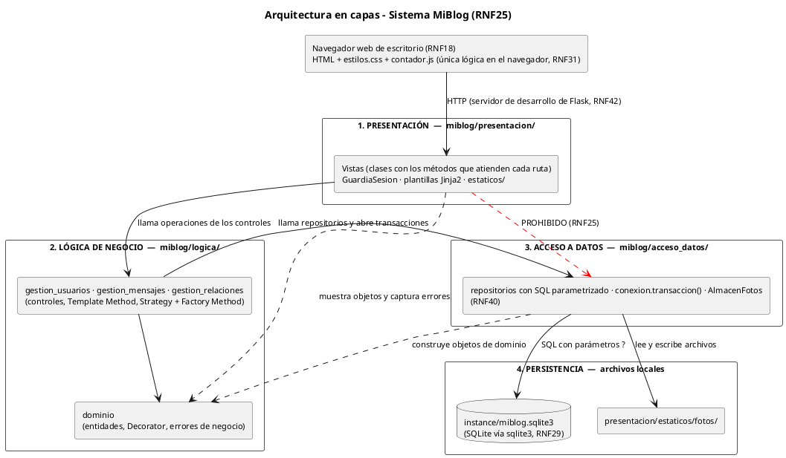
 
### 2.4 Estructura del código
 
Esta es la estructura de carpetas que se crea en la Etapa 4. Cada carpeta corresponde a una capa o a un paquete de análisis.
 
```
miblog/                          <- raíz del código (dentro de 4. Implementacion/codigo/)
├── miblog/
│   ├── __init__.py              crear_app(): raíz de composición (ver 2.5)
│   ├── presentacion/            CAPA 1 · paquete de análisis "Interfaz de Usuario"
│   │   ├── seguridad_web.py         GuardiaSesion
│   │   ├── vistas_usuarios.py       VistaRegistro, VistaInicioSesion, VistaConfirmacionCierreSesion
│   │   ├── vistas_mensajes.py       VistaTablon, DialogoEdicionMensaje, DialogoConfirmacionBorrado
│   │   ├── vistas_relaciones.py     VistaBusquedaUsuarios
│   │   ├── errores_web.py           archivo de registro y manejadores de error globales
│   │   ├── plantillas/              base, _marca, inicio_sesion, registro, registro_ok, tablon,
│   │   │                            dialogo_edicion, dialogo_borrado, busqueda,
│   │   │                            cerrar_sesion, error  (todas .html; _marca es una macro)
│   │   └── estaticos/               estilos.css, contador.js, fuentes/, fotos/ (fuera del repo)
│   ├── logica/                  CAPA 2
│   │   ├── gestion_usuarios/        control_registro.py, control_autenticacion.py
│   │   ├── gestion_mensajes/        control_publicacion.py, operaciones_mensaje.py,
│   │   │                            analizador.py, extractores.py,
│   │   │                            control_republicacion.py, control_tablon.py
│   │   ├── gestion_relaciones/      control_busqueda_usuarios.py, control_seguimiento.py
│   │   └── dominio/                 usuario.py, seguimiento.py, mensaje.py, republicacion.py,
│   │                                elementos.py, enumeraciones.py, errores.py
│   └── acceso_datos/            CAPA 3
│       ├── conexion.py              obtener_conexion, cerrar_conexion, transaccion, normalizar
│       ├── esquema.sql
│       ├── repositorio_usuarios.py  repositorio_sesiones.py  repositorio_seguimientos.py
│       ├── repositorio_mensajes.py  repositorio_republicaciones.py  repositorio_elementos.py
│       └── almacen_fotos.py
├── instance/                    CAPA 4 · fuera del repositorio: miblog.sqlite3, miblog.log
├── pruebas/
├── .env                         fuera del repositorio
├── .env.example                 plantilla del .env, sin valores secretos (sí va al repositorio)
├── .gitignore                   .env, instance/, presentacion/estaticos/fotos/, __pycache__/, venv/, .vscode/
├── requirements.txt             Flask, python-dotenv (H10)
├── sembrar_datos.py             herramienta de apoyo con datos de demostración (fuera de la aplicación)
└── README.md
```
 
**Dónde queda esta estructura en el repositorio.** El repositorio de git guarda las cinco etapas del Proceso Unificado, así que el árbol de arriba vive dentro de `4. Implementacion/codigo/`. Los comandos de Flask y las comprobaciones de §2.7 se corren desde esa carpeta, y las rutas `miblog/...` valen tal cual. `fuentes/` contiene las tipografías del diseño visual (Space Grotesk y Martian Mono, licencia SIL OFL 1.1) como archivos del proyecto, para no depender de ningún CDN.
 
Los nombres de los tres archivos de patrones (`analizador.py`, `extractores.py`, `operaciones_mensaje.py`) son los de ANALISIS §8.3 y ANALISIS §8.5, para que las comprobaciones de ANALISIS §8.8 se corran tal cual están escritas.
 
**Tres archivos que se sumaron al programar (DV-8).** `plantillas/_marca.html` es una macro de Jinja2 con la franja de marca (el símbolo `#`, «MiBlog» y el lema) que ocupa el lugar de la barra en las dos pantallas que se ven sin sesión, el inicio de sesión y el registro; la usan las dos y no hay otra copia. `.env.example` es la plantilla del `.env`: lista cada variable con su valor de ejemplo y no lleva ningún secreto. `sembrar_datos.py` llena la base con usuarios, seguimientos y mensajes de demostración para probar a mano; **no es parte de la aplicación ni de los diez casos de uso**, y por eso es el único archivo con SQL que está fuera de `acceso_datos/`: la comprobación 5 de §2.7 se corre sobre `miblog/`, donde sigue dando cero.
 
### 2.5 Raíz de composición y tabla de rutas
 
**La idea.** Si `AnalizadorDeTexto` no puede nombrar a `ExtractorEtiquetas` (condición 2 de ANALISIS §8.3), alguien tiene que crear los extractores y dárselos. Ese alguien es la función `crear_app()` de `miblog/__init__.py`. Es el **único módulo que conoce las cuatro capas**: crea los repositorios, se los da a los controles, les da los controles a las vistas y registra las rutas. No es una capa: es el arranque.
 
```python
# miblog/__init__.py — esquema, no código final
def crear_app():
    app = Flask(__name__, instance_relative_config=True,
                template_folder="presentacion/plantillas",
                static_folder="presentacion/estaticos")
    # ... configuración y logging (ver 2.6) ...
 
    repo_mensajes = RepositorioMensajes()
    repo_elementos = RepositorioElementos()
    # ... resto de los repositorios ...
 
    analizador = AnalizadorDeTexto([ExtractorEtiquetas(), ExtractorMenciones(), ExtractorEnlaces()])
    control_publicacion = ControlPublicacion(
        Publicacion(analizador, repo_mensajes, repo_elementos),
        Edicion(analizador, repo_mensajes, repo_elementos),
        repo_mensajes, repo_republicaciones, repo_elementos)
    # ... resto de los controles ...
 
    guardia = GuardiaSesion(control_autenticacion)
    vista_tablon = VistaTablon(control_tablon, control_publicacion, control_republicacion)
    app.add_url_rule("/tablon", "tablon", guardia.requiere_sesion(vista_tablon.mostrar))
    app.add_url_rule("/mensajes", "publicar_mensaje", methods=["POST"],
                     view_func=guardia.requiere_sesion(vista_tablon.publicar, conservar_borrador=True))
    # ... resto de las rutas, según la tabla de abajo ...
    return app
```
 
Los métodos de las vistas se registran directamente como funciones de ruta con `add_url_rule`. Es Flask estándar, sin extensiones.
 
| Método y ruta | Clase · método | CU | ¿Pasa por `GuardiaSesion`? | Endpoint |
|---|---|---|---|---|
| `GET /` | `VistaInicioSesion.mostrar` | CU0002 | No | `inicio_sesion` |
| `POST /sesion/iniciar` | `VistaInicioSesion.iniciar_sesion` | CU0002 | No | `iniciar_sesion` |
| `GET /registro` | `VistaRegistro.mostrar` | CU0001 | No | `registro` |
| `POST /registro` | `VistaRegistro.registrar` | CU0001 | No | `registrar` |
| `GET /sesion/cerrar` | `VistaConfirmacionCierreSesion.solicitar_confirmacion` | CU0003 | No (`ca 3.1`) | `solicitar_cierre_sesion` |
| `POST /sesion/cerrar` | `VistaConfirmacionCierreSesion.confirmar` | CU0003 | No (`ca 3.1`) | `confirmar_cierre_sesion` |
| `GET /tablon` | `VistaTablon.mostrar` | CU0009 | Sí | `tablon` |
| `POST /mensajes` | `VistaTablon.publicar` | CU0004 | Sí, con `conservar_borrador=True` (`ca 4.3`) | `publicar_mensaje` |
| `POST /mensajes/<int:id_mensaje>/republicar` | `VistaTablon.republicar` | CU0007 | Sí | `republicar_mensaje` |
| `GET /mensajes/<int:id_mensaje>/editar` | `DialogoEdicionMensaje.abrir` | CU0005 | Sí | `abrir_edicion` |
| `POST /mensajes/<int:id_mensaje>/editar` | `DialogoEdicionMensaje.confirmar` | CU0005 | Sí | `confirmar_edicion` |
| `GET /mensajes/<int:id_mensaje>/borrar` | `DialogoConfirmacionBorrado.solicitar_confirmacion` | CU0006 | Sí | `solicitar_borrado` |
| `POST /mensajes/<int:id_mensaje>/borrar` | `DialogoConfirmacionBorrado.confirmar` | CU0006 | Sí | `confirmar_borrado` |
| `GET /usuarios/buscar` | `VistaBusquedaUsuarios.buscar` | CU0014 | Sí | `buscar_usuarios` |
| `POST /usuarios/<int:id_seguido>/seguir` | `VistaBusquedaUsuarios.seguir` | CU0011 | Sí | `seguir_usuario` |
 
La última columna es el **endpoint**: el nombre con que `crear_app()` registra cada ruta en Flask. Se fijó al programar para que el esquema de arriba, el código y las pruebas la llamen igual; no cambia ninguna ruta ni ninguna clase.
 
**Regla de las peticiones.** Todo lo que **cambia** datos es `POST`; todo lo que solo **muestra** es `GET`. Después de un `POST` exitoso se responde con una redirección (patrón *Post/Redirect/Get*), para que recargar la página no publique dos veces el mismo mensaje.
 
**Un criterio que se repite en todos los controles.** Quien **hace** la operación llega como objeto `Usuario` (el de la sesión, `g.usuario`). Aquello **sobre lo que** se opera llega como id, porque viene en la URL. Por eso es `republicar(usuario, id_mensaje)` y `seguir(usuario, id_seguido)`.
 
### 2.6 Tabla de mecanismos de diseño
 
**La idea.** Un mecanismo de diseño es una solución **que se decide una vez y se usa en todos los casos de uso**, en lugar de resolverla de nuevo en cada uno. Por eso lo decide el Arquitecto al principio, antes de las secuencias.
 
#### Persistencia
 
| Qué resuelve | Implementación concreta | Dónde | Requisito |
|---|---|---|---|
| Dónde se guardan los datos | Un archivo SQLite en `instance/miblog.sqlite3`, fuera del repositorio. El esquema está en `acceso_datos/esquema.sql` y se crea con el comando `flask --app miblog iniciar-bd`, registrado con `app.cli.command`. | `acceso_datos/conexion.py` | RNF29 |
| Una conexión por petición | `obtener_conexion()` abre la conexión la primera vez que se pide en una petición y la guarda en `flask.g`. `cerrar_conexion()` la cierra al terminar, registrada con `app.teardown_appcontext`. | `conexion.py` | — |
| Configuración de cada conexión | `sqlite3.connect(ruta, isolation_level=None, timeout=5)` · `row_factory = sqlite3.Row` · `PRAGMA foreign_keys = ON` (SQLite lo trae apagado y hay que encenderlo **en cada conexión**) · `create_function("normalizar", 1, normalizar)` | `conexion.py` | RNF40, rnf 6.3, rnf 14.1 |
| Traducir filas a objetos | Un **repositorio** por entidad. Cada método recibe o devuelve objetos del dominio. Es la clase que en el proyecto de referencia se llamaba DAO. | `repositorio_*.py` | RNF25, RNF40 |
| Consultas seguras | Todos los valores van como parámetro `?`. **Nunca** `f"... {valor}"` ni `+` dentro de una sentencia SQL. Las búsquedas con `LIKE` escapan `%`, `_` y `\` del criterio y usan `ESCAPE '\'`. | repositorios | RNF40 |
| Búsqueda sin acentos ni mayúsculas | El `LIKE` de SQLite solo ignora mayúsculas en letras sin acento. Se registra en SQLite la función Python `normalizar()` (minúsculas con `casefold()` y acentos quitados con `unicodedata`), y se compara `normalizar(columna) LIKE ?` contra el criterio normalizado. | `conexion.py`, `RepositorioUsuarios.buscar_activos_por_criterio` | rnf 14.1 |
| Integridad en la base | **Unicidad** e **integridad referencial** se imponen en la base además de en la lógica: `UNIQUE`, `PRIMARY KEY`, `REFERENCES`, `CHECK`. Las **longitudes y formatos** (140, 15, 8) se validan **solo en la lógica**, para que cada límite tenga un único dueño. | `esquema.sql` | rnf 11.1, RNF03, RNF04 |
| Fechas | Texto ISO 8601 en UTC (`datetime.now(timezone.utc).isoformat()`). Ordenan bien como texto y se convierten a `datetime` al leer. **Solo para mostrarlas** se pasan a la hora local de la computadora, con el formato `dd/mm/aaaa hh:mm`, mediante el filtro de plantilla `fecha` (`formatear_fecha()`, registrado en `crear_app()`). La base nunca guarda hora local. | repositorios · `vistas_mensajes.py` | RNF05 |
| Fotos de perfil | `AlmacenFotos.guardar()` escribe el archivo con un nombre al azar (`uuid4`) en `presentacion/estaticos/fotos/`, fuera del repositorio. Flask lo sirve como archivo estático. `url_foto` guarda solo el nombre del archivo. | `almacen_fotos.py` | rnf 1.1 |
 
**Esquema de la base.**
 
```sql
CREATE TABLE usuarios (
  id_usuario       INTEGER PRIMARY KEY,
  nombre_usuario   TEXT NOT NULL UNIQUE COLLATE NOCASE,
  email            TEXT NOT NULL UNIQUE COLLATE NOCASE,
  clave_hash       TEXT NOT NULL,
  nombre_completo  TEXT NOT NULL,
  descripcion      TEXT,
  url_foto         TEXT,
  rol              TEXT NOT NULL DEFAULT 'EMPLEADO' CHECK (rol IN ('EMPLEADO', 'ADMINISTRADOR')),
  fecha_alta       TEXT NOT NULL,
  activo           INTEGER NOT NULL DEFAULT 1 CHECK (activo IN (0, 1))
);
 
-- Tabla técnica (H1). No tiene clase de dominio.
CREATE TABLE sesiones (
  hash_token        TEXT PRIMARY KEY,
  id_usuario        INTEGER NOT NULL REFERENCES usuarios (id_usuario),
  fecha_expiracion  TEXT NOT NULL
);
 
CREATE TABLE seguimientos (
  id_seguidor   INTEGER NOT NULL REFERENCES usuarios (id_usuario),
  id_seguido    INTEGER NOT NULL REFERENCES usuarios (id_usuario),
  fecha_inicio  TEXT NOT NULL,
  PRIMARY KEY (id_seguidor, id_seguido),          -- rnf 11.1
  CHECK (id_seguidor <> id_seguido)               -- DIA1 §4.2
);
 
CREATE TABLE mensajes (
  id_mensaje            INTEGER PRIMARY KEY,
  id_autor              INTEGER NOT NULL REFERENCES usuarios (id_usuario),   -- RNF05
  texto                 TEXT NOT NULL,
  fecha_publicacion     TEXT NOT NULL,                                       -- RNF05
  fecha_ultima_edicion  TEXT,
  editado               INTEGER NOT NULL DEFAULT 0 CHECK (editado IN (0, 1)),
  origen                TEXT NOT NULL CHECK (origen IN ('WEB', 'API')),       -- rnf 4.5
  CHECK ((editado = 0 AND fecha_ultima_edicion IS NULL)
      OR (editado = 1 AND fecha_ultima_edicion IS NOT NULL))               -- diagrama 7.1
);
 
CREATE TABLE republicaciones (
  id_republicacion     INTEGER PRIMARY KEY,
  id_usuario           INTEGER NOT NULL REFERENCES usuarios (id_usuario),
  id_mensaje           INTEGER NOT NULL REFERENCES mensajes (id_mensaje),     -- sin texto propio (C23)
  fecha_republicacion  TEXT NOT NULL,
  UNIQUE (id_usuario, id_mensaje)                                            -- ca 7.3
);
 
CREATE TABLE etiquetas (
  id_etiqueta  INTEGER PRIMARY KEY,
  nombre       TEXT NOT NULL UNIQUE
);
 
CREATE TABLE mensaje_etiqueta (
  id_mensaje   INTEGER NOT NULL REFERENCES mensajes (id_mensaje),
  id_etiqueta  INTEGER NOT NULL REFERENCES etiquetas (id_etiqueta),
  PRIMARY KEY (id_mensaje, id_etiqueta)
);
 
CREATE TABLE menciones (
  id_mencion             INTEGER PRIMARY KEY,
  id_mensaje             INTEGER NOT NULL REFERENCES mensajes (id_mensaje),
  id_usuario_mencionado  INTEGER NOT NULL REFERENCES usuarios (id_usuario),
  posicion_en_texto      INTEGER NOT NULL
);
 
CREATE TABLE enlaces (
  id_enlace   INTEGER PRIMARY KEY,
  id_mensaje  INTEGER NOT NULL REFERENCES mensajes (id_mensaje),
  url         TEXT NOT NULL
);
 
CREATE INDEX ix_mensajes_autor           ON mensajes (id_autor);
CREATE INDEX ix_republicaciones_usuario  ON republicaciones (id_usuario);
CREATE INDEX ix_seguimientos_seguido     ON seguimientos (id_seguido);
```
 
Tres cosas del esquema que conviene poder explicar:
 
1. **No hay `ON DELETE CASCADE`.** El borrado en cascada de CU0006 lo hace el código, en el orden de la colaboración 5.6. Las claves foráneas quedan como red de seguridad: si el código olvidara borrar las republicaciones, el `DELETE` del mensaje **fallaría** y la transacción entera volvería atrás.
2. **`mensajes` no tiene columna de tipo.** En esta versión solo existen mensajes públicos. Cuando se realice CU0008, se agrega `tipo` e `id_destinatario` y las consultas del tablón filtran por `tipo`. Hoy el `rnf 9.1` se cumple porque no hay ninguna fila privada que filtrar.
3. **`COLLATE NOCASE` en `nombre_usuario` y `email`.** "Abel" y "abel" no pueden coexistir, y el inicio de sesión no distingue mayúsculas. La especificación no lo decía; es la opción que evita que dos cuentas se vean iguales en pantalla.
#### Transacciones
 
| Qué resuelve | Implementación concreta | Requisito |
|---|---|---|
| Que una operación de varias escrituras se complete entera o no deje nada | Context manager `conexion.transaccion()`: ejecuta `BEGIN IMMEDIATE`, entrega el control, y al salir hace `COMMIT`; si salta cualquier excepción, `ROLLBACK` y la vuelve a lanzar. | RNF23, rnf 1.3, 4.4, 6.3 |
| Que dos peticiones simultáneas no pasen las dos la misma verificación | `BEGIN IMMEDIATE` toma el bloqueo de escritura **al empezar**, no en la primera escritura. Así, "verificar que no existe" y "crear" quedan dentro del mismo bloqueo. La restricción `UNIQUE` de la tabla es la segunda barrera. | ca 7.3, ca 11.3 |
| Quién abre la transacción | **Solo la capa de lógica**, y solo en la operación de entrada del caso de uso. Nunca se anidan. | RNF25 |
| Operaciones que abren transacción | `OperacionSobreMensaje.ejecutar()` (publicar y editar) · `ControlPublicacion.borrar()` · `ControlRegistro.registrar_usuario()` · `ControlRepublicacion.republicar()` · `ControlSeguimiento.seguir()` | — |
| Operaciones que **no** necesitan `transaccion()` | `ControlAutenticacion` al crear, borrar y limpiar filas de sesión, y todas las lecturas. Son **una sola sentencia**, y con `isolation_level=None` SQLite ejecuta cada sentencia suelta como una transacción propia: no hay nada a medio hacer que deshacer. | — |
| La foto y la fila del usuario, juntas | Un archivo no entra en una transacción de SQLite. Se usa **acción compensatoria**: primero se guarda el archivo; si después la inserción del usuario falla, `ControlRegistro` llama a `AlmacenFotos.eliminar()`. No queda ni la fila ni el archivo. | rnf 1.3 |
 
#### Seguridad
 
| Qué resuelve | Implementación concreta | Requisito |
|---|---|---|
| Claves guardadas de forma segura | `werkzeug.security.generate_password_hash()` al registrar y `check_password_hash()` al iniciar sesión. Werkzeug viene con Flask. La clave en texto plano nunca se guarda ni se escribe en el log. | RNF08, RNF41, rnf 1.2, 2.2 |
| No delatar qué nombres de usuario existen | Mensaje único "Usuario o clave incorrectos". Además, si el usuario no existe, `_verificar_clave()` compara igual contra un hash ficticio, para que la respuesta tarde lo mismo. | rnf 2.3 |
| Sesión invalidable en el servidor | Cookie firmada de Flask con **solo el token**; fila en `sesiones` con el hash SHA-256 del token y su vencimiento. Cerrar sesión borra la fila. Iniciar sesión hace `session.clear()` antes de guardar el token nuevo, para que nunca se reutilice una cookie anterior. Duración configurable (`DURACION_SESION_MINUTOS`). La validación exige además que la cuenta siga activa. Ver H1. | RNF09, rnf 3.1 |
| Limpieza de sesiones vencidas | **Al validar:** si el token no corresponde a una sesión vigente, `eliminar_si_vencida(hash_token, ahora)` borra su fila si venció. **Al iniciar sesión:** `eliminar_vencidas(ahora)` borra las vencidas de todos los usuarios, incluidas las abandonadas. Una sesión vencida nunca se acepta aunque su fila siga ahí: la limpieza es orden, no el control de seguridad. Sin planificador (RNF33 no se implementa) y sin escribir en la base en cada petición. | rnf 3.1 |
| Toda operación exige sesión | `GuardiaSesion.requiere_sesion(vista, conservar_borrador=False)` envuelve cada ruta protegida en la raíz de composición (tabla de 2.5). Si no hay sesión vigente redirige al inicio; si hay, deja el usuario en `g.usuario`. Solo la ruta de publicar pasa `conservar_borrador=True`: guarda el texto en la sesión antes de redirigir, y `VistaTablon.mostrar()` lo saca de ahí para volver a llenar el campo. Así el borrador de una edición nunca aparece en el campo de publicar. | RNF09, ca 4.3 |
| Solo el autor edita o borra | La lógica verifica en **cada** petición, con `Mensaje.verificar_autoria()`. Que la plantilla no muestre el botón no cuenta como control. | RNF10, rnf 5.1, 6.1 |
| Inyección SQL | SQL parametrizado, solo dentro de `acceso_datos`. | RNF40 |
| Inyección de HTML y scripts (XSS) | Flask activa el escape automático de Jinja2 en las plantillas `.html`: un mensaje con `<script>` se muestra como texto. **Ninguna plantilla usa el filtro `|safe`.** Los enlaces se muestran como texto, sin convertirlos en `<a>`. | RNF16 |
| Peticiones falsificadas desde otro sitio (CSRF) | `SESSION_COOKIE_SAMESITE = "Lax"` y `SESSION_COOKIE_HTTPONLY = True`: el navegador no envía la cookie en un `POST` que venga de otro sitio. No se agrega token CSRF: no está pedido y requeriría una extensión o código propio. `SESSION_COOKIE_SECURE` no se activa porque el servidor de desarrollo no usa HTTPS. | — |
| Secretos fuera del repositorio | `SECRET_KEY` y las rutas se leen de `.env` (con `python-dotenv`, H10). `.env`, `instance/` y la carpeta de fotos están en `.gitignore`. | RNF13 |
| Archivos subidos | Extensión en lista blanca (`png`, `jpg`, `jpeg`), verificación de la **firma** de los primeros bytes (un `.png` tiene que empezar como PNG), tamaño máximo configurable, y nombre de archivo generado por el sistema. `MAX_CONTENT_LENGTH` de Flask se fija un poco por encima, como tope duro. | ca 1.3 |
 
#### Manejo de errores y registro
 
**La idea.** Hay dos tipos de error y se tratan distinto. Los **esperados** son los cursos alternativos: el sistema sabe qué pasó y se lo dice al usuario. Los **inesperados** son fallas: se registran en el log y el usuario ve un mensaje genérico.
 
| Qué resuelve | Implementación concreta | Requisito |
|---|---|---|
| Cursos alternativos | Cada curso alternativo que rechaza una operación es una **excepción de negocio**, subclase de `ErrorDeNegocio`, con un `mensaje` en español. La lógica la lanza; la vista la captura, la muestra con `flash()` y vuelve a la pantalla que corresponde. | RNF16 |
| Errores inesperados | `app.register_error_handler(Exception, ...)` en `errores_web.py`: registra el error completo con `logging` y muestra `error.html` con un texto genérico («Algo salió mal», código 500). Un error de restricción `UNIQUE` que llegue hasta acá es un error de programación, no un curso alternativo. Del pedido se anotan **solo el método y la ruta**, nunca el contenido del formulario, que puede traer una clave. | RNF24 |
| Página inexistente | Manejador del `404` con `error.html` («Esa página no existe»). | RNF16 |
| Pedido demasiado grande | Manejador del `413` con `error.html` («Lo que enviaste pesa demasiado»). Salta cuando el pedido pasa de `MAX_CONTENT_LENGTH`, que es el tamaño máximo de la foto más 1 MB (fila «Archivos subidos»). | RNF16, ca 1.3 |
| Otros errores HTTP | Manejador de `HTTPException`: conserva el código que trae el error (un `405` sigue siendo `405` y no se convierte en un `500`) y muestra «No se pudo atender el pedido». No se anota en el log: no es una falla del sistema. | RNF16 |
| Log | `logging` de la biblioteca estándar, con `FileHandler` sobre `instance/miblog.log` y formato con fecha y hora (`dd/mm/aaaa hh:mm:ss`). Anota avisos y errores (nivel `WARNING`), no el funcionamiento normal, y el archivo se crea recién cuando hay algo que anotar (`delay=True`). Se puede cambiar con `ARCHIVO_DE_REGISTRO` en el `.env`: una ruta relativa se toma dentro de `instance/`, una absoluta se respeta. El manejador lleva nombre para no duplicarse si `crear_app()` se llama más de una vez en el mismo proceso (las pruebas lo hacen). | RNF24 |
 
**Las excepciones de negocio y el curso alternativo que representa cada una:**
 
| Excepción | Curso alternativo | Qué hace la vista |
|---|---|---|
| `DatosInvalidosError(errores_por_campo)` | `ca 1.1`, `ca 1.3`, `ca 2.2` | Vuelve a mostrar el formulario con el error debajo de cada campo |
| `UsuarioDuplicadoError(campos)` | `ca 1.2` | Formulario indicando cuál está en uso |
| `CredencialesInvalidasError` | `ca 2.1` | Formulario con el mensaje genérico |
| `TextoVacioError` | `ca 4.1`, `ca 5.3` | Tablón o diálogo con el aviso |
| `TextoExcedidoError(excedente)` | `ca 4.2`, `ca 5.3` | Tablón o diálogo con el límite y los caracteres de más; el texto vuelve completo |
| `MensajeInexistenteError` | `ca 5.1`, `ca 6.1`, `ca 7.4` | Redirige al tablón; en `ca 6.1` sin aviso |
| `NoEsAutorError` | `ca 5.2`, `ca 6.2` | Redirige al tablón con el aviso |
| `AutorNoSeguidoError` | `ca 7.1` | Redirige al tablón con el aviso |
| `MensajePropioError` | `ca 7.2` | Redirige al tablón con el aviso |
| `RepublicacionExistenteError` | `ca 7.3` | Redirige al tablón con el aviso |
| `UsuarioInexistenteError` | `ca 11.1` | Vuelve a la búsqueda con el aviso |
| `AutoSeguimientoError` | `ca 11.2` | Vuelve a la búsqueda con el aviso |
| `SeguimientoExistenteError` | `ca 11.3` | Vuelve a la búsqueda marcando "Siguiendo" |
| `CriterioVacioError` | `ca 14.1` | Búsqueda con el aviso |
 
Los cursos que **no** son excepción, porque no rechazan nada: `ca 1.4`, `ca 5.4` y `ca 6.3` (cancelar, que es un enlace), `ca 3.1` (sesión ya vencida al cerrar, que sigue sin error), `ca 4.3` (lo resuelve `GuardiaSesion`), `ca 9.1` y `ca 14.2` (una lista vacía).
 
**Regla para el código:** los mensajes que mencionan el límite de caracteres se arman con `OperacionSobreMensaje.LIMITE`, nunca escribiendo "140". Si no, la comprobación de ANALISIS §8.8 falla por un texto de error.
 
#### Mecanismos previstos y no implementados
 
El RNF32, el RNF33 y del RNF35 al RNF39 dicen que se verifican "por inspección del documento de arquitectura". Para que eso sea posible, tienen que estar escritos acá, aunque no se construyan.
 
| Mecanismo | Diseño previsto | Requisito | Caso de uso |
|---|---|---|---|
| Correo | `smtplib` de la biblioteca estándar contra un servidor SMTP externo. Credenciales en `.env`. Si falla un destinatario, se registra en el log y se sigue con el resto. | RNF32, RNF22 | CU0019 |
| Planificador | Una entrada de `crontab` que ejecuta un comando de Flask (`flask --app miblog enviar-resumen`) una vez por semana, en un proceso aparte del servidor web. | RNF33, RNF07, RNF21 | CU0019 |
| API REST (distribución) | Un *blueprint* de Flask en `/api/v1/`, que responde JSON con `jsonify` y los códigos de estado HTTP estándar, autenticado con una clave de aplicación enviada en una cabecera y guardada como hash. **Reutiliza `ControlPublicacion` y `AnalizadorDeTexto` sin cambios**: es la razón de que los controles no conozcan HTTP. | RNF35 a RNF39, RNF12 | CU0020, CU0021 |
 
**Ninguno de los tres aparece en el diagrama de clases**, porque no hay código que los ejercite. En el diagrama de despliegue aparecen **marcados como no desplegados**, que es lo que pide la sección 8.3 de los requisitos no funcionales.
 
### 2.7 Comprobaciones mecánicas
 
Las tres de ANALISIS §8.8 siguen valiendo. Agrego tres para las reglas de arquitectura, que también se corren sobre el repositorio en la pasada de coherencia:
 
| Comando | Resultado esperado | Qué detecta |
|---|---|---|
| `grep -rn "140" miblog/logica` | una sola aparición | Template Method degradado |
| `grep -rn "isinstance\|es_republicacion" miblog/logica miblog/presentacion` | cero | Decorator degradado |
| `grep -rn "Extractor[A-Z]" miblog/logica/gestion_mensajes/analizador.py` | cero | Strategy degradado |
| `grep -rn "acceso_datos\|sqlite3" miblog/presentacion` | **cero** | La presentación llega a la base (RNF25) |
| `grep -rn "execute(" miblog --include=*.py \| grep -v acceso_datos` | **cero** | SQL fuera del módulo de acceso a datos (RNF40) |
| `grep -rn "acceso_datos" miblog/logica/dominio` | **cero** | El dominio depende de la base: se rompió la inversión de dependencias (§5.5) |
 
---
 
## 3. Artefacto 2 — Diagrama de clases de diseño integral
 
### 3.1 La idea
 
Es **un solo diagrama** con todo lo que se va a programar: 47 clases, interfaces y enumeraciones, repartidas en los mismos paquetes que las carpetas del código. Los cuatro patrones **no tienen diagrama propio**: están adentro, marcados con un estereotipo que dice qué papel cumple cada clase en su patrón (por ejemplo, `<<Decorator: Decorador>>`).
 
La cátedra marcó "FALTA" dos veces al proyecto de referencia por entregar un diagrama por patrón. Por eso acá no hay ninguno aparte.
 
**Cómo leerlo sin perderse.** Va de izquierda a derecha, en el mismo orden que las capas:
 
| Paquete en el diagrama | Carpeta del código | Qué vas a encontrar |
|---|---|---|
| `presentacion` | `miblog/presentacion/` | Las 7 vistas del análisis, más `GuardiaSesion` |
| `logica.gestion_usuarios` | `miblog/logica/gestion_usuarios/` | Registro e inicio de sesión |
| `logica.gestion_mensajes` | `miblog/logica/gestion_mensajes/` | Publicar, editar, borrar, republicar, tablón. **Aquí están Template Method, Strategy y Factory Method** |
| `logica.gestion_relaciones` | `miblog/logica/gestion_relaciones/` | Buscar y seguir |
| `logica.dominio` | `miblog/logica/dominio/` | Las entidades. **Aquí está Decorator** |
| `acceso_datos` | `miblog/acceso_datos/` | Repositorios, conexión y fotos |
 
**Qué significa cada símbolo.**
 
| En el diagrama | Qué quiere decir | Cómo se escribe en Python |
|---|---|---|
| `+` | Público: lo puede usar cualquiera | `def publicar(self, ...)` |
| `-` | Privado: solo la propia clase | `def _validar_datos(self, ...)` (un guion bajo) |
| `#` | Protegido: la clase y sus subclases | `def _persistir_mensaje(self, ...)` (también un guion bajo) |
| `{abstract}` | La subclase está obligada a escribirlo | `@abstractmethod` de `abc` |
| `{static}` | Pertenece a la clase, no a cada objeto | constante de clase o `@staticmethod` |
| `{leaf}` | Ninguna subclase lo puede redefinir | Python no lo impide: se respeta por regla y se verifica en la pasada de coherencia (§8.8 del análisis) |
| `<<dataclass>>` | Objeto que solo lleva datos entre capas | `@dataclass` |
| flecha llena `-->` | Asociación: la clase guarda un atributo con el otro objeto | `self._repo_mensajes = repo_mensajes` |
| flecha punteada `..>` | Dependencia: lo usa un momento, sin guardarlo | un parámetro o una llamada |
 
> **Para la defensa: Python no tiene `private`.** El guion bajo es una convención que todos los programadores de Python respetan. El diagrama dice la intención, y el código la cumple con la convención. Si te preguntan por qué `-` y `#` se escriben igual, esa es la respuesta.
 
### 3.2 Diagrama
 
```plantuml
@startuml
title Diagrama de Clases de Diseño integral - Sistema MiBlog\n(Python 3 · Flask · Jinja2 · sqlite3 · Linux)
skinparam classAttributeIconSize 0
skinparam linetype ortho
skinparam packageStyle rectangle
skinparam shadowing false
skinparam defaultFontSize 11
hide empty members
left to right direction
 
' ======================================================================
package "presentacion  (capa de Presentación · Interfaz de Usuario)" as P {
  class GuardiaSesion {
    - _control_autenticacion : ControlAutenticacion
    + requiere_sesion(vista : Callable, conservar_borrador : bool = False) : Callable
  }
  class VistaRegistro {
    - _control_registro : ControlRegistro
    + mostrar() : Response
    + registrar() : Response
    - _leer_formulario() : DatosRegistro
    - _formulario_con_errores(datos : DatosRegistro, errores : dict[str, str]) : Response
  }
  class VistaInicioSesion {
    - _control_autenticacion : ControlAutenticacion
    + mostrar() : Response
    + iniciar_sesion() : Response
  }
  class VistaConfirmacionCierreSesion {
    - _control_autenticacion : ControlAutenticacion
    + solicitar_confirmacion() : Response
    + confirmar() : Response
  }
  class VistaTablon {
    - _control_tablon : ControlTablon
    - _control_publicacion : ControlPublicacion
    - _control_republicacion : ControlRepublicacion
    + mostrar() : Response
    + publicar() : Response
    + republicar(id_mensaje : int) : Response
    - _pagina(texto : str) : Response
  }
  class DialogoEdicionMensaje {
    - _control_publicacion : ControlPublicacion
    + abrir(id_mensaje : int) : Response
    + confirmar(id_mensaje : int) : Response
    - _pagina(id_mensaje : int, texto : str) : Response
  }
  class DialogoConfirmacionBorrado {
    - _control_publicacion : ControlPublicacion
    + solicitar_confirmacion(id_mensaje : int) : Response
    + confirmar(id_mensaje : int) : Response
  }
  class VistaBusquedaUsuarios {
    - _control_busqueda : ControlBusquedaUsuarios
    - _control_seguimiento : ControlSeguimiento
    + buscar() : Response
    + seguir(id_seguido : int) : Response
    - _volver_a_la_busqueda(criterio : str) : Response
  }
}
 
' ======================================================================
package "logica.gestion_usuarios  (capa de Lógica)" as GU {
  class DatosRegistro <<dataclass>> {
    + nombre_usuario : str
    + email : str
    + clave : str
    + confirmacion_clave : str
    + nombre_completo : str
    + descripcion : str | None
    + nombre_archivo_foto : str | None
    + contenido_foto : bytes | None
  }
  class ControlRegistro {
    + LIMITE_NOMBRE_USUARIO : int = 15 {static}
    + LONGITUD_MINIMA_CLAVE : int = 8 {static}
    - _FIRMAS_FOTO : dict[str, tuple[bytes, ...]] {static}
    - _PATRON_EMAIL : re.Pattern {static}
    - _PATRON_NOMBRE_USUARIO : re.Pattern {static}
    - _repo_usuarios : RepositorioUsuarios
    - _almacen_fotos : AlmacenFotos
    - _tamano_maximo_foto : int
    + registrar_usuario(datos : DatosRegistro) : Usuario
    - _validar_datos(datos : DatosRegistro) : None
    - _validar_foto(nombre_archivo : str, contenido : bytes | None) : str | None
    - _verificar_unicidad(nombre_usuario : str, email : str) : None
    - _cifrar_clave(clave : str) : str
  }
  class ControlAutenticacion {
    - _repo_usuarios : RepositorioUsuarios
    - _repo_sesiones : RepositorioSesiones
    - _duracion_sesion : timedelta
    - _hash_ficticio : str
    + autenticar(nombre_usuario : str, clave : str) : str
    + cerrar_sesion(token : str | None) : None
    + obtener_usuario_en_sesion(token : str | None) : Usuario | None
    - _validar_campos(nombre_usuario : str, clave : str) : None
    - _verificar_clave(usuario : Usuario | None, clave : str) : bool
    - _abrir_sesion(usuario : Usuario) : str
    - _invalidar_sesion(token : str) : int
  }
}
 
' ======================================================================
package "logica.gestion_mensajes  (capa de Lógica)" as GM {
  class ControlPublicacion {
    - _publicacion : Publicacion
    - _edicion : Edicion
    - _repo_mensajes : RepositorioMensajes
    - _repo_republicaciones : RepositorioRepublicaciones
    - _repo_elementos : RepositorioElementos
    + publicar(autor : Usuario, texto : str) : MensajePublico
    + verificar_autoria(id_mensaje : int, usuario : Usuario) : MensajePublico
    + editar(id_mensaje : int, usuario : Usuario, texto : str) : MensajePublico
    + borrar(id_mensaje : int, usuario : Usuario) : None
  }
  abstract class OperacionSobreMensaje <<Template Method: ClaseAbstracta>> {
    + LIMITE : int = 140 {static}
    # _analizador : AnalizadorDeTexto
    # _repo_mensajes : RepositorioMensajes
    # _repo_elementos : RepositorioElementos
    + ejecutar(usuario : Usuario, texto : str, **datos) : MensajePublico {leaf}
    # _autorizar(usuario : Usuario, **datos) : None
    # _validar_texto(texto : str) : str
    # {abstract} _persistir_mensaje(texto : str, usuario : Usuario, **datos) : MensajePublico
    # _reemplazar_elementos(mensaje : MensajePublico, elementos : list[ElementoExtraido]) : None
  }
  class Publicacion <<Template Method: ClaseConcreta>> {
    # _persistir_mensaje(texto : str, usuario : Usuario, **datos) : MensajePublico
  }
  class Edicion <<Template Method: ClaseConcreta>> {
    # _autorizar(usuario : Usuario, **datos) : None
    # _persistir_mensaje(texto : str, usuario : Usuario, **datos) : MensajePublico
    - _buscar_mensaje(id_mensaje : int) : MensajePublico
  }
  class AnalizadorDeTexto <<Strategy: Contexto>> {
    - _extractores : list[Extractor]
    + __init__(extractores : list[Extractor])
    + analizar(texto : str) : list[ElementoExtraido]
  }
  abstract class Extractor <<Strategy: Estrategia · Factory Method: Creador>> {
    + extraer(texto : str) : list[ElementoExtraido]
    + {abstract} patron() : str
    + {abstract} crear_elemento(coincidencia : re.Match) : ElementoExtraido
  }
  class ExtractorEtiquetas <<EstrategiaConcreta · CreadorConcreto>> {
    + patron() : str
    + crear_elemento(coincidencia : re.Match) : Etiqueta
  }
  class ExtractorMenciones <<EstrategiaConcreta · CreadorConcreto>> {
    + patron() : str
    + crear_elemento(coincidencia : re.Match) : Mencion
  }
  class ExtractorEnlaces <<EstrategiaConcreta · CreadorConcreto>> {
    + patron() : str
    + crear_elemento(coincidencia : re.Match) : Enlace
  }
  class ControlRepublicacion {
    - _repo_mensajes : RepositorioMensajes
    - _repo_seguimientos : RepositorioSeguimientos
    - _repo_republicaciones : RepositorioRepublicaciones
    + republicar(usuario : Usuario, id_mensaje : int) : int
    - _verificar_no_es_propio(usuario : Usuario, mensaje : MensajePublico) : None
    - _verificar_sigue_al_autor(usuario : Usuario, mensaje : MensajePublico) : None
    - _verificar_no_duplicada(usuario : Usuario, id_mensaje : int) : None
  }
  class ControlTablon {
    - _repo_mensajes : RepositorioMensajes
    - _repo_republicaciones : RepositorioRepublicaciones
    + obtener_tablon(usuario : Usuario) : list[ElementoDeTablon]
    - _ordenar_por_fecha(elementos : list[ElementoDeTablon]) : list[ElementoDeTablon]
  }
}
 
' ======================================================================
package "logica.gestion_relaciones  (capa de Lógica)" as GR {
  class ResultadoBusqueda <<dataclass>> {
    + id_usuario : int
    + nombre_usuario : str
    + nombre_completo : str
    + url_foto : str | None
    + lo_sigue : bool
  }
  class ControlBusquedaUsuarios {
    - _repo_usuarios : RepositorioUsuarios
    - _repo_seguimientos : RepositorioSeguimientos
    + buscar(criterio : str, usuario : Usuario) : list[ResultadoBusqueda]
    - _validar_criterio(criterio : str) : str
    - _marcar_seguidos(usuarios : list[Usuario], ids_seguidos : set[int]) : list[ResultadoBusqueda]
  }
  class ControlSeguimiento {
    - _repo_usuarios : RepositorioUsuarios
    - _repo_seguimientos : RepositorioSeguimientos
    + seguir(usuario : Usuario, id_seguido : int) : None
    - _verificar_no_es_el_mismo(usuario : Usuario, id_seguido : int) : None
    - _verificar_no_existe(usuario : Usuario, id_seguido : int) : None
  }
}
 
' ======================================================================
package "logica.dominio  (capa de Lógica · Entidades del Dominio)" as D {
  enum RolUsuario {
    EMPLEADO
    ADMINISTRADOR
  }
  enum OrigenPublicacion {
    WEB
    API
  }
  class Usuario <<entidad>> {
    + id_usuario : int | None
    + nombre_usuario : str
    + email : str | None
    + clave_hash : str | None
    + nombre_completo : str
    + descripcion : str | None
    + url_foto : str | None
    + rol : RolUsuario
    + fecha_alta : datetime
    + activo : bool
  }
  class Seguimiento <<entidad>> {
    + id_seguidor : int
    + id_seguido : int
    + fecha_inicio : datetime
  }
  interface ElementoDeTablon <<Decorator: Componente>> {
    + obtener_fecha_de_orden() : datetime
    + obtener_texto_vigente() : str
    + obtener_autor_original() : Usuario
    + obtener_id_mensaje() : int
    + esta_editado() : bool
    + obtener_fecha_ultima_edicion() : datetime | None
    + obtener_republicador() : Usuario | None
  }
  abstract class Mensaje <<entidad>> {
    + id_mensaje : int | None
    + autor : Usuario
    + texto : str
    + fecha_publicacion : datetime
    + fecha_ultima_edicion : datetime | None
    + editado : bool
    + origen : OrigenPublicacion
    + es_autor(id_usuario : int) : bool
    + verificar_autoria(id_usuario : int) : None
  }
  class MensajePublico <<entidad · Decorator: ComponenteConcreto>> {
    + {static} publicar(autor : Usuario, texto : str, fecha : datetime) : MensajePublico
    + editar(texto : str, fecha : datetime) : None
    + obtener_fecha_de_orden() : datetime
    + obtener_texto_vigente() : str
    + obtener_autor_original() : Usuario
    + obtener_id_mensaje() : int
    + esta_editado() : bool
    + obtener_fecha_ultima_edicion() : datetime | None
    + obtener_republicador() : None
  }
  class Republicacion <<entidad · Decorator: Decorador>> {
    + id_republicacion : int
    + republicador : Usuario
    + fecha_republicacion : datetime
    - _original : MensajePublico
    + obtener_fecha_de_orden() : datetime
    + obtener_texto_vigente() : str
    + obtener_autor_original() : Usuario
    + obtener_id_mensaje() : int
    + esta_editado() : bool
    + obtener_fecha_ultima_edicion() : datetime | None
    + obtener_republicador() : Usuario
  }
  abstract class ElementoExtraido <<Factory Method: Producto>> {
    + {abstract} guardar_en(registro : RegistroDeElementos, id_mensaje : int) : None
  }
  class Etiqueta <<entidad · ProductoConcreto>> {
    + id_etiqueta : int | None
    + nombre : str
    + guardar_en(registro : RegistroDeElementos, id_mensaje : int) : None
  }
  class Mencion <<entidad · ProductoConcreto>> {
    + nombre_usuario_mencionado : str
    + posicion_en_texto : int
    + guardar_en(registro : RegistroDeElementos, id_mensaje : int) : None
  }
  class Enlace <<entidad · ProductoConcreto>> {
    + url : str
    + guardar_en(registro : RegistroDeElementos, id_mensaje : int) : None
  }
  interface RegistroDeElementos {
    + registrar_etiqueta(id_mensaje : int, etiqueta : Etiqueta) : None
    + registrar_mencion(id_mensaje : int, mencion : Mencion) : bool
    + registrar_enlace(id_mensaje : int, enlace : Enlace) : None
    + eliminar_de_mensaje(id_mensaje : int) : None
  }
  class ErrorDeNegocio <<exception>> {
    + mensaje : str
  }
}
 
' ======================================================================
package "acceso_datos  (capa de Acceso a Datos · SQL parametrizado sobre sqlite3)" as AD {
  class conexion <<módulo>> {
    + {static} obtener_conexion() : sqlite3.Connection
    + {static} cerrar_conexion(error : Exception | None) : None
    + {static} transaccion() : ContextManager
    + {static} normalizar(texto : str) : str
    + {static} inicializar_base() : None
  }
  class RepositorioUsuarios {
    + existe_nombre_usuario(nombre_usuario : str) : bool
    + existe_email(email : str) : bool
    + crear(usuario : Usuario) : int
    + buscar_activo_por_nombre_usuario(nombre_usuario : str) : Usuario | None
    + buscar_activo_por_id(id_usuario : int) : Usuario | None
    + buscar_activos_por_criterio(criterio : str) : list[Usuario]
  }
  class RepositorioSesiones {
    + crear(hash_token : str, id_usuario : int, fecha_expiracion : datetime) : None
    + buscar_usuario_vigente(hash_token : str, ahora : datetime) : Usuario | None
    + eliminar(hash_token : str) : int
    + eliminar_si_vencida(hash_token : str, ahora : datetime) : int
    + eliminar_vencidas(ahora : datetime) : int
  }
  class RepositorioSeguimientos {
    + existe(id_seguidor : int, id_seguido : int) : bool
    + crear(seguimiento : Seguimiento) : None
    + buscar_ids_seguidos_de(id_usuario : int) : set[int]
  }
  class RepositorioMensajes {
    + crear(mensaje : MensajePublico) : int
    + buscar_por_id(id_mensaje : int) : MensajePublico | None
    + actualizar_texto(mensaje : MensajePublico) : int
    + eliminar(id_mensaje : int) : int
    + buscar_publicos_para_tablon(id_usuario : int) : list[MensajePublico]
  }
  class RepositorioRepublicaciones {
    + existe(id_usuario : int, id_mensaje : int) : bool
    + crear(id_usuario : int, id_mensaje : int, fecha : datetime) : int
    + eliminar_por_mensaje(id_mensaje : int) : int
    + buscar_para_tablon(id_usuario : int) : list[Republicacion]
    - _construir_republicacion(fila : sqlite3.Row) : Republicacion
  }
  class RepositorioElementos {
    + registrar_etiqueta(id_mensaje : int, etiqueta : Etiqueta) : None
    + registrar_mencion(id_mensaje : int, mencion : Mencion) : bool
    + registrar_enlace(id_mensaje : int, enlace : Enlace) : None
    + eliminar_de_mensaje(id_mensaje : int) : None
  }
  class AlmacenFotos {
    - _carpeta : Path
    + guardar(contenido : bytes, extension : str) : str
    + eliminar(nombre_archivo : str) : None
  }
}
 
' ================= PRESENTACION -> LOGICA =================
GuardiaSesion --> ControlAutenticacion
VistaRegistro --> ControlRegistro
VistaRegistro ..> DatosRegistro : <<crea>>
VistaInicioSesion --> ControlAutenticacion
VistaConfirmacionCierreSesion --> ControlAutenticacion
VistaTablon --> ControlTablon
VistaTablon --> ControlPublicacion
VistaTablon --> ControlRepublicacion
DialogoEdicionMensaje --> ControlPublicacion
DialogoConfirmacionBorrado --> ControlPublicacion
VistaBusquedaUsuarios --> ControlBusquedaUsuarios
VistaBusquedaUsuarios --> ControlSeguimiento
VistaTablon ..> ElementoDeTablon : <<muestra>>
VistaInicioSesion ..> VistaTablon : <<navega>>
VistaRegistro ..> VistaInicioSesion : <<navega>>
VistaConfirmacionCierreSesion ..> VistaInicioSesion : <<navega>>
VistaTablon ..> VistaBusquedaUsuarios : <<navega>>
VistaTablon ..> DialogoEdicionMensaje : <<navega>>
VistaTablon ..> DialogoConfirmacionBorrado : <<navega>>
VistaTablon ..> VistaConfirmacionCierreSesion : <<navega>>
 
' ================= TEMPLATE METHOD =================
ControlPublicacion --> Publicacion
ControlPublicacion --> Edicion
OperacionSobreMensaje <|-- Publicacion
OperacionSobreMensaje <|-- Edicion
OperacionSobreMensaje --> AnalizadorDeTexto
 
' ================= STRATEGY + FACTORY METHOD =================
AnalizadorDeTexto o--> "1..*" Extractor : _extractores
Extractor <|-- ExtractorEtiquetas
Extractor <|-- ExtractorMenciones
Extractor <|-- ExtractorEnlaces
Extractor ..> ElementoExtraido : <<crea>>
ExtractorEtiquetas ..> Etiqueta : <<crea>>
ExtractorMenciones ..> Mencion : <<crea>>
ExtractorEnlaces ..> Enlace : <<crea>>
ElementoExtraido <|-- Etiqueta
ElementoExtraido <|-- Mencion
ElementoExtraido <|-- Enlace
ElementoExtraido ..> RegistroDeElementos
RegistroDeElementos <|.. RepositorioElementos
 
' ================= DECORATOR =================
ElementoDeTablon <|.. MensajePublico
ElementoDeTablon <|.. Republicacion
Mensaje <|-- MensajePublico
Republicacion o--> "1" MensajePublico : _original
ControlTablon ..> ElementoDeTablon
 
' ================= LOGICA -> ACCESO A DATOS =================
ControlRegistro --> RepositorioUsuarios
ControlRegistro --> AlmacenFotos
ControlAutenticacion --> RepositorioUsuarios
ControlAutenticacion --> RepositorioSesiones
ControlPublicacion --> RepositorioMensajes
ControlPublicacion --> RepositorioRepublicaciones
ControlPublicacion --> RepositorioElementos
OperacionSobreMensaje --> RepositorioMensajes
OperacionSobreMensaje --> RepositorioElementos
ControlRepublicacion --> RepositorioMensajes
ControlRepublicacion --> RepositorioSeguimientos
ControlRepublicacion --> RepositorioRepublicaciones
ControlTablon --> RepositorioMensajes
ControlTablon --> RepositorioRepublicaciones
ControlBusquedaUsuarios --> RepositorioUsuarios
ControlBusquedaUsuarios --> RepositorioSeguimientos
ControlBusquedaUsuarios ..> ResultadoBusqueda : <<crea>>
ControlSeguimiento --> RepositorioUsuarios
ControlSeguimiento --> RepositorioSeguimientos
ControlSeguimiento ..> Seguimiento : <<crea>>
OperacionSobreMensaje ..> conexion : transaccion()
ControlPublicacion ..> conexion : transaccion()
ControlRegistro ..> conexion : transaccion()
ControlRepublicacion ..> conexion : transaccion()
ControlSeguimiento ..> conexion : transaccion()
RepositorioUsuarios ..> conexion
RepositorioSesiones ..> conexion
RepositorioSeguimientos ..> conexion
RepositorioMensajes ..> conexion
RepositorioRepublicaciones ..> conexion
RepositorioElementos ..> conexion
 
' ================= DOMINIO =================
Usuario "1" <-- "0..*" Mensaje : autor
Usuario ..> RolUsuario
Mensaje ..> OrigenPublicacion
Republicacion --> "1" Usuario : republicador
Seguimiento "0..*" ..> "2" Usuario : id_seguidor, id_seguido
Mensaje ..> ErrorDeNegocio : <<lanza>>
 
note "STRATEGY + FACTORY METHOD (rnf 4.3 · CU0004, CU0005)\nAnalizadorDeTexto recibe los extractores por constructor\ny NO nombra ninguna clase concreta.\nCada subclase decide en crear_elemento() qué producto instancia." as N1
N1 .. AnalizadorDeTexto
note "TEMPLATE METHOD (CU0004, CU0005)\nejecutar() fija el orden: _autorizar → _validar_texto →\nanalizar → _persistir_mensaje → _reemplazar_elementos.\nNinguna subclase lo redefine. LIMITE vive solo acá." as N2
N2 .. OperacionSobreMensaje
note "DECORATOR (C23 · RA07 · CU0007, CU0009)\nRepublicacion delega en _original el texto,\nel autor, el id y la marca de editado, y agrega\nrepublicador y fecha_republicacion.\nNo copia el texto. No se anida." as N3
N3 .. Republicacion
note "ELEMENTOS DE APOYO (no son clases · DV-4, DV-8)\nFunciones de módulo que este diagrama no dibuja:\nrepositorio_usuarios: construir_usuario, _escapar_like\nrepositorio_mensajes: construir_usuario_resumido, construir_mensaje,\n_fecha_a_texto, _fecha_desde_texto\nvistas_mensajes: formatear_fecha (filtro «fecha» de las plantillas)\nusuario y control_autenticacion: _ahora · control_autenticacion: _hash_de\nerrores_web: configurar_registro, registrar_manejadores_de_error\nconexion: BaseYaInicializadaError (excepción técnica de la base)\nLas 14 excepciones de negocio están en la tabla de §2.6." as N4
N4 .. conexion
@enduml
```
 
> **Para verlo.** Es muy ancho. En `plantuml.com` pedilo como **SVG**; la salida PNG del servidor recorta la imagen. Junto al documento va `clases.png` ya generado.
 
**Qué se agregó al diagrama al programar (DV-4 y DV-8), y qué no se dibuja.** Todas las clases, los atributos públicos y los métodos públicos son los de la versión 1.0; no se cambió ninguno. Se sumaron los miembros **privados de apoyo** que el código necesitó y que el diagrama no había previsto: las constantes `_FIRMAS_FOTO`, `_PATRON_EMAIL` y `_PATRON_NOMBRE_USUARIO` y el método `_validar_foto()` en `ControlRegistro`; `_hash_ficticio` en `ControlAutenticacion`; `_formulario_con_errores()`, `_pagina()`, `_volver_a_la_busqueda()`, `_buscar_mensaje()` y `_construir_republicacion()`. Las **funciones de módulo** (que no pertenecen a ninguna clase) van en la nota N4, y las **14 excepciones de negocio** siguen descritas en la tabla de §2.6 y no como clases. Por eso el conteo de 47 elementos no cambia. La comparación se hizo leyendo el código con un script (módulo `ast` de Python), no a ojo.
 
### 3.3 De dónde sale cada clase: correspondencia con el análisis
 
**La idea.** El PU exige que el diseño **derive** del análisis. Eso quiere decir que cada una de las 23 clases de análisis tiene que tener un "heredero" en el diseño, y que cada clase nueva del diseño tiene que tener un motivo escrito. Esta es la tabla que prueba las dos cosas.
 
#### Las 7 clases de interfaz
 
| Clase de análisis | Clases de diseño | Qué se agregó y por qué |
|---|---|---|
| `VistaRegistro` | `VistaRegistro` · `DatosRegistro` · plantillas `registro.html` y `registro_ok.html` | `DatosRegistro` junta los 7 campos en un solo objeto, para que el control no reciba 8 parámetros sueltos. |
| `VistaInicioSesion` | `VistaInicioSesion` · `inicio_sesion.html` | — |
| `VistaTablon` | `VistaTablon` · `tablon.html` · `contador.js` | `contador.js` es la única lógica en el navegador (RNF31, `rnf 4.1`). |
| `VistaBusquedaUsuarios` | `VistaBusquedaUsuarios` · `busqueda.html` | — |
| `VistaConfirmacionCierreSesion` | `VistaConfirmacionCierreSesion` · `cerrar_sesion.html` | — |
| `DialogoEdicionMensaje` | `DialogoEdicionMensaje` · `dialogo_edicion.html` | Es una página propia, no una ventana flotante (H9). |
| `DialogoConfirmacionBorrado` | `DialogoConfirmacionBorrado` · `dialogo_borrado.html` | Ídem (H9). |
 
#### Las 8 clases de control
 
| Clase de análisis | Clases de diseño | Qué se agregó y por qué |
|---|---|---|
| `ControlRegistro` | `ControlRegistro` | Las constantes `LIMITE_NOMBRE_USUARIO` y `LONGITUD_MINIMA_CLAVE`, para que cada límite tenga un solo dueño. |
| `ControlAutenticacion` | `ControlAutenticacion` · `GuardiaSesion` | `GuardiaSesion` pregunta "¿hay sesión?" antes de cada ruta protegida (RNF09). Está en presentación porque trabaja con la petición HTTP. |
| `ControlPublicacion` | `ControlPublicacion` · `OperacionSobreMensaje` · `Publicacion` · `Edicion` | **Template Method** (ANALISIS §8.5). El esqueleto de publicar y editar queda escrito una vez. |
| `ControlRepublicacion` | `ControlRepublicacion` | — |
| `ControlTablon` | `ControlTablon` | Ordena usando la interfaz `ElementoDeTablon` (ver Decorator). |
| `ControlSeguimiento` | `ControlSeguimiento` | — |
| `ControlBusquedaUsuarios` | `ControlBusquedaUsuarios` · `ResultadoBusqueda` | `ResultadoBusqueda` **no tiene campo `email`**: la vista no puede mostrar el correo aunque quiera (`rnf 14.2`). |
| `AnalizadorDeTexto` | `AnalizadorDeTexto` · `Extractor` · `ExtractorEtiquetas` · `ExtractorMenciones` · `ExtractorEnlaces` | **Strategy + Factory Method** (ANALISIS §8.3). Firma cambiada a `analizar(texto)` (H2). |
 
#### Las 8 clases de entidad
 
Cada entidad se convierte en **tres cosas**: la clase de dominio, el repositorio que la guarda y la lee, y la tabla.
 
| Clase de análisis | Clase de dominio | Repositorio | Tabla |
|---|---|---|---|
| `Usuario` | `Usuario` (+ enum `RolUsuario`) | `RepositorioUsuarios` | `usuarios` |
| `Seguimiento` | `Seguimiento` | `RepositorioSeguimientos` | `seguimientos` |
| `Mensaje` «abstract» | `Mensaje` (+ enum `OrigenPublicacion`) | — (es abstracta) | — |
| `MensajePublico` | `MensajePublico`, que además implementa `ElementoDeTablon` | `RepositorioMensajes` | `mensajes` |
| `Republicacion` | `Republicacion`, que además implementa `ElementoDeTablon` | `RepositorioRepublicaciones` | `republicaciones` |
| `Etiqueta` | `Etiqueta`, subclase de `ElementoExtraido` | `RepositorioElementos` | `etiquetas` y `mensaje_etiqueta` |
| `Mencion` | `Mencion`, subclase de `ElementoExtraido` | `RepositorioElementos` | `menciones` |
| `Enlace` | `Enlace`, subclase de `ElementoExtraido` | `RepositorioElementos` | `enlaces` |
 
**Un solo repositorio para los tres elementos extraídos**, y no tres. Los tres se guardan y se borran siempre juntos, en el mismo momento y por el mismo mensaje. Tres repositorios obligarían a `_reemplazar_elementos()` a conocer los tres.
 
#### Clases que no vienen de ninguna clase de análisis
 
Ninguna aparece "porque sí". Cada una sale de un patrón ya decidido, de un mecanismo de §2.6 o de un hallazgo de §1.
 
| Clase de diseño | Motivo | Origen |
|---|---|---|
| `ElementoDeTablon` | Interfaz común del tablón | Decorator, ANALISIS §8.4 |
| `ElementoExtraido` | Producto abstracto de los extractores | Factory Method, ANALISIS §8.3 |
| `RegistroDeElementos` | Deja que `Etiqueta` se guarde **sin que el dominio importe `acceso_datos`** | H2 |
| `ErrorDeNegocio` y sus 14 subclases | Un curso alternativo = una excepción. En el diagrama se dibuja solo la clase base; las 14 subclases están en la tabla de §2.6, para no repetirlas | Mecanismo de errores, §2.6 |
| `conexion` | Conexión por petición y `transaccion()` | Mecanismos de persistencia y transacciones, §2.6 |
| `RepositorioSesiones` | Sesión que se puede invalidar en el servidor | H1, `rnf 3.1` |
| `AlmacenFotos` | Guardar y borrar el archivo de la foto | `rnf 1.1`, `rnf 1.3` |
 
**Clases que estaban en el análisis y desaparecen: ninguna.** Las 23 tienen heredero.
 
### 3.4 Dónde está cada patrón dentro del diagrama
 
#### Template Method — `OperacionSobreMensaje`
 
| Papel del patrón | Clase del diagrama | Qué hace |
|---|---|---|
| Clase abstracta | `OperacionSobreMensaje` | `ejecutar()` fija el orden: `_autorizar` → `_validar_texto` → `analizar` → `_persistir_mensaje` → `_reemplazar_elementos`. Está marcado `{leaf}`. |
| Clase concreta 1 | `Publicacion` | Solo escribe `_persistir_mensaje()`: **crea** el mensaje. |
| Clase concreta 2 | `Edicion` | Escribe `_autorizar()` (verifica autoría) y `_persistir_mensaje()`: **actualiza** el mensaje. |
 
**Dónde mirar:** `LIMITE = 140` aparece una sola vez en todo el diagrama, en `OperacionSobreMensaje`. `ControlPublicacion` recibe una `Publicacion` y una `Edicion` ya creadas, así que `publicar()` y `editar()` quedan en una línea cada uno, como pide ANALISIS §8.5.
 
**Un agregado respecto del análisis:** `ejecutar()` abre `conexion.transaccion()` al principio. Así, si falla cualquier paso, se deshace todo, y nadie puede olvidarse de abrir la transacción, porque está escrita en el esqueleto.
 
#### Strategy — `AnalizadorDeTexto` y la familia `Extractor`
 
| Papel del patrón | Clase del diagrama |
|---|---|
| Contexto | `AnalizadorDeTexto` (recibe `list[Extractor]` en `__init__`) |
| Estrategia | `Extractor` (abstracta) |
| Estrategias concretas | `ExtractorEtiquetas`, `ExtractorMenciones`, `ExtractorEnlaces` |
 
**Dónde mirar:** entre `AnalizadorDeTexto` y las tres concretas **no hay ninguna flecha**. La única flecha va a `Extractor`. Eso es la condición 2 de ANALISIS §8.3 dibujada.
 
#### Factory Method — dentro de la misma familia
 
| Papel del patrón | Clase del diagrama |
|---|---|
| Creador | `Extractor`, con `crear_elemento()` abstracto |
| Creadores concretos | los tres extractores |
| Producto | `ElementoExtraido` (abstracta) |
| Productos concretos | `Etiqueta`, `Mencion`, `Enlace` |
 
**Dónde mirar:** las tres flechas `<<crea>>`, cada una desde un extractor a su producto. `ExtractorEtiquetas.crear_elemento()` devuelve `Etiqueta`, no `ElementoExtraido`: Python permite que la subclase sea más precisa en lo que devuelve.
 
**Qué cambió respecto de ANALISIS §8.3 (H2).** En el análisis, `ExtractorEtiquetas` "obtenía o creaba" la etiqueta, y para eso tenía que consultar la base. En el diseño, el extractor **siempre crea un objeto** en memoria, y el "si ya existe, usar la que está" lo resuelve la base con `INSERT OR IGNORE`, cuando `Etiqueta.guardar_en()` llama a `registrar_etiqueta()`. El patrón queda igual y los extractores se pueden probar sin base de datos.
 
#### Decorator — `Republicacion`
 
| Papel del patrón | Clase del diagrama |
|---|---|
| Componente | `ElementoDeTablon` (interfaz) |
| Componente concreto | `MensajePublico` |
| Decorador | `Republicacion` |
 
**Dónde mirar:** `Republicacion` tiene el atributo `_original : MensajePublico` y **no tiene atributo `texto`**. Implementa los mismos siete métodos que `MensajePublico`: cinco los delega en `_original` y dos los responde con datos propios (`obtener_fecha_de_orden()` y `obtener_republicador()`).
 
**La salvedad escrita, para tenerla lista.** En el Decorator de libro, el decorador guarda una referencia al **Componente** (la interfaz), para poder envolver a otro decorador. Acá `_original` es de tipo **`MensajePublico`**, a propósito: una republicación no se puede republicar, y el tipo del atributo lo impide. Es la misma salvedad que ANALISIS §8.4 dejó anotada ("no se anida"), ahora visible en el diagrama.
 
### 3.5 Lo que podría salir mal con este diagrama
 
| Riesgo | Por qué puede pasar | Qué lo evita |
|---|---|---|
| El código usa otros nombres que el diagrama | Programando con apuro se renombra algo "más cómodo" | Los nombres del diagrama son los de la tabla de rutas y las secuencias. Si en la Etapa 4 cambia uno, se cambia **en el diagrama el mismo día**. |
| Un patrón queda dibujado y no programado | Template Method y Strategy son los que más fácil se degradan (ANALISIS §8.7) | Las 6 comprobaciones de §2.7. Si falla una y no hay tiempo, **se saca el patrón del diagrama**. |
| La plantilla usa `isinstance` para mostrar "republicado por" | Parece lo más directo | `obtener_republicador()` devuelve `None` en `MensajePublico`: la plantilla pregunta ``, que no pregunta por el tipo. |
| Te preguntan por qué hay 47 clases si el análisis tenía 23 | Parece que el diseño "infló" el modelo | La tabla 3.3: cada clase nueva tiene su motivo y su origen. El diseño **siempre** tiene más clases que el análisis; es una de las diferencias de la tabla de §8.3 de este documento. |
 
## 4. Artefacto 3 — Diagrama de despliegue
 
### 4.1 La idea
 
El diagrama de despliegue contesta **en qué máquinas corre el sistema y qué pieza va en cada una**. Lo produce el Arquitecto.
 
En MiBlog la respuesta es corta: **todo corre en una sola PC con Linux**. El navegador, el servidor de Flask y la base SQLite están en la misma máquina, y se hablan por `127.0.0.1`. Así lo piden el RNF34 (Linux) y el RNF42 (servidor de desarrollo de Flask, en ambiente local, sin servidor de producción).
 
Un diagrama de un solo nodo puede parecer pobre, pero **inventar un segundo servidor sería diseñar algo que los requisitos prohíben**. Lo que sí vale la pena dibujar es lo que el sistema **va a necesitar** cuando se realicen los casos de uso que faltan: por eso aparecen tres nodos en gris, marcados como no desplegados.
 
### 4.2 Diagrama
 
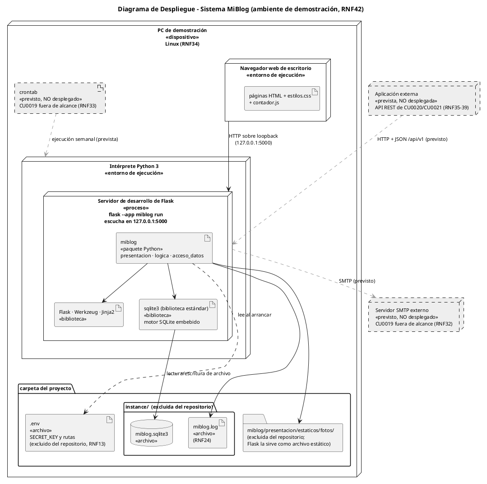
 
### 4.3 Qué hay en cada nodo
 
| Nodo o artefacto | Qué es | Requisito | ¿Desplegado? |
|---|---|---|---|
| **PC de demostración** | Dispositivo físico con Linux | RNF34 | Sí |
| Navegador web de escritorio | Entorno donde se ven las páginas y corre `contador.js` | RNF18, RNF31 | Sí |
| Intérprete Python 3 | Entorno de ejecución de todo el código | RNF30 | Sí |
| Servidor de desarrollo de Flask | Proceso que atiende las peticiones. Se arranca con `flask --app miblog run` | RNF42 | Sí |
| Paquete `miblog` | El código de las tres capas | RNF25 | Sí |
| `sqlite3` | Viene con Python; el motor SQLite está **adentro** de la biblioteca, no es un servidor aparte | RNF29 | Sí |
| `miblog.sqlite3` | El archivo de la base, en `instance/` | RNF29 | Sí |
| `miblog.log` | Registro de errores | RNF24 | Sí |
| `.env` | `SECRET_KEY` y rutas. **No se sube al repositorio** | RNF13 | Sí |
| Carpeta de fotos | Archivos subidos en el registro. No se sube al repositorio | `rnf 1.1` | Sí |
| `crontab` | Planificador del envío semanal | RNF33 · CU0019 | **No** |
| Servidor SMTP externo | Salida de correo | RNF32 · CU0019 | **No** |
| Aplicación externa | Cliente de la API REST | RNF35 a RNF39 · CU0020, CU0021 | **No** |
 
### 4.4 Tres cosas que conviene poder explicar
 
1. **SQLite no es un nodo.** No hay "servidor de base de datos" porque SQLite no es un servidor: es una biblioteca que lee y escribe un archivo. Por eso aparece como **artefacto dentro del proceso de Flask**, y el archivo de la base como artefacto en la carpeta del proyecto.
2. **`127.0.0.1` es a propósito.** El servidor de desarrollo de Flask no es seguro para exponerse en una red. Escuchar solo en la propia máquina es la configuración por defecto y la que corresponde al RNF42.
3. **Por qué se dibujan nodos que no existen.** El RNF32, el RNF33 y del RNF35 al RNF39 se verifican "por inspección del documento de arquitectura". Si no estuvieran dibujados, no habría nada que inspeccionar. Están en gris y con `<<previsto, NO desplegado>>` para que nadie los confunda con lo que se entrega.
---
 
## 5. Artefacto 4 — Diagrama de subsistemas en capas
 
### 5.1 La idea
 
Un **subsistema de diseño** es un grupo de clases que se puede tratar como una sola pieza: tiene **interfaces** (lo que ofrece a los demás) y **esconde** cómo lo hace por dentro. Lo produce el Ingeniero de Componentes.
 
La teoría del PU ordena los subsistemas en **cuatro capas**, de lo más particular a lo más general:
 
| Capa | Qué va | En MiBlog |
|---|---|---|
| **Específica de la aplicación** | Lo que solo tiene sentido para este sistema | Interfaz de Usuario, Gestión de Usuarios, Gestión de Mensajes, Gestión de Relaciones |
| **General de la aplicación** | Lo que otra aplicación de la empresa podría reutilizar | Entidades del Dominio, Acceso a Datos |
| **Intermedia** (*middleware*) | Software de terceros sobre el que se construye | Flask, Jinja2, intérprete Python |
| **Software del sistema** | Lo que ya trae la máquina | Linux, motor SQLite, TCP/IP |
 
**Ojo con una confusión que es fácil de tener en la defensa.** Estas cuatro capas **no son** las cuatro capas de la arquitectura de §2 (presentación, lógica, acceso a datos, persistencia). Las de §2 dicen **quién llama a quién dentro del código**. Las de acá dicen **cuán reutilizable es cada pieza**. Por eso Interfaz de Usuario y Gestión de Mensajes están en la misma capa acá, y en capas distintas en §2.
 
**Este artefacto se puede dibujar de dos formas, y las dos son correctas.** La §5.2 explica cuál es cuál y cuál se entrega.
 
### 5.2 Los dos formatos, y cuál se entrega
 
| | **5.2.1 Paquetes anidados por capa** | **5.2.2 Las cuatro capas del PU** |
|---|---|---|
| Agrupa por | Capa de ejecución, con la tecnología adentro de cada una | Grado de reutilización: de lo propio de MiBlog a lo que trae la máquina |
| Qué muestra de más | El metasistema, el protocolo, el navegador, y cada vista con el caso de uso que atiende | Las **interfaces** que ofrece cada subsistema y la relación *realiza* |
| De dónde sale | Es el formato que circula entre los proyectos de la cátedra | Es el de la teoría (`Ingeniería_de_Software.pdf`, capas específica / general / intermedia / software del sistema) y el que usó el proyecto de referencia ya aprobado |
 
**El que se entrega es el de 5.2.1.** El de 5.2.2 queda como **vista complementaria**: no se tira, porque es el que responde directamente si en la defensa preguntan por las cuatro capas que nombra la teoría.
 
**Cómo se corresponden los dos.** No se contradicen: agrupan las mismas piezas con criterios distintos.
 
| Pieza | Capa en 5.2.1 | Capa en 5.2.2 |
|---|---|---|
| Interfaz de Usuario | Presentación | Específica de la aplicación |
| Gestión de Usuarios, de Mensajes y de Relaciones | Aplicación | Específica de la aplicación |
| Entidades del Dominio | Aplicación | General de la aplicación |
| Acceso a Datos | Aplicación | General de la aplicación |
| Flask, Jinja2, Werkzeug, intérprete Python | Dibujados adentro del subsistema que los usa | Capa intermedia, como subsistemas propios |
| SQLite, Linux, TCP/IP | Subsistema BD y el marco exterior | Capa de software del sistema |
 
### 5.2.1 Diagrama que se entrega — paquetes anidados por capa
 
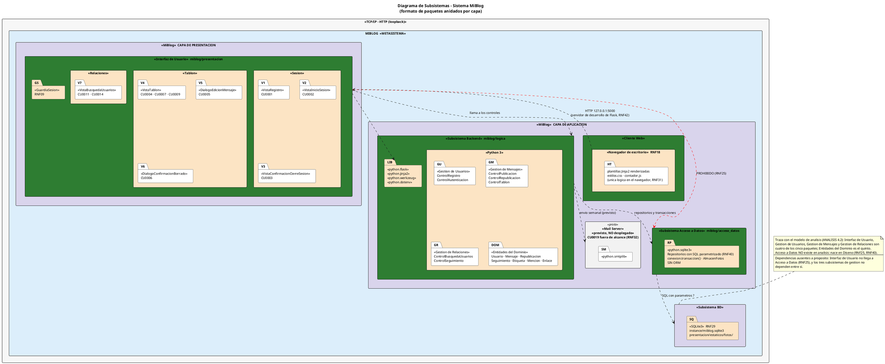
 
**Cómo leerlo.**
 
| Elemento | Qué quiere decir |
|---|---|
| El marco exterior `<<TCP/IP - HTTP>>` | El protocolo sobre el que se habla todo. Acá, por *loopback*: nada sale de la máquina |
| `MIBLOG <<METASISTEMA>>` | El sistema completo, con todo lo que lo rodea |
| Cajas verdes | Subsistemas de MiBlog |
| Cajas naranjas | Lo que hay adentro de cada subsistema: paquetes de código o bibliotecas |
| Caja gris de `Mail Server` | Previsto y **no** desplegado: CU0019 está fuera de alcance (RNF32) |
| Flecha roja | La dependencia **prohibida** por el RNF25 |
 
**Tres cosas que este diagrama dice y conviene poder defender:**
 
1. **No hay subsistema de frontend.** Las plantillas Jinja2 se arman en el servidor (RNF31); el navegador recibe HTML ya hecho. Lo único que corre en el navegador es `contador.js`.
2. **No hay servidor de aplicaciones.** El RNF42 fija el servidor de desarrollo de Flask. Por eso no aparece ningún uWSGI, Gunicorn ni Nginx.
3. **No hay ORM.** El Subsistema de Acceso a Datos usa `sqlite3` con SQL parametrizado (RNF40), y dice `SIN ORM` en el propio dibujo, para que no quede duda.
### 5.2.2 Vista complementaria — las cuatro capas del Proceso Unificado
 
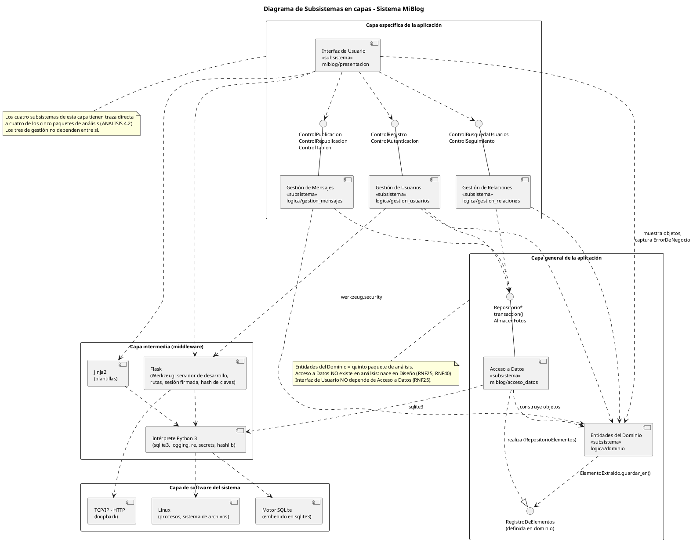
 
**Qué aporta esta vista que la otra no.** Las **interfaces** (los círculos): qué ofrece cada subsistema hacia afuera y qué queda escondido adentro. Y la relación **realiza**, de Acceso a Datos hacia `RegistroDeElementos`, que es la que demuestra que no hay ciclo (§5.5).
 
### 5.3 Traza con los cinco paquetes de análisis
 
| Paquete de análisis (ANALISIS §4.2) | Subsistema de diseño | Capa | Interfaz que ofrece |
|---|---|---|---|
| Interfaz de Usuario | Interfaz de Usuario (`miblog/presentacion`) | Específica | Ninguna: la usa el navegador por HTTP |
| Gestión de Usuarios | Gestión de Usuarios (`logica/gestion_usuarios`) | Específica | `ControlRegistro`, `ControlAutenticacion` |
| Gestión de Mensajes | Gestión de Mensajes (`logica/gestion_mensajes`) | Específica | `ControlPublicacion`, `ControlRepublicacion`, `ControlTablon` |
| Gestión de Relaciones | Gestión de Relaciones (`logica/gestion_relaciones`) | Específica | `ControlBusquedaUsuarios`, `ControlSeguimiento` |
| Entidades del Dominio | Entidades del Dominio (`logica/dominio`) | General | Las entidades y `RegistroDeElementos` |
| — (no existe en análisis) | **Acceso a Datos** (`miblog/acceso_datos`) | General | Los repositorios, `transaccion()`, `AlmacenFotos` |
 
**Los cinco paquetes tienen subsistema, con el mismo nombre.** Se agrega uno solo, Acceso a Datos, que el análisis dejó pendiente a propósito (ANALISIS §4.5, última fila) y que exigen el RNF25 y el RNF40.
 
**Lo que queda escondido dentro de cada subsistema.** Por ejemplo, `OperacionSobreMensaje`, `Publicacion`, `Edicion`, `AnalizadorDeTexto` y los extractores **no son interfaz** de Gestión de Mensajes: ninguna vista los llama. Si mañana se saca Template Method, Interfaz de Usuario no se entera.
 
### 5.4 Las dependencias, comparadas con el análisis
 
| Dependencia | ¿Estaba en análisis? | Qué la fundamenta en diseño |
|---|---|---|
| Interfaz de Usuario → los tres de gestión | Sí | Las vistas llaman a los controles (tabla de rutas, §2.5) |
| Los tres de gestión → Entidades del Dominio | Sí | Los controles crean y usan entidades |
| Los tres de gestión → Acceso a Datos | **Nueva** | Los controles piden y guardan datos mediante repositorios |
| Interfaz de Usuario → Entidades del Dominio | **Nueva** | La plantilla del tablón llama a `obtener_texto_vigente()` y la vista captura `ErrorDeNegocio` (H11) |
| Acceso a Datos → Entidades del Dominio | **Nueva** | Los repositorios construyen objetos de dominio a partir de filas |
| Acceso a Datos **realiza** `RegistroDeElementos` | **Nueva** | `RepositorioElementos` implementa la interfaz que declaró el dominio (H2) |
| **Interfaz de Usuario → Acceso a Datos** | — | **No existe y no puede existir** (RNF25). Lo verifica la cuarta comprobación de §2.7 |
| Entre los tres de gestión | No (se eliminó en la 2.0) | Sigue sin existir |
 
### 5.5 Por qué no hay un ciclo entre Dominio y Acceso a Datos
 
**La pregunta que te pueden hacer:** "Acceso a Datos depende de Dominio, porque construye entidades. Y `Etiqueta.guardar_en()` necesita guardar en la base. ¿Entonces Dominio también depende de Acceso a Datos? Eso es un ciclo."
 
**La respuesta: no, y el diagrama lo muestra.** `Etiqueta` no conoce a `RepositorioElementos`. Conoce a la interfaz `RegistroDeElementos`, que **está definida dentro del propio dominio**. Acceso a Datos la **implementa**. Las dos flechas apuntan hacia el dominio:
 
```
Acceso a Datos  ──construye──▶  Entidades del Dominio
Acceso a Datos  ──realiza────▶  RegistroDeElementos (que vive en Dominio)
```
 
Esto se llama **inversión de dependencias**: en lugar de que el dominio dependa de la base, la base se adapta a lo que el dominio pide. Así se cumple lo que dijo ANALISIS §4.5: **el dominio no depende de nadie**.
 
La comprobación mecánica es `grep -rn "acceso_datos" miblog/logica/dominio`, que tiene que dar **cero**. Es la sexta comprobación de §2.7.
 
## 6. Artefacto 5 — Diagramas de secuencia de los diez casos de uso
 
### 6.0 Cómo leerlos
 
**La idea.** En Análisis cada caso de uso tenía un **diagrama de colaboración**: mostraba **quién habla con quién**, con mensajes numerados. En Diseño pasa a ser un **diagrama de secuencia**: muestra lo mismo, pero **en el orden del tiempo, de arriba hacia abajo**, y con los nombres reales de los métodos. Es el mismo contenido que se puede dibujar de las dos formas; el de secuencia se lee mejor cuando hay condiciones.
 
**Qué significa cada elemento.**
 
| Elemento | Qué quiere decir |
|---|---|
| `«GET /tablon»` debajo de un mensaje | La ruta HTTP que dispara ese método (tabla de §2.5) |
| `alt ca 5.2 — ...` | Fragmento **alternativo**: se ejecuta **una sola** de sus ramas. Cada rama con nombre `ca` es un curso alternativo de la especificación |
| `opt` | Fragmento **opcional**: se ejecuta o no (por ejemplo, si se adjuntó foto) |
| `loop` | Se repite por cada elemento |
| `ref over` | "Esto es igual a lo que ya se dibujó en otro diagrama". Evita copiar la misma interacción dos veces |
| flecha punteada hacia atrás | Respuesta. Si dice `raise`, es una excepción de negocio |
| `ROLLBACK` / `COMMIT` | Salida de `conexion.transaccion()` |
 
**Tres convenciones para no repetir en cada diagrama:**
 
1. **`GuardiaSesion` se dibuja completo una sola vez**, en CU0004, que es donde tiene un curso alternativo (`ca 4.3`). En los demás casos de uso protegidos se da por hecho: la vista ya recibe `g.usuario` cargado. La columna "¿Pasa por `GuardiaSesion`?" de la tabla de rutas dice cuáles son.
2. **La extracción de elementos se dibuja completa una sola vez**, en CU0004. CU0005 la referencia con `ref over`.
3. **Las plantillas no son participantes.** Aparecen como texto en la respuesta (`tablon.html`), porque no tienen métodos propios.
**Qué pide la restricción de esta etapa, y cómo se cumple.** Cada curso alternativo **ya especificado** tiene su rama `alt`, con su número. Donde la especificación tenía un hueco, el diagrama **no lo inventó**: lo señaló con una nota y remitió al hallazgo. En la versión 1.1 esos huecos ya están corregidos en `ESPECIFICACIONES_CASOS_DE_USO_MiBlog.md` 1.2: el `ca 7.4` tiene su rama `alt` (H6), y las notas que quedan remiten a la observación de la especificación, no a un hueco (H3, H4).
 
---
 
### 6.1 CU0001 — Registrar Usuario
 
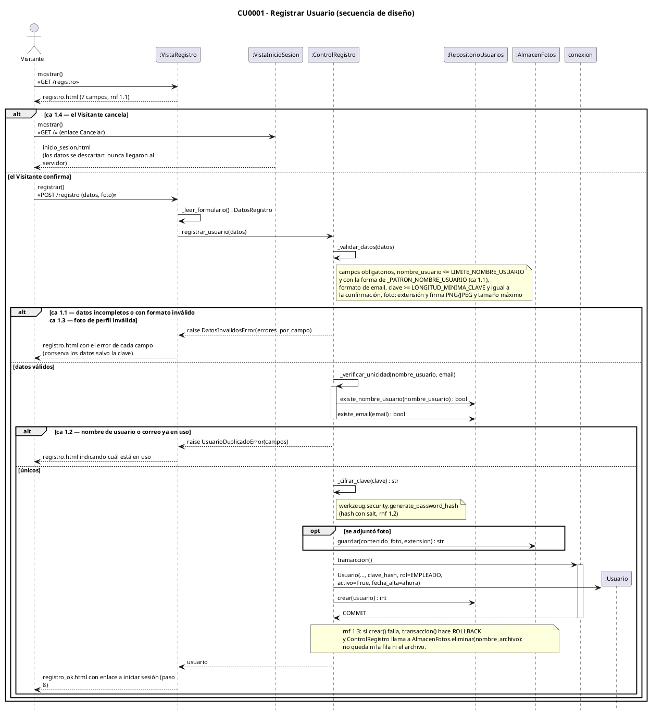
 
| Paso del CU | Mensajes del diagrama |
|---|---|
| 1-2 Selecciona "Registrarse" y ve el formulario | `mostrar()` sobre `VistaRegistro` |
| 3 Completa y confirma | `registrar()` → `_leer_formulario()` → `registrar_usuario(datos)` |
| 4 Valida campos y formato | `_validar_datos(datos)` |
| 5 Verifica unicidad | `_verificar_unicidad()` → `existe_nombre_usuario()` y `existe_email()` |
| 6 Guarda la foto y cifra la clave | `_cifrar_clave()` y, si hay foto, `AlmacenFotos.guardar()` |
| 7 Crea la cuenta activa con rol Empleado | `transaccion()` → `Usuario(...)` → `RepositorioUsuarios.crear()` → `COMMIT` |
| 8 Informa y ofrece iniciar sesión | `registro_ok.html` |
 
| Curso alternativo | Rama |
|---|---|
| `ca 1.1` datos incompletos o inválidos | `DatosInvalidosError` |
| `ca 1.2` nombre o correo en uso | `UsuarioDuplicadoError` |
| `ca 1.3` foto inválida | `DatosInvalidosError` (misma rama que `ca 1.1`: la foto se valida en `_validar_datos`) |
| `ca 1.4` cancela | Enlace a `VistaInicioSesion.mostrar()`; no llega nada al control |
 
**La forma del nombre de usuario (`ca 1.1`).** El nombre admite letras (con tilde o `ñ`), números y guion bajo, y además punto y guion **solo en el medio**: `juan.perez` y `ana-lopez` valen, `.juan`, `juan.`, `a..b` y `juan perez` no. La regla es la expresión regular `\w+(?:[.\-]\w+)*` aplicada al nombre completo (`fullmatch`), y es **la misma forma que reconoce `ExtractorMenciones`** (§6.4): todo nombre que se puede registrar se puede mencionar con `@`. Si una cambia, la otra también, y hay una prueba que las ata. Solo se aplica al **registrar**; el inicio de sesión no la usa, para que una cuenta que ya existe pueda entrar siempre. En pantalla, el texto de ayuda dice lo mismo en una línea.
 
**Por qué la foto se valida antes de guardarse.** Si se guardara primero y se validara después, un archivo inválido quedaría escrito en el disco. El orden del diagrama es: validar todo, verificar unicidad, recién ahí escribir.
 
---
 
### 6.2 CU0002 — Iniciar Sesión
 
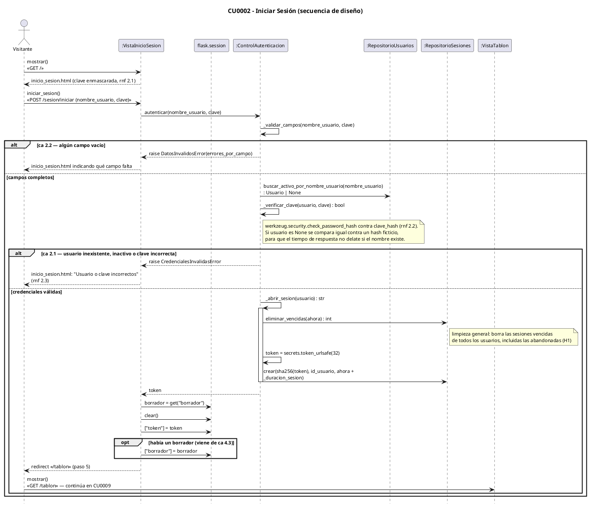
 
| Paso del CU | Mensajes del diagrama |
|---|---|
| 1-2 Ve el formulario | `mostrar()` sobre `VistaInicioSesion` |
| 3 Ingresa usuario y clave | `iniciar_sesion()` → `autenticar(nombre_usuario, clave)` |
| 4 Verifica cuenta activa y clave | `_validar_campos()` → `buscar_activo_por_nombre_usuario()` → `_verificar_clave()` |
| 5 Abre la sesión y redirige al tablón | `_abrir_sesion()` → `eliminar_vencidas(ahora)` → `RepositorioSesiones.crear()` → `session["token"]` → redirección a `/tablon` |
 
| Curso alternativo | Rama |
|---|---|
| `ca 2.1` usuario inexistente, inactivo o clave incorrecta | `CredencialesInvalidasError`, un solo mensaje para los tres (`rnf 2.3`) |
| `ca 2.2` campo vacío | `DatosInvalidosError` |
 
**Por qué `_abrir_sesion()` borra primero las sesiones vencidas de todos.** Porque una sesión abandonada nunca se vuelve a validar, y la limpieza al validar no la alcanzaría. Iniciar sesión es un momento que ocurre seguido y que ya escribe en la tabla (H1).
 
**Por qué el control devuelve un token y no toca `flask.session`.** Porque la lógica no sabe de HTTP (§2.2). El control genera el token y guarda su hash; la vista es la que lo pone en la cookie. Si mañana la API necesita autenticarse, reutiliza `autenticar()` y manda el token en una cabecera.
 
---
 
### 6.3 CU0003 — Cerrar Sesión
 
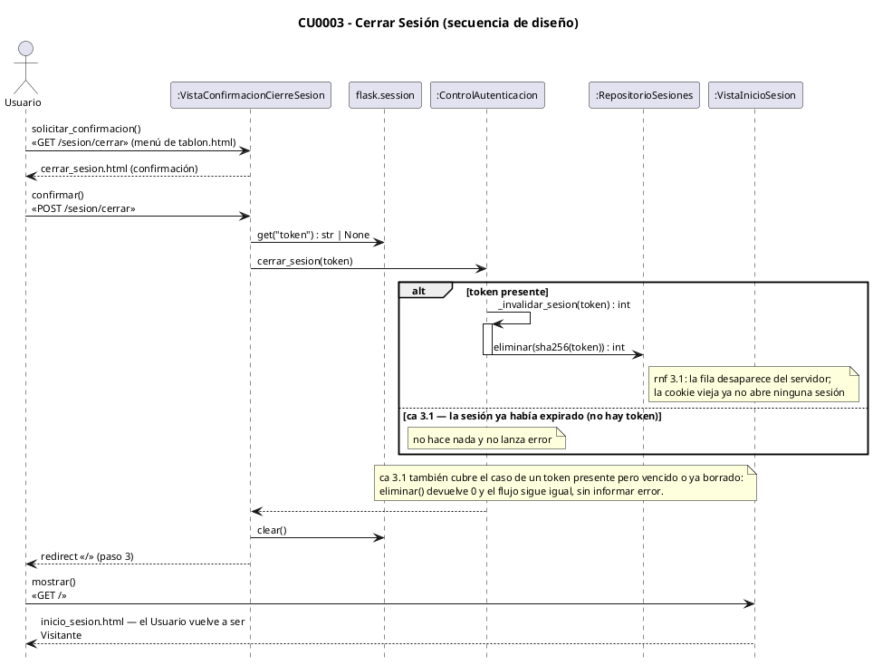
 
| Paso del CU | Mensajes del diagrama |
|---|---|
| 1 Selecciona "Cerrar sesión" | `solicitar_confirmacion()` y `confirmar()` sobre `VistaConfirmacionCierreSesion` |
| 2 Invalida la sesión | `cerrar_sesion(token)` → `_invalidar_sesion()` → `RepositorioSesiones.eliminar()` → `session.clear()` |
| 3 Redirige a la pantalla inicial | Redirección a `/` → `VistaInicioSesion.mostrar()` |
 
| Curso alternativo | Rama |
|---|---|
| `ca 3.1` la sesión ya expiró | Rama sin token: no hace nada y no informa error. La nota cubre también el token vencido: `eliminar()` devuelve 0 y el flujo sigue igual |
 
**Por qué esta ruta no pasa por `GuardiaSesion`.** Si pasara, una sesión vencida sería redirigida al inicio con aviso de "sesión expirada", y el `ca 3.1` dice que se cierre sin error. Sin la guardia, el flujo es el mismo haya sesión o no.
 
---
 
### 6.4 CU0004 — Publicar Mensaje
 
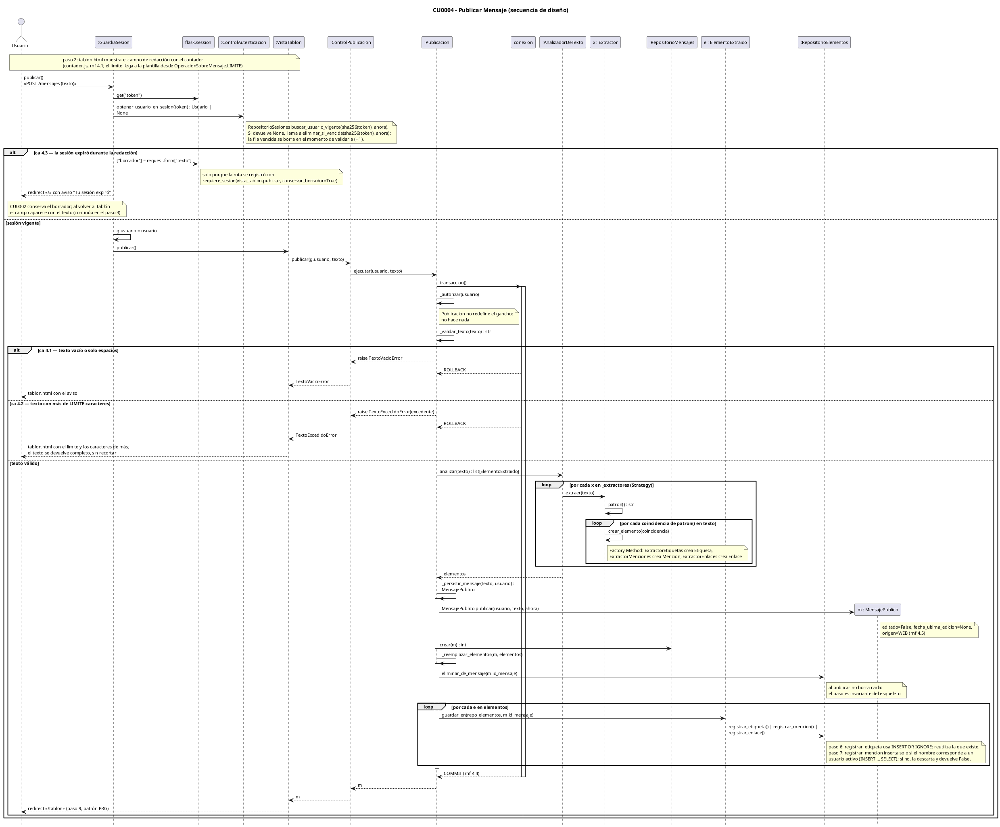
 
| Paso del CU | Mensajes del diagrama |
|---|---|
| 1-2 Ve el campo con el contador | Nota inicial: `tablon.html` con `contador.js` y el límite tomado de `OperacionSobreMensaje.LIMITE` |
| 3 Escribe y confirma | `publicar()` pasa por `GuardiaSesion` → `VistaTablon.publicar()` → `ControlPublicacion.publicar()` → `Publicacion.ejecutar()` |
| 4 Valida vacío y 140 | `_validar_texto(texto)` |
| 5 Extrae etiquetas, menciones y enlaces | `analizar(texto)` → por cada extractor, `extraer()` → `patron()` → `crear_elemento()` |
| 6 Registra etiquetas nuevas | `Etiqueta.guardar_en()` → `registrar_etiqueta()` con `INSERT OR IGNORE` |
| 7 Descarta menciones a usuarios inexistentes | `Mencion.guardar_en()` → `registrar_mencion()`, que inserta solo si el usuario existe y está activo |
| 8 Almacena el mensaje con autor, fecha y origen | `_persistir_mensaje()` → `MensajePublico.publicar()` → `RepositorioMensajes.crear()` → `COMMIT` |
| 9 Lo muestra en el tablón | Redirección a `/tablon` (continúa en CU0009) |
 
| Curso alternativo | Rama |
|---|---|
| `ca 4.1` texto vacío | `TextoVacioError` + `ROLLBACK` |
| `ca 4.2` más de 140 caracteres | `TextoExcedidoError(excedente)` + `ROLLBACK`; el texto vuelve completo |
| `ca 4.3` la sesión expiró mientras escribía | `GuardiaSesion` guarda el borrador y redirige al inicio de sesión. Lo hace **solo en esta ruta**, porque se registró con `conservar_borrador=True`; CU0002 lo conserva al abrir la sesión nueva y `VistaTablon.mostrar()` vuelve a llenar el campo |
 
**La otra mitad de la limpieza de sesiones está acá.** La nota sobre `obtener_usuario_en_sesion()` muestra que, si el token no corresponde a una sesión vigente, su fila se borra si venció (`eliminar_si_vencida`). Vale para todas las rutas protegidas, porque todas pasan por la misma guardia.
 
**Dónde se ven tres de los cuatro patrones.** Template Method: la columna de `:Publicacion` recibe `ejecutar()` y se manda a sí misma los pasos en orden. Strategy: el `loop` sobre `x : Extractor`, sin nombrar ningún extractor concreto. Factory Method: `crear_elemento()` dentro de ese loop.
 
**Cuatro reglas que se fijaron al programar (Etapa 4).** El diagrama no las muestra porque no son mensajes sino detalles de dos pasos. Todas están cubiertas por pruebas.
 
- **Etiquetas en minúsculas.** `#Reunion` y `#reunion` son la misma etiqueta: `ExtractorEtiquetas.crear_elemento()` guarda el nombre en minúsculas.
- **Qué reconoce cada extractor.** Una etiqueta es `#` más letras, números o guion bajo; una mención es `@` más un nombre con la forma del nombre de usuario (§6.1); un enlace empieza con `http://` o `https://` y llega hasta un espacio, sin arrastrar la puntuación final (`.`, `,`, `)`, etc.). Etiquetas y menciones no se reconocen pegadas a una letra o a una barra: el `#` de `a#b` o de una dirección web no es una etiqueta.
- **El texto se limpia antes de contarlo.** `_validar_texto()` convierte los saltos de línea `\r\n` del navegador en uno solo y recorta los espacios de los extremos. Sin esto, un mensaje con Enters pasaría el contador de la pantalla y el servidor lo rechazaría, porque el navegador manda dos caracteres por cada Enter y el contador cuenta uno.
- **Un solo dueño del 140.** El límite vive únicamente en `OperacionSobreMensaje.LIMITE`; la plantilla lo recibe de ahí (comprobación 1 de §2.7).
**Una pregunta que te pueden hacer.** "¿Por qué el paso 8 del CU aparece antes que el 6 y el 7 en el diagrama?" Porque para guardar una etiqueta asociada al mensaje hace falta el `id_mensaje`, y ese id lo da la base **al insertar el mensaje**. El orden de la especificación es el orden en que el usuario lo entiende; el del diagrama es el orden en que la base lo permite. Como todo está dentro de la misma transacción, para el usuario ocurre a la vez.
 
---
 
### 6.5 CU0005 — Editar Mensaje Propio
 
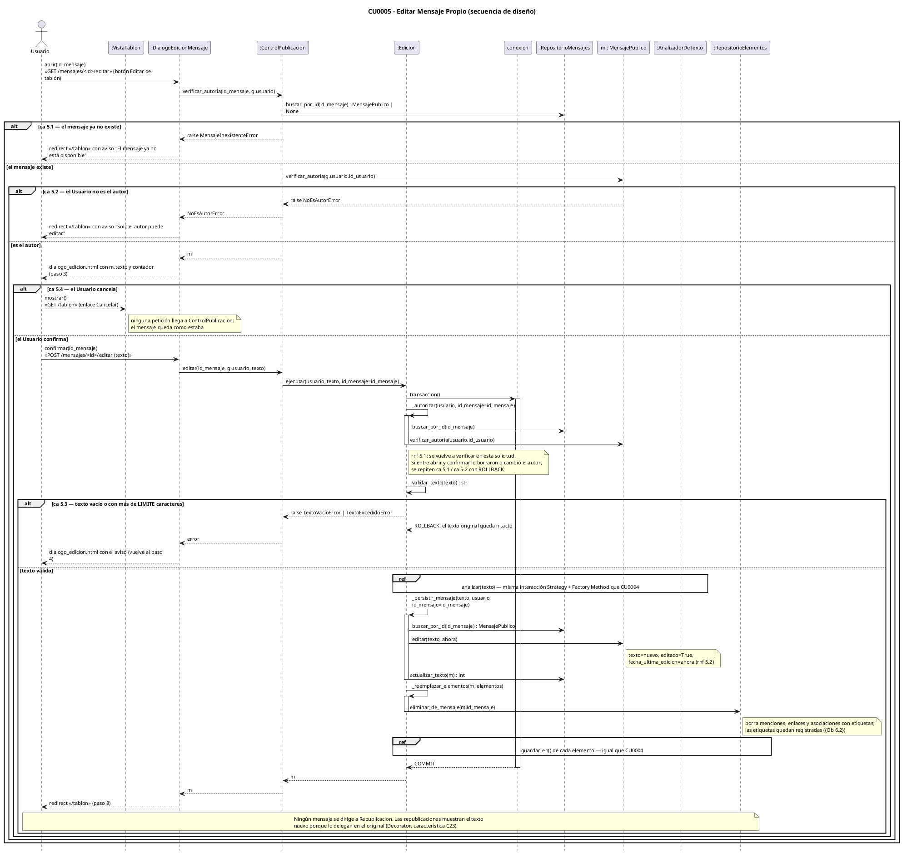
 
| Paso del CU | Mensajes del diagrama |
|---|---|
| 1 Selecciona editar | `abrir(id_mensaje)` sobre `DialogoEdicionMensaje` |
| 2 Verifica autoría | `verificar_autoria()` → `buscar_por_id()` → `MensajePublico.verificar_autoria()` |
| 3 Muestra el texto actual con contador | `dialogo_edicion.html` |
| 4 Modifica y confirma | `confirmar(id_mensaje)` → `editar()` → `Edicion.ejecutar()` |
| 5 Valida vacío y 140 | `_validar_texto(texto)` — **el mismo método que en CU0004** |
| 6 Recalcula elementos | `ref over`: `analizar(texto)`, y `_reemplazar_elementos()` → `eliminar_de_mensaje()` + `guardar_en()` |
| 7 Guarda el texto, la fecha y la marca de editado | `_persistir_mensaje()` → `MensajePublico.editar()` → `actualizar_texto()` → `COMMIT` |
| 8 Muestra el mensaje; las republicaciones ven el texto nuevo | Redirección a `/tablon`. Nota final: ningún mensaje va a `Republicacion` |
 
| Curso alternativo | Rama |
|---|---|
| `ca 5.1` el mensaje ya no existe | `MensajeInexistenteError` |
| `ca 5.2` no es el autor | `NoEsAutorError` |
| `ca 5.3` texto vacío o excedido | `TextoVacioError` o `TextoExcedidoError` + `ROLLBACK`; vuelve al paso 4 |
| `ca 5.4` cancela | Enlace a `VistaTablon.mostrar()`; no llega nada al control |
 
**Por qué la autoría se verifica dos veces.** Una al abrir el diálogo (paso 2) y otra al confirmar, dentro de `_autorizar()`. Entre las dos pueden pasar minutos, y cada petición HTTP es independiente: el `rnf 5.1` exige verificar en la operación que modifica. Si se verificara solo al abrir, alguien podría mandar el `POST` directo, sin pasar por el diálogo.
 
**La prueba de que Decorator funciona está en lo que no aparece.** Revisá el diagrama: no hay ninguna flecha hacia `Republicacion`. Aun así, el paso 8 dice que las republicaciones muestran el texto nuevo. Pasa porque la republicación nunca tuvo el texto: se lo pide al original cada vez que se muestra.
 
---
 
### 6.6 CU0006 — Borrar Mensaje Propio
 
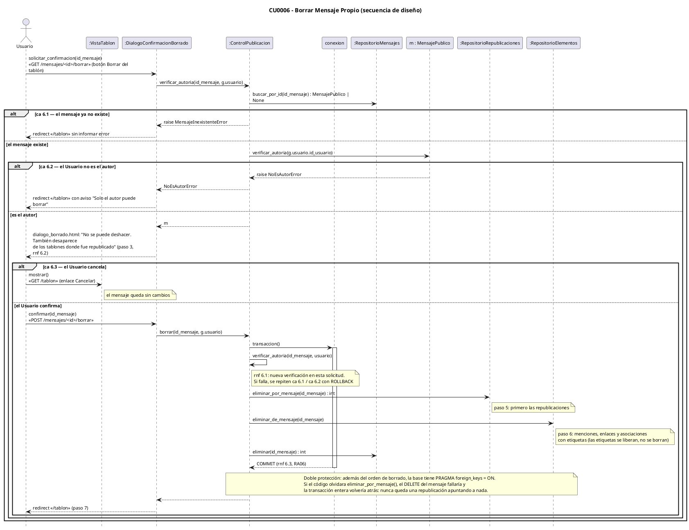
 
| Paso del CU | Mensajes del diagrama |
|---|---|
| 1 Selecciona borrar | `solicitar_confirmacion(id_mensaje)` sobre `DialogoConfirmacionBorrado` |
| 2 Verifica autoría | `verificar_autoria()` → `buscar_por_id()` → `MensajePublico.verificar_autoria()` |
| 3 Pide confirmación con la advertencia | `dialogo_borrado.html` con el texto del `rnf 6.2` |
| 4 Confirma | `confirmar(id_mensaje)` → `borrar()` |
| 5 Elimina las republicaciones | `RepositorioRepublicaciones.eliminar_por_mensaje()` |
| 6 Elimina menciones y enlaces, libera etiquetas, elimina el mensaje | `RepositorioElementos.eliminar_de_mensaje()` → `RepositorioMensajes.eliminar()` → `COMMIT` |
| 7 Actualiza la vista | Redirección a `/tablon` |
 
| Curso alternativo | Rama |
|---|---|
| `ca 6.1` el mensaje ya no existe | `MensajeInexistenteError`, redirige **sin aviso** |
| `ca 6.2` no es el autor | `NoEsAutorError` |
| `ca 6.3` cancela | Enlace a `VistaTablon.mostrar()` |
 
**Por qué borrar no usa Template Method.** Porque no comparte el esqueleto: no valida texto, no analiza, no persiste un mensaje. Meterlo en `OperacionSobreMensaje` obligaría a que `_validar_texto()` no hiciera nada para borrar, y eso es forzar el patrón. `borrar()` es un método común de `ControlPublicacion` que reutiliza `verificar_autoria()`.
 
**Por qué este caso de uso cambió de objeto respecto del análisis (H9).** En la colaboración 5.6 del análisis, `VistaTablon` verificaba la autoría antes de abrir el diálogo. Acá lo hace `DialogoConfirmacionBorrado`, porque el diálogo es una página propia con su propia ruta. El **mensaje** es el mismo (`verificar_autoria`); cambia **quién lo manda**.
 
---
 
### 6.7 CU0007 — Republicar Mensaje
 
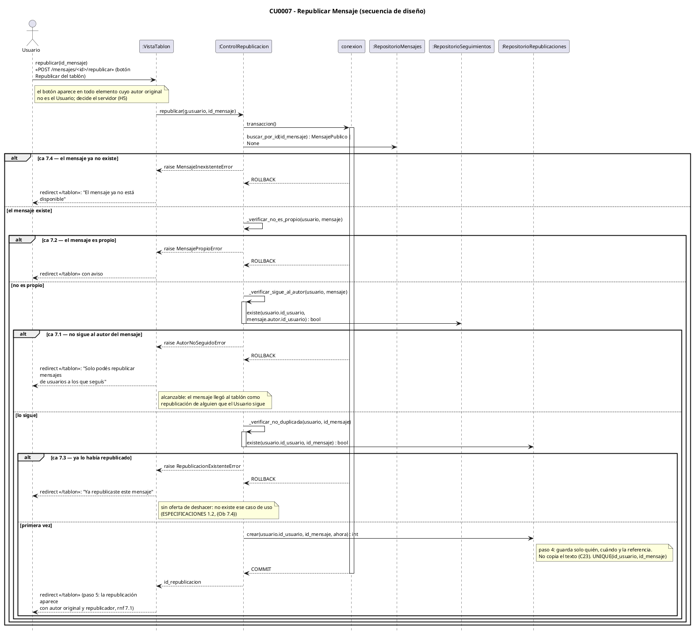
 
| Paso del CU | Mensajes del diagrama |
|---|---|
| 1 Selecciona republicar | `republicar(id_mensaje)` sobre `VistaTablon` → `ControlRepublicacion.republicar()` → `buscar_por_id()` |
| 2 Verifica que sea público y de alguien que sigue | `_verificar_no_es_propio()` → `_verificar_sigue_al_autor()` |
| 3 Verifica que no esté ya republicado | `_verificar_no_duplicada()` → `RepositorioRepublicaciones.existe()` |
| 4 Registra quién, cuándo y la referencia | `RepositorioRepublicaciones.crear()` → `COMMIT` |
| 5 Lo muestra con el autor original | Redirección a `/tablon` (continúa en CU0009) |
 
| Curso alternativo | Rama |
|---|---|
| `ca 7.1` no sigue al autor | `AutorNoSeguidoError` |
| `ca 7.2` el mensaje es propio | `MensajePropioError` |
| `ca 7.3` ya lo republicó | `RepublicacionExistenteError`. Solo informa: no existe la operación de deshacer (`{Ob 7.4}`, H3) |
| `ca 7.4` el mensaje ya no existe | `MensajeInexistenteError` + `ROLLBACK`. Es la primera rama, porque sin mensaje no hay nada que verificar (H6) |
 
**Por qué "es propio" se verifica antes que "lo sigue".** Uno no puede seguirse a sí mismo (`ca 11.2`). Si se verificara primero "lo sigue", un mensaje propio caería en `ca 7.1` con un aviso equivocado ("solo podés republicar mensajes de usuarios a los que seguís"), cuando el motivo real es otro.
 
**Sobre el `ca 7.1` (H5).** El análisis 2.1 lo daba como inalcanzable desde la interfaz, y está corregido en `ANALISIS_MiBlog.md` 2.2 y en `{Ob 7.3}`. No es inalcanzable: si Beatriz, a quien seguís y que sí sigue a Carlos, republica un mensaje de Carlos, a quien no seguís, ese mensaje aparece en tu tablón con su botón. El diagrama lo trata como lo que es, un curso que **sí** ocurre.
 
---
 
### 6.8 CU0009 — Visualizar Tablón
 
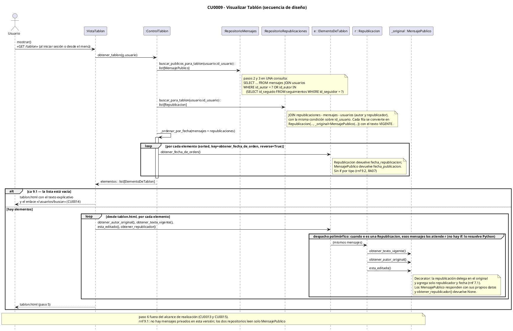
 
| Paso del CU | Mensajes del diagrama |
|---|---|
| 1 Accede a la página principal | `mostrar()` sobre `VistaTablon` → `obtener_tablon(g.usuario)` |
| 2 Determina a quién sigue | Dentro de las dos consultas: `SELECT id_seguido FROM seguimientos` |
| 3 Reúne mensajes propios, de seguidos y republicaciones | `buscar_publicos_para_tablon()` y `buscar_para_tablon()` |
| 4 Ordena por la fecha que corresponde | `_ordenar_por_fecha()` → `obtener_fecha_de_orden()` en cada elemento |
| 5 Muestra autor, fecha, texto, editado y republicador | `loop` de la plantilla → `obtener_autor_original()`, `obtener_texto_vigente()`, `esta_editado()`, `obtener_republicador()` |
| 6 Seguidores y temas del momento | **Fuera de alcance** (CU0013, CU0015). Nota final |
 
| Curso alternativo | Rama |
|---|---|
| `ca 9.1` el tablón está vacío | `tablon.html` con el texto y el enlace a la búsqueda |
 
**Por qué el paso 2 no tiene mensaje propio.** El análisis mandaba un mensaje a `Seguimiento` para obtener la lista de seguidos, y después pedía los mensajes de esa lista. En diseño eso son **dos viajes a la base**; con una subconsulta es **uno**. El paso 2 sigue ocurriendo, dentro del SQL. El cambio es de diseño, no de comportamiento.
 
**Dónde se ve Decorator.** En el grupo "despacho polimórfico". La plantilla le pide a cada elemento lo mismo, sin preguntar qué es. Cuando el elemento es una `Republicacion`, esta le pide a `_original` el texto, el autor y la marca de editado. Nadie escribe un `if`: lo resuelve Python al llamar al método del objeto que corresponde.
 
---
 
### 6.9 CU0011 — Seguir Usuario
 
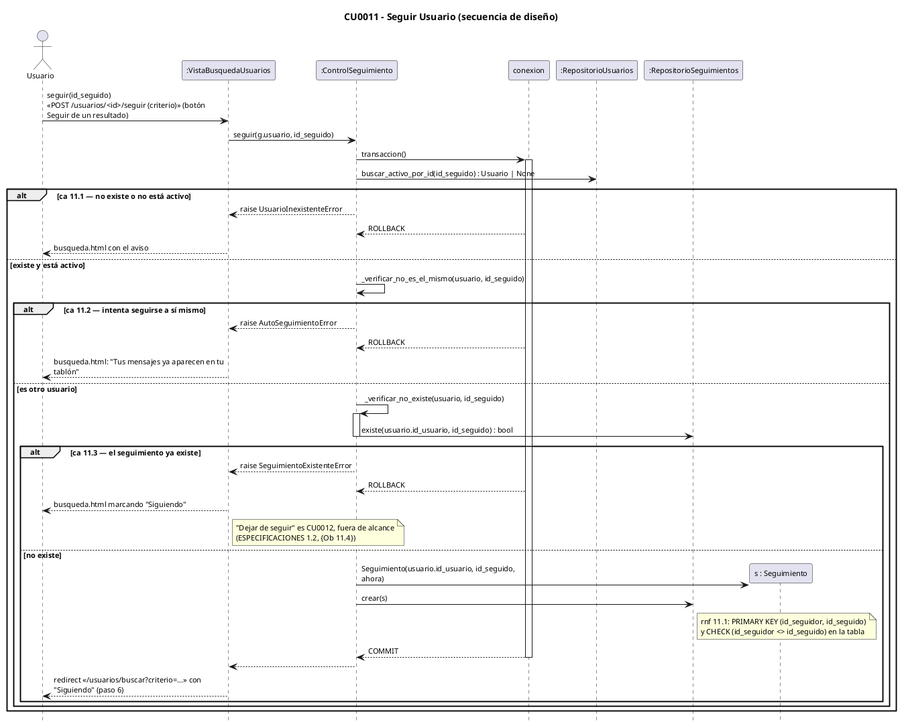
 
| Paso del CU | Mensajes del diagrama |
|---|---|
| 1 Selecciona "Seguir" desde un resultado de búsqueda | `seguir(id_seguido)` sobre `VistaBusquedaUsuarios` → `ControlSeguimiento.seguir()`. Desde el muro: fuera de alcance (CU0010) |
| 2 Verifica que exista y esté activo | `RepositorioUsuarios.buscar_activo_por_id()` |
| 3 Verifica que no sea él mismo | `_verificar_no_es_el_mismo()` |
| 4 Verifica que no lo siga ya | `_verificar_no_existe()` → `RepositorioSeguimientos.existe()` |
| 5 Registra el seguimiento con su fecha | `Seguimiento(...)` → `RepositorioSeguimientos.crear()` → `COMMIT` |
| 6 Indica que ahora lo sigue | Redirección a la búsqueda, con "Siguiendo" |
 
| Curso alternativo | Rama |
|---|---|
| `ca 11.1` no existe o no está activo | `UsuarioInexistenteError` |
| `ca 11.2` intenta seguirse a sí mismo | `AutoSeguimientoError` |
| `ca 11.3` ya lo sigue | `SeguimientoExistenteError`, marca "Siguiendo" **sin** botón de dejar de seguir (H4) |
 
**Cómo se llega a `ca 11.1` y `ca 11.2`, si la búsqueda no los muestra.** No se llega haciendo clic: la búsqueda solo trae usuarios activos y el botón no aparece en uno mismo. Se llega mandando el `POST` a mano o con una página vieja. Por eso la verificación está en el control y no en la plantilla: **lo que la pantalla esconde no cuenta como control** (el mismo criterio de `rnf 5.1`).
 
**Por qué la redirección conserva el criterio.** Si volviera a `/usuarios/buscar` sin el criterio, el usuario perdería la lista de resultados después de cada clic en "Seguir".
 
---
 
### 6.10 CU0014 — Buscar Usuarios
 
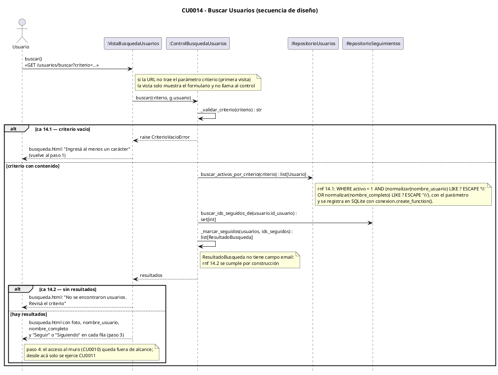
 
| Paso del CU | Mensajes del diagrama |
|---|---|
| 1 Ingresa el criterio | `buscar()` sobre `VistaBusquedaUsuarios` → `ControlBusquedaUsuarios.buscar(criterio, g.usuario)` |
| 2 Busca activos por nombre de usuario o nombre completo | `_validar_criterio()` → `buscar_activos_por_criterio()` con `normalizar()` y `LIKE` |
| 3 Muestra foto, nombres y si ya lo sigue | `buscar_ids_seguidos_de()` → `_marcar_seguidos()` → `busqueda.html` |
| 4 Acceder al muro o seguir | Muro **fuera de alcance** (CU0010). Seguir continúa en CU0011 |
 
| Curso alternativo | Rama |
|---|---|
| `ca 14.1` criterio vacío | `CriterioVacioError` |
| `ca 14.2` sin resultados | Lista vacía: aviso en `busqueda.html` |
 
**Por qué la búsqueda no abre transacción.** Solo lee. Las lecturas sueltas no dejan nada a medio hacer (§2.6, Transacciones).
 
**Por qué `ca 14.2` no es una excepción y `ca 14.1` sí.** Un criterio vacío es un **pedido mal hecho**: el control lo rechaza. Una búsqueda sin resultados es un **pedido bien hecho con respuesta vacía**: no hay nada que rechazar.
 
---
 
### 6.11 Verificación: los diez casos de uso se realizan
 
| CU | ¿Todos los pasos del curso normal tienen mensaje? | ¿Todos los `ca` especificados tienen rama? | Huecos de la especificación señalados | Resultado |
|---|---|---|---|---|
| CU0001 | Sí (8 de 8) | Sí (4 de 4) | — | ✅ Se realiza |
| CU0002 | Sí (5 de 5) | Sí (2 de 2) | — | ✅ Se realiza |
| CU0003 | Sí (3 de 3) | Sí (1 de 1) | — | ✅ Se realiza |
| CU0004 | Sí (9 de 9) | Sí (3 de 3) | — | ✅ Se realiza |
| CU0005 | Sí (8 de 8) | Sí (4 de 4) | — | ✅ Se realiza |
| CU0006 | Sí (7 de 7) | Sí (3 de 3) | — | ✅ Se realiza |
| CU0007 | Sí (5 de 5) | Sí (4 de 4, con el `ca 7.4` agregado) | H3, H5 y H6, corregidos en las especificaciones 1.2 | ✅ Se realiza |
| CU0009 | Sí (5 de 5; el 6 está fuera de alcance) | Sí (1 de 1) | — | ✅ Se realiza |
| CU0011 | Sí (6 de 6; "desde el muro" fuera de alcance) | Sí (3 de 3) | H4, marcado fuera de alcance en las especificaciones 1.2 | ✅ Se realiza |
| CU0014 | Sí (3 de 3; el 4 solo en su parte de seguir) | Sí (2 de 2) | — | ✅ Se realiza |
 
**Resultado: 10 de 10.** Ningún diagrama inventa comportamiento que la especificación no tenga. Los huecos que había quedaron corregidos en la especificación, y el diagrama sigue a la especificación corregida.
 
## 7. Artefacto 6 — Diagramas de estado
 
### 7.0 La idea
 
Un diagrama de estado se dibuja **solo para las clases cuyo comportamiento cambia según lo que les pasó antes**. Muestra en qué situaciones puede estar un objeto, qué evento lo hace pasar de una a otra y qué condición tiene que cumplirse.
 
**Regla que usé para no inventar estados:** un estado solo existe si **un atributo del modelo de dominio lo distingue**. Si no hay atributo que cambie, no hay estado. Por eso "republicado" no es un estado de `Mensaje`, e "iniciado sesión" no es un estado de `Usuario`.
 
### 7.1 Mensaje (`MensajePublico`)
 
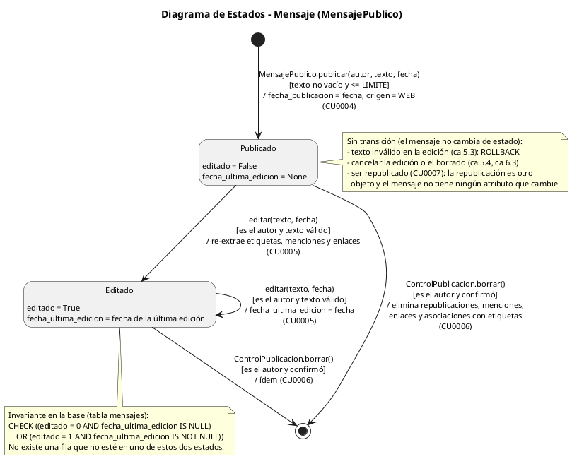
 
| Estado | Qué atributo lo distingue (DIA1 §4) | Cómo se garantiza en el código |
|---|---|---|
| **Publicado** | `editado = False`, `fecha_ultima_edicion = None` | `MensajePublico.publicar()` lo crea así |
| **Editado** | `editado = True`, `fecha_ultima_edicion` con fecha | `MensajePublico.editar()` pone los dos juntos |
| *(final)* | La fila deja de existir | `ControlPublicacion.borrar()` |
 
| Transición | Evento | Condición | Caso de uso |
|---|---|---|---|
| inicio → Publicado | `MensajePublico.publicar()` | Texto no vacío y dentro del límite | CU0004 |
| Publicado → Editado | `editar()` | Es el autor y el texto es válido | CU0005 |
| Editado → Editado | `editar()` otra vez | Ídem; cambia `fecha_ultima_edicion` | CU0005 |
| Publicado o Editado → final | `borrar()` | Es el autor y confirmó | CU0006 |
 
**Por qué no hay transición de Editado a Publicado.** Ningún caso de uso deshace una edición. Una vez editado, queda marcado para siempre. Es lo que pide la característica C23: que quien lee sepa que el texto cambió.
 
**Por qué "republicado" no es un estado.** Republicar crea **otro objeto** (`Republicacion`) que apunta al mensaje. El mensaje no tiene ningún atributo que cambie cuando lo republican. Si se dibujara un estado "Republicado", el diagrama diría algo que el modelo de dominio no tiene.
 
**El diagrama está también en la base.** La tabla `mensajes` tiene un `CHECK` que impide guardar una fila con `editado = 1` y sin fecha, o al revés (§2.6). Es decir: **no puede existir en la base un mensaje que no esté en uno de estos dos estados**. Si en la defensa te preguntan cómo se asegura que el diagrama de estado se cumple, esa es la respuesta concreta.
 
### 7.2 Usuario
 
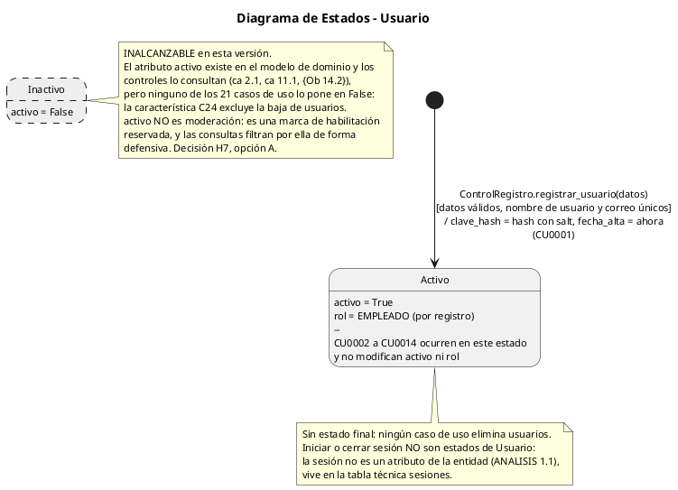
 
| Estado | Qué atributo lo distingue | ¿Se alcanza en esta versión? |
|---|---|---|
| **Activo** | `activo = True` | Sí: CU0001 lo crea así |
| **Inactivo** | `activo = False` | **No.** Ningún caso de uso lo produce (H7) |
 
**Por qué se dibuja un estado al que no se llega.** Porque el atributo `activo` **existe** en el modelo de dominio y **los controles lo consultan**: `ca 2.1` rechaza a un usuario inactivo, `ca 11.1` no deja seguirlo y `{Ob 14.2}` lo saca de la búsqueda. Si el diagrama no tuviera el estado `Inactivo`, esas tres verificaciones estarían preguntando por algo que "no existe". Se dibuja en gris, con línea punteada y con la nota que explica que nadie llega. Es la **opción A de H7, decidida el 15/09/2026**.
 
**Qué es `activo`, dicho en una frase para la defensa.** No es una función de moderación, que la característica C24 descartó: es una **marca de habilitación reservada**, y las consultas filtran por ella **de forma defensiva**. La respuesta completa, con cómo se prueba, está en H7 (§1) y en §8.4.
 
| Consulta que filtra por `activo = 1` | Caso de uso |
|---|---|
| `RepositorioUsuarios.buscar_activo_por_nombre_usuario()` | CU0002 (`ca 2.1`) |
| `RepositorioSesiones.buscar_usuario_vigente()` | Toda ruta protegida (`GuardiaSesion`) |
| `RepositorioUsuarios.buscar_activo_por_id()` | CU0011 (`ca 11.1`) |
| `RepositorioUsuarios.buscar_activos_por_criterio()` | CU0014 (`{Ob 14.2}`) |
| `RepositorioElementos.registrar_mencion()` | CU0004 y CU0005 (paso 7: se descarta la mención) |
 
**Por qué no hay estados "Con sesión" y "Sin sesión".** La sesión no es un atributo de `Usuario` (ANALISIS §1.1): vive en la tabla técnica `sesiones`. Un mismo usuario puede tener sesiones abiertas en dos navegadores a la vez, cosa que un atributo de estado no podría representar.
 
**Por qué no hay estado final.** Ningún caso de uso elimina usuarios. La característica C24 lo excluye expresamente. Por eso `Activo` no tiene flecha de salida en esta versión.
 
---
 
## 8. Teoría para la defensa
 
### 8.1 Qué es una realización de caso de uso (diseño)
 
**En una frase:** es **cómo un grupo de clases de diseño lleva a cabo un caso de uso**, contado con los nombres reales del código.
 
El caso de uso dice **qué** hace el sistema, visto desde afuera. La realización dice **qué objetos trabajan y en qué orden** para que eso pase.
 
**Cómo se describe.** Con tres cosas:
 
| Parte | Qué muestra | En MiBlog |
|---|---|---|
| **Diagrama de clases** | Qué clases participan y cómo se relacionan | El diagrama integral de §3 (cada caso de uso usa una parte) |
| **Diagramas de interacción** | En qué orden se mandan los mensajes | Las 10 secuencias de §6 |
| **Flujo de sucesos-diseño** | Lo que el diagrama no dice con flechas: por qué ese orden, qué se decidió | Las tablas y notas debajo de cada secuencia en §6 |
 
Además puede llevar **requisitos de implementación**: cosas que se descubren al diseñar y se dejan anotadas para el programador. En MiBlog, por ejemplo, "la foto se valida antes de guardarse" (CU0001) o "la autoría se verifica también al confirmar" (CU0005).
 
**Con qué se relaciona.** Cada realización de diseño tiene **traza** a la realización de análisis del mismo caso de uso. Ejemplo: la secuencia de CU0007 de §6.7 traza a la colaboración 5.7 de `ANALISIS_MiBlog.md`. Los mismos objetos de análisis, ahora con métodos, rutas y transacciones.
 
**Un ejemplo para decirlo en voz alta.** "La realización de CU0005 Editar Mensaje Propio es la colaboración entre `DialogoEdicionMensaje`, `ControlPublicacion`, `Edicion`, `AnalizadorDeTexto`, `RepositorioMensajes`, `RepositorioElementos` y `MensajePublico`. La describo con la secuencia de §6.5, donde se ven los cuatro cursos alternativos como fragmentos `alt`, y traza a la colaboración 5.5 del análisis."
 
### 8.2 Trabajadores y actividades del flujo de Diseño
 
**La idea.** El PU divide el trabajo de cada flujo en **trabajadores**: no son personas, son **roles**. Una persona puede tener varios (en este proyecto, vos tenés los tres), y un rol puede estar repartido entre varias personas.
 
| Trabajador | De qué es responsable | Actividad que realiza | Qué produjo en MiBlog |
|---|---|---|---|
| **Arquitecto** | De que el modelo de diseño y el de despliegue sean correctos y coherentes, **en conjunto**. No de cada clase por separado | **Diseño de la arquitectura** | Las capas y la tabla de mecanismos (§2), el despliegue (§4), la identificación de los subsistemas (§5) |
| **Ingeniero de Casos de Uso** | De que cada realización de caso de uso cumpla lo que dice el caso de uso | **Diseño de un caso de uso** | Las 10 secuencias con sus tablas de correspondencia (§6) |
| **Ingeniero de Componentes** | De las clases de diseño y los subsistemas: sus atributos, métodos, relaciones e interfaces | **Diseño de una clase** y **diseño de un subsistema** | El diagrama de clases integral con los patrones (§3), las interfaces de cada subsistema (§5), los diagramas de estado (§7) |
 
**El orden de las actividades, y por qué.** Primero la arquitectura, porque decide las reglas que todos respetan (capas, transacciones, errores). Después cada caso de uso, porque ahí aparecen los métodos que cada clase necesita. Después cada clase, juntando lo que pidieron todos los casos de uso. Y al final cada subsistema, verificando que ofrezca las interfaces que se usaron.
 
**Por qué los diagramas de estado son del Ingeniero de Componentes.** Porque describen el comportamiento **de una clase**, no de un caso de uso. Forman parte de la actividad "diseño de una clase".
 
**Una pregunta trampa posible.** "¿Quién hace el diagrama de despliegue?" El **Arquitecto**. El modelo de despliegue es uno de los tres artefactos de los que es responsable, junto con el modelo de diseño completo y la descripción de la arquitectura.
 
### 8.3 La diferencia entre el modelo de análisis y el de diseño
 
**En una frase:** el análisis dice **qué** objetos hacen falta; el diseño dice **cómo** se construyen con una tecnología concreta.
 
| | Modelo de **análisis** | Modelo de **diseño** |
|---|---|---|
| Qué es | Conceptual | Físico: es el plano del código |
| Tecnología | No sabe cuál es | Existe para Python, Flask y SQLite |
| Estereotipos | Solo tres: interfaz, control, entidad | Los que haga falta |
| Cantidad de clases en MiBlog | 23 | 47 |
| Nombres de métodos | `obtenerTablon(idUsuario)`, para entender | `obtener_tablon(usuario)`, exactamente como se programa |
| Diagramas de interacción | De colaboración | De secuencia |
| Costo | Barato de hacer y de cambiar | Mucho más caro |
| ¿Se mantiene hasta el final? | Puede no mantenerse | **Tiene que** mantenerse, porque es lo que se codifica |
 
**El ejemplo concreto, con `AnalizadorDeTexto`.** Es el mejor ejemplo del proyecto, porque muestra que el diseño **no es solo agregar detalle**: a veces obliga a **corregir** el análisis.
 
| En Análisis | En Diseño | Por qué cambió |
|---|---|---|
| Una sola clase «control» | Seis clases: `AnalizadorDeTexto`, `Extractor` abstracta, tres extractores concretos, `ElementoExtraido` | Aparecen los patrones Strategy y Factory Method con sus clases reales |
| `analizar(texto, mensaje)` | `analizar(texto)` | Con la firma vieja había que tener el mensaje guardado antes de analizarlo. Pero el Template Method analiza **antes** de guardar, para no guardar nada si algo falla. Las dos cosas no podían ser ciertas a la vez (H2) |
| `ExtractorEtiquetas` "obtiene o crea" la etiqueta | El extractor siempre crea un objeto en memoria; el "si ya existe" lo resuelve la base con `INSERT OR IGNORE` | El extractor no tiene por qué saber de la base. Así se puede probar sin base de datos |
| No hay transacciones | `ejecutar()` abre `conexion.transaccion()` al empezar | Solo en diseño existe SQLite, y con él la posibilidad de dejar datos a medio guardar |
 
**Un segundo ejemplo, más corto, con `ControlTablon`.** El análisis predijo (ANALISIS §6.4) que "puede ser una sola consulta SQL con un `UNION`". En diseño se decidió otra cosa: **dos consultas** (una para mensajes, otra para republicaciones) y el orden se hace en Python con `obtener_fecha_de_orden()`. El motivo: un `UNION` devuelve filas mezcladas, y habría que preguntar en Python "¿esta fila es una republicación?" para construir el objeto correcto. Eso es el `if` por tipo que el Decorator existe para evitar. **El análisis abrió la posibilidad; el diseño eligió con un criterio que el análisis no tenía.**
 
**Por qué hacer los dos y no ir directo al diseño.** Porque las reglas de negocio (qué entra al tablón, qué pasa al borrar) quedaron escritas en el análisis **sin mezclarse con SQLite**. Si mañana la base cambia, las reglas no hay que volver a descubrirlas: están en el análisis, y el diseño se rehace sobre ellas.
 
### 8.4 Preguntas probables y respuestas cortas
 
| Pregunta | Respuesta corta |
|---|---|
| ¿Por qué un solo diagrama de clases y no uno por patrón? | Porque los patrones **conviven** en las mismas clases: `ControlPublicacion` usa Template Method, que usa Strategy, que produce elementos del Factory Method. Separarlos escondería justo esas conexiones. |
| ¿Por qué `Republicacion` no hereda de `Mensaje`? | Porque no tiene texto propio (C23). Una subclase con el atributo principal siempre vacío es un modelo forzado (DIA1 §4). Comparte **interfaz** con `MensajePublico`, no herencia. |
| ¿Dónde está la capa de persistencia en el diagrama de clases? | En el paquete `acceso_datos`. La persistencia en sí (el archivo `.sqlite3`) no tiene clases: es un archivo. |
| ¿Por qué hay una tabla `sesiones` si no hay clase `Sesion`? | Porque la sesión es un **mecanismo técnico**, no información del negocio (ANALISIS §1.1). Hace falta para cumplir el `rnf 3.1` (H1), pero no representa nada que al negocio le importe guardar. |
| ¿Cómo se limpian las sesiones vencidas? | Una vencida **nunca se acepta**, se haya borrado o no. La fila se borra cuando alguien intenta usarla ya vencida (`eliminar_si_vencida`), y cada inicio de sesión borra las vencidas de todos, lo que cubre las abandonadas (`eliminar_vencidas`). Sin `cron`, porque es de CU0019, y sin escribir en la base en cada petición. |
| ¿Para qué sirve `activo` si nadie lo pone en `False`? | No es moderación: eso lo descartó C24. Es una **marca de habilitación reservada**, y las consultas filtran por ella **de forma defensiva**: si una cuenta quedara deshabilitada, no puede entrar, sus sesiones dejan de valer, nadie la sigue ni la encuentra, y no hay que tocar ninguna consulta. Se prueba con un usuario `activo = 0` en los datos de prueba. |
| ¿`python-dotenv` no rompe el RNF41? | No. El RNF41 excluye dependencias adicionales **de autenticación**. `python-dotenv` solo lee el `.env`, y está declarada en `REQUISITOS_NO_FUNCIONALES_MiBlog.md` §8.0 con su motivo (H10). |
| ¿Qué pasa si la vista llama directo a un repositorio? | Se rompe el RNF25. Lo detecta la cuarta comprobación de §2.7. |
| ¿Cómo sabés que el diseño realiza los casos de uso? | Por la tabla de §6.11: cada paso del curso normal tiene su mensaje y cada curso alternativo especificado tiene su rama `alt`. |
| ¿Qué diferencia hay entre subsistema y paquete? | El paquete solo agrupa. El subsistema además **ofrece interfaces y esconde su interior** (§5.3). |
| ¿Por qué no usaste un ORM? | Porque el RNF40 y el RNF29 piden `sqlite3` y SQL parametrizado, y la §8.0 de los requisitos no funcionales declara exactamente dos dependencias: Flask y `python-dotenv`. |
 
---
 
## 9. Qué hereda la Etapa 4 (Implementación)
 
**La idea.** Este documento se termina cuando se puede empezar a programar sin tener que decidir nada importante. Esto es lo que la Etapa 4 recibe **ya decidido**. Desde el 15/09/2026 no queda nada pendiente de confirmación.
 
| Ya decidido en este documento | Dónde |
|---|---|
| Estructura de carpetas y nombre de cada archivo | §2.4 |
| Las 15 rutas con su método y su clase | §2.5 |
| El esquema SQL completo | §2.6 |
| Las 14 excepciones de negocio | §2.6 |
| Nombres de todas las clases, atributos y métodos | §3 |
| Orden de los mensajes de cada caso de uso | §6 |
| Las 6 comprobaciones mecánicas para la pasada de coherencia | §2.7 |
| Las dos dependencias de `requirements.txt`: Flask y `python-dotenv` | `REQUISITOS_NO_FUNCIONALES_MiBlog.md` §8.0 |
 
| Decidido el 15/09/2026 | Qué tiene que hacer el código |
|---|---|
| H1: tabla `sesiones` | Token con `secrets.token_urlsafe(32)`, hash SHA-256 en la base, `eliminar_si_vencida()` al validar y `eliminar_vencidas()` al iniciar sesión |
| H2: `analizar(texto)` | Ningún método de `extractores.py` ni de `analizador.py` recibe un mensaje |
| H5: `ca 7.1` alcanzable | La plantilla muestra "Republicar" en todo elemento cuyo autor original no es el usuario, **sin** preguntar si lo sigue |
| H7: conservar `activo` | Las cinco consultas de la tabla de §7.2 filtran por `activo = 1`; los datos de prueba incluyen un usuario inactivo |
| H9: diálogos como páginas propias | Las dos rutas `GET` de §2.5 con su plantilla; "Cancelar" es un enlace |
| H10: `python-dotenv` | En `requirements.txt`, y ninguna otra dependencia que no esté en §8.0 de los requisitos no funcionales |
 
**El criterio que ya está escrito en el proyecto, y que sigue valiendo:** si al programar un patrón no llega al código, **se saca de la documentación el mismo día**. No se entrega un diagrama que muestre algo que el código no tiene.
 
---
 
## Control del documento
 
| Versión | Fecha | Etapa / Chat | Cambios |
|---|---|---|---|
| 1.1 | 15/09/2026 | Diseño | Confirmadas las seis decisiones de §1 y estado a `[DECIDIDO]`: flujo de Diseño cerrado. H1: agregada la limpieza de sesiones vencidas (al validar y al iniciar sesión), con dos métodos nuevos en `RepositorioSesiones` y la respuesta para la defensa. H6: `ca 7.4` como rama `alt` en la secuencia de CU0007. H7: respuesta para la defensa y tabla de consultas que filtran por `activo`. H10: referencia a la §8.0 de los requisitos no funcionales. Resumen final de §1 y tabla de §9 con lo decidido. Actualizadas las secuencias de CU0002, CU0004, CU0007 y CU0011, el diagrama de clases y el de estados de `Usuario`. Corregida la fila de H4 del resumen de §1, que nombraba CU0014 paso 3 en lugar de la colaboración 5.10 del análisis. |
| 1.2 | 07/10/2026 | Diseño | Segundo diagrama de subsistemas, en el formato de paquetes anidados por capa que usan los demás proyectos de la cátedra, con el stack de MiBlog. Pasa a ser el que se entrega; el de las cuatro capas del PU queda como vista complementaria. Nueva §5.2 con la comparación de los dos formatos y la correspondencia entre sus capas. Corregida una fila repetida en la tabla de comprobaciones de §2.7. |
| 1.3 | 24/10/2026 | Implementación | §2.4: la raíz del árbol pasa a ser la raíz del código, que vive en `4. Implementacion/codigo/` dentro del repositorio; se agrega `fuentes/` a `estaticos/`; el `.gitignore` suma `venv/` y `.vscode/`. Nuevo párrafo con la ubicación en el repositorio. Ningún diagrama, ruta, clase ni secuencia cambia. Corresponde a DV-1, DV-2 y DV-3 de `CONTEXTO_IMPLEMENTACION_MiBlog.md`. |
| 1.4 | 28/10/2026 | Implementación | Cierre del bloque 4.6. Se pasan al diseño los desvíos DV-4 a DV-8 de `CONTEXTO_IMPLEMENTACION_MiBlog.md`, que hasta ahora estaban solo allá. §2.4: se suman al árbol `plantillas/_marca.html`, `.env.example` y `sembrar_datos.py`, con su explicación. §2.5: la tabla de las 15 rutas gana la columna *Endpoint* y el esquema usa `publicar_mensaje`. §2.6: fechas locales para mostrar, y el manejo de errores completo (404, 413, otros errores HTTP, error inesperado, archivo de registro configurable que anota solo método y ruta). §3.2: los miembros privados de apoyo en seis clases y la nota N4 con las funciones de módulo; se recompiló con PlantUML sin errores; el conteo de 47 elementos no cambia. §6.1: la forma del nombre de usuario (`ca 1.1`). §6.4: cuatro reglas fijadas al programar. §6.9: el texto del aviso es el del código. Ninguna clase, ruta pública ni secuencia cambia. Se quita de esta tabla la fila 1.0 para mantener las últimas cuatro. |
